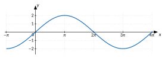
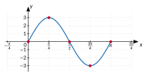

<!-- GÉNÉRÉ par outils/typ2site.py (autoeval.py) : NE PAS ÉDITER. -->


::: {#ae-app data-cle="trigo"}
::: {.ae-attente}
Chargement…
:::
:::


::: {#ae-banque .ae-cache}

::: {.ae-sec data-ae-id="sec-london-eye" data-chap="1" data-url="ch1-tourner-angles-arcs/1-la-cabine-du-london-eye.html" data-n="2"}
La cabine du London Eye
:::

::: {.ae-sec data-ae-id="sec-arc-secteur" data-chap="1" data-url="ch1-tourner-angles-arcs/2-longueur-dun-arc-aire-dun.html" data-n="1"}
Longueur d’un arc, aire d’un secteur
:::

::: {.ae-sec data-ae-id="sec-radian" data-chap="1" data-url="ch1-tourner-angles-arcs/3-le-radian-mesurer-un-arc.html" data-n="4"}
Le radian : mesurer un arc en rayons
:::

::: {.ae-sec data-ae-id="sec-angles-orientes" data-chap="1" data-url="ch1-tourner-angles-arcs/4-angles-orientes-plusieurs-tours.html" data-n="3"}
Angles orientés, plusieurs tours
:::

::: {.ae-sec data-ae-id="sec-enroulement" data-chap="2" data-url="ch2-le-cercle-trigonomet/1-enrouler-la-droite-reelle-sur.html" data-n="3"}
Enrouler la droite réelle sur le cercle
:::

::: {.ae-sec data-ae-id="sec-valeurs-remarquables" data-chap="2" data-url="ch2-le-cercle-trigonomet/2-valeurs-remarquables-et-symetries.html" data-n="5"}
Valeurs remarquables et symétries
:::

::: {.ae-sec data-ae-id="sec-equations-sin-cos" data-chap="2" data-url="ch2-le-cercle-trigonomet/3-equations-sin-x-a-et.html" data-n="4"}
Équations $\sin x = a$ et $\cos x = a$
:::

::: {.ae-sec data-ae-id="sec-tangente" data-chap="2" data-url="ch2-le-cercle-trigonomet/4-la-tangente.html" data-n="2"}
La tangente
:::

::: {.ae-sec data-ae-id="sec-equations-tan" data-chap="2" data-url="ch2-le-cercle-trigonomet/5-equations-tan-x-a.html" data-n="1"}
Équations $\tan x = a$
:::

::: {.ae-sec data-ae-id="sec-sinus-cosinus" data-chap="3" data-url="ch3-les-fonctions-trigon/1-du-cercle-au-graphique-sinus.html" data-n="4"}
Du cercle au graphique : sinus et cosinus
:::

::: {.ae-sec data-ae-id="sec-fonction-tangente" data-chap="3" data-url="ch3-les-fonctions-trigon/2-la-fonction-tangente.html" data-n="2"}
La fonction tangente
:::

::: {.ae-sec data-ae-id="sec-resoudre-graphiquement" data-chap="3" data-url="ch3-les-fonctions-trigon/3-resoudre-graphiquement-choisir-son-outil.html" data-n="1"}
Résoudre graphiquement ; choisir son outil
:::

::: {.ae-sec data-ae-id="sec-a-b" data-chap="4" data-url="ch4-la-fonction-x-a-sin/1-role-de-a-et-de.html" data-n="3"}
Rôle de $a$ et de $b$
:::

::: {.ae-sec data-ae-id="sec-c" data-chap="4" data-url="ch4-la-fonction-x-a-sin/2-role-de-c-phase-et.html" data-n="4"}
Rôle de $c$ : phase et déphasage
:::

::: {.ae-sec data-ae-id="sec-tracer-apparier" data-chap="4" data-url="ch4-la-fonction-x-a-sin/3-tracer-apparier-retrouver-lexpression.html" data-n="6"}
Tracer, apparier, retrouver l’expression
:::

::: {.ae-sec data-ae-id="sec-equations-asin" data-chap="4" data-url="ch4-la-fonction-x-a-sin/4-equations-a-sin-b-x.html" data-n="3"}
Équations $a \sin(b x + c) = k$
:::

::: {.ae-sec data-ae-id="sec-sinusoides-partout" data-chap="5" data-url="ch5-modeliser-des-phenom/1-des-sinusoides-partout.html" data-n="2"}
Des sinusoïdes partout
:::

::: {.ae-sec data-ae-id="sec-retour-london-eye" data-chap="5" data-url="ch5-modeliser-des-phenom/2-retour-au-london-eye-les.html" data-n="1"}
Retour au London Eye ; les limites d’un modèle
:::

::: {.ae-sec data-ae-id="sec-derivees" data-chap="6" data-url="ch6-module-derivees-trig/1-derivees-de-sinus-cosinus-et.html" data-n="2"}
Dérivées de sinus, cosinus et tangente
:::

::: {.ae-sec data-ae-id="sec-derivees-composees" data-chap="6" data-url="ch6-module-derivees-trig/2-derivees-de-composees-vitesse-dun.html" data-n="2"}
Dérivées de composées ; vitesse d’un mouvement circulaire
:::

::: {.ae-obj data-code="C1" data-cat="Connaître"}
Représenter sur un cercle trigonométrique un point correspondant à un angle donné ainsi que ses nombres trigonométriques.
:::

::: {.ae-obj data-code="C2" data-cat="Connaître"}
Représenter graphiquement les fonctions trigonométriques.
:::

::: {.ae-obj data-code="C3" data-cat="Connaître"}
Associer graphiquement les nombres trigonométriques d’un angle et les images d’un réel par une fonction trigonométrique.
:::

::: {.ae-obj data-code="C4" data-cat="Connaître"}
Interpréter le rôle des paramètres $a$, $b$ et $c$ de la fonction $x \mapsto a \sin(b x + c)$.
:::

::: {.ae-obj data-code="C5" data-cat="Connaître"}
Définir période, fréquence, amplitude d’une fonction périodique.
:::

::: {.ae-obj data-code="C6" data-cat="Connaître"}
Décrire comment la hauteur d’un point qui tourne varie quand l’arc parcouru augmente (de plus en plus / de moins en moins vite).
:::

::: {.ae-obj data-code="C7" data-cat="Connaître"}
Exprimer un angle en radians comme « nombre de rayons » de l’arc intercepté ; convertir degrés ↔ radians.
:::

::: {.ae-obj data-code="C8" data-cat="Connaître"}
Lire sur le cercle les liens entre nombres trigonométriques d’angles symétriques et la relation $\cos^{2} x + \sin^{2} x = 1$.
:::

::: {.ae-obj data-code="C9" data-cat="Connaître"}
(D) Interpréter $(\sin x)' = \cos x$ sur le graphique (pente) et sur le cercle (vitesse verticale d’un point qui tourne).
:::

::: {.ae-obj data-code="A1" data-cat="Appliquer"}
Calculer une amplitude d’angle, une longueur d’arc de cercle et une aire de secteur.
:::

::: {.ae-obj data-code="A2" data-cat="Appliquer"}
Apparier des graphiques de transformées de fonctions trigonométriques et des expressions analytiques.
:::

::: {.ae-obj data-code="A3" data-cat="Appliquer"}
Trouver l’expression analytique d’une transformée simple d’une fonction trigonométrique à partir de son graphique.
:::

::: {.ae-obj data-code="A4" data-cat="Appliquer"}
Tracer le graphique d’une transformée simple d’une fonction trigonométrique.
:::

::: {.ae-obj data-code="A5" data-cat="Appliquer"}
Résoudre des équations du type $\sin x = a$, $\cos x = a$, $\tan x = a$ en utilisant la calculatrice, le cercle trigonométrique et les fonctions trigonométriques.
:::

::: {.ae-obj data-code="A6" data-cat="Appliquer"}
Résoudre graphiquement et/ou algébriquement une équation trigonométrique du type $a \sin(b x + c) = k$.
:::

::: {.ae-obj data-code="A7" data-cat="Appliquer"}
Déterminer l’amplitude, la période, le déphasage et les extrémums d’une fonction trigonométrique.
:::

::: {.ae-obj data-code="A8" data-cat="Appliquer"}
(D) Calculer la dérivée d’une expression contenant des fonctions trigonométriques.
:::

::: {.ae-obj data-code="A9" data-cat="Appliquer"}
Déterminer les caractéristiques (domaine, période, ensemble image, zéros) d’une transformée simple d’une fonction trigonométrique au départ de son expression analytique.
:::

::: {.ae-obj data-code="T1" data-cat="Transférer"}
Résoudre un problème qui requiert l’utilisation d’une fonction du type $x \mapsto a \sin(b x + c)$.
:::

::: {.ae-qa data-ae-id="qa-rappel-ch1" data-spec='{"questions": null, "tirage": {"nombre": 3, "sections": ["sec-london-eye", "sec-arc-secteur", "sec-radian", "sec-angles-orientes"], "obj": [], "types": [], "niveaux": [1]}}'}
::: {.ae-qa-titre}
Rappel — chapitre 1
:::

::: {.ae-qa-desc}
Trois questions de base pour commencer la séance : arcs, radians, tours.
:::
:::

::: {.ae-qa data-ae-id="qa-rappel-ch2" data-spec='{"questions": null, "tirage": {"nombre": 3, "sections": ["sec-enroulement", "sec-valeurs-remarquables", "sec-tangente", "sec-equations-sin-cos", "sec-equations-tan"], "obj": [], "types": [], "niveaux": [1]}}'}
::: {.ae-qa-titre}
Rappel — chapitre 2
:::

::: {.ae-qa-desc}
Trois questions de base : cercle, valeurs exactes, équations.
:::
:::

::: {.ae-qa data-ae-id="qa-rappel-ch3" data-spec='{"questions": null, "tirage": {"nombre": 3, "sections": ["sec-sinus-cosinus", "sec-fonction-tangente", "sec-resoudre-graphiquement"], "obj": [], "types": [], "niveaux": [1]}}'}
::: {.ae-qa-titre}
Rappel — chapitre 3
:::

::: {.ae-qa-desc}
Trois questions de base : graphiques, période, amplitude.
:::
:::

::: {.ae-qa data-ae-id="qa-rappel-ch4" data-spec='{"questions": null, "tirage": {"nombre": 3, "sections": ["sec-a-b", "sec-c", "sec-tracer-apparier", "sec-equations-asin"], "obj": [], "types": [], "niveaux": [1]}}'}
::: {.ae-qa-titre}
Rappel — chapitre 4
:::

::: {.ae-qa-desc}
Trois questions de base : a, b, c, tracer, équations.
:::
:::

::: {.ae-qa data-ae-id="qa-interro-1" data-spec='{"questions": null, "tirage": {"nombre": 12, "sections": ["sec-arc-secteur", "sec-radian", "sec-angles-orientes", "sec-enroulement", "sec-valeurs-remarquables", "sec-tangente", "sec-equations-sin-cos", "sec-equations-tan"], "obj": [], "types": [], "niveaux": []}}'}
::: {.ae-qa-titre}
Préparer l’interro 1 : angles et cercle
:::

::: {.ae-qa-desc}
Douze questions sur les chapitres 1 et 2 : radians, mesure principale, valeurs remarquables, équations.
:::
:::

::: {.ae-qa data-ae-id="qa-cercle-bases" data-spec='{"questions": ["tg-quadrant-signes", "tg-calculatrice-degres", "tg-cos-5pi-6", "tg-angle-associe-pi-moins-x", "tg-tan-2pi-3", "tg-tan-existe", "tg-relation-fondamentale"], "tirage": null}'}
::: {.ae-qa-titre}
Le cercle trigonométrique : les bases
:::

::: {.ae-qa-desc}
Signes, valeurs exactes, tangente.
:::
:::

::: {.ae-qa data-ae-id="qa-equations" data-spec='{"questions": ["tg-eq-sin-racine3", "tg-eq-sin-intervalle", "tg-eq-sans-solution", "tg-eq-tan", "tg-nombre-solutions-graphique", "tg-eq-isoler", "tg-eq-sin2x"], "tirage": null}'}
::: {.ae-qa-titre}
Résoudre des équations
:::

::: {.ae-qa-desc}
Du cercle à $a \sin(b x + c) = k$.
:::
:::

::: {.ae-qa data-ae-id="qa-interro-2" data-spec='{"questions": null, "tirage": {"nombre": 12, "sections": ["sec-sinus-cosinus", "sec-fonction-tangente", "sec-resoudre-graphiquement", "sec-a-b", "sec-c", "sec-tracer-apparier", "sec-equations-asin", "sec-sinusoides-partout", "sec-retour-london-eye"], "obj": [], "types": [], "niveaux": []}}'}
::: {.ae-qa-titre}
Préparer l’interro 2 : fonctions et modèles
:::

::: {.ae-qa-desc}
Douze questions sur les chapitres 3 à 5.
:::
:::

::: {.ae-qa data-ae-id="qa-bases" data-spec='{"questions": null, "tirage": {"nombre": 10, "sections": [], "obj": [], "types": [], "niveaux": [1]}}'}
::: {.ae-qa-titre}
Les bases, pour démarrer
:::

::: {.ae-qa-desc}
Dix questions de niveau ★ sur tout le cours.
:::
:::

::: {.ae-qa data-ae-id="qa-derivees" data-spec='{"questions": null, "tirage": {"nombre": 4, "sections": ["sec-derivees", "sec-derivees-composees"], "obj": [], "types": [], "niveaux": []}}'}
::: {.ae-qa-titre}
Module : dérivées trigonométriques
:::

::: {.ae-qa-desc}
Si le module a été vu en classe.
:::
:::

::: {.ae-q data-ae-id="tg-cabine-premier-quart" data-type="qcm" data-section="sec-london-eye" data-obj="C6" data-niveau="1" data-id="5UAA5.q.tg-cabine-premier-quart" data-tags="" data-ordre="melange"}
::: {.ae-enonce}
Une cabine d’une grande roue part du point le plus bas. On note sa hauteur toutes les 2,5 minutes pendant le premier quart de tour (7,5 minutes). Sur ces durées égales, sa hauteur augmente…
:::

::: {.ae-prop .ae-bonne}
::: {.ae-r}
de plus en plus vite
:::

::: {.ae-fb}
Oui. Près du point le plus bas, la cabine se déplace presque horizontalement ; au niveau de l’axe, elle monte verticalement. Pour le London Eye : $8$ m, puis $22$ m, puis $30$ m.
:::
:::

::: {.ae-prop}
::: {.ae-r}
toujours de la même quantité
:::

::: {.ae-fb}
La roue tourne à vitesse constante, mais la **hauteur** ne varie pas de la même quantité sur des durées égales : $8$ m, puis $22$ m, puis $30$ m pour le London Eye. C’est pour cela qu’on ne relie pas les points par des segments.
:::
:::

::: {.ae-prop}
::: {.ae-r}
de moins en moins vite
:::

::: {.ae-fb}
C’est ce qui se passe pendant le **deuxième** quart de tour, de l’axe jusqu’au sommet. Pendant le premier, la cabine part d’un mouvement presque horizontal.
:::
:::

::: {.ae-prop}
::: {.ae-r}
de plus en plus vite, puis de moins en moins vite
:::

::: {.ae-fb}
C’est la description d’un **demi**-tour (du point le plus bas au sommet). La question ne porte que sur le premier quart de tour, qui s’arrête au niveau de l’axe.
:::
:::
:::

::: {.ae-q data-ae-id="tg-cabine-segments" data-type="ouverte" data-section="sec-london-eye" data-obj="C6" data-niveau="2" data-id="5UAA5.q.tg-cabine-segments" data-tags="" data-forme="longue"}
::: {.ae-enonce}
On a placé dans un repère la hauteur d’une cabine toutes les 2,5 minutes. Un élève relie les points par des segments. Explique pourquoi ce n’est pas correct, en t’appuyant sur les accroissements de la hauteur.
:::

::: {.ae-rep}
La cabine passe par toutes les positions intermédiaires, et sa hauteur ne varie pas de la même quantité sur des durées égales : pendant le premier quart de tour, elle augmente de plus en plus vite ($8$ m, $22$ m, $30$ m pour le London Eye), puis de moins en moins vite. Entre deux points, la hauteur ne suit donc pas un segment : on relie les points par une courbe « arrondie », plate près du sommet et du point le plus bas, la plus raide au niveau de l’axe.
:::

::: {.ae-crit}
J’ai dit que la hauteur ne varie pas de la même quantité sur des durées égales.
:::

::: {.ae-crit}
J’ai décrit le sens de variation : de plus en plus vite, puis de moins en moins vite.
:::

::: {.ae-crit}
J’ai conclu qu’on relie les points par une courbe, plate en haut et en bas, raide au niveau de l’axe.
:::
:::

::: {.ae-q data-ae-id="tg-arc-degres" data-type="qcm" data-section="sec-arc-secteur" data-obj="A1" data-niveau="1" data-id="5UAA5.q.tg-arc-degres" data-tags="" data-ordre="melange"}
::: {.ae-enonce}
Dans un cercle de rayon $10$ cm, quelle est la longueur de l’arc intercepté par un angle au centre de $72°$ ?
:::

::: {.ae-prop .ae-bonne}
::: {.ae-r}
$4 \pi \approx 12{,}57$ cm
:::

::: {.ae-fb}
Oui : $\ell = \frac{72}{360} \cdot 2 \pi \cdot 10 = \frac{1}{5} \cdot 20 \pi = 4 \pi$ cm.
:::
:::

::: {.ae-prop}
::: {.ae-r}
$2 \pi \approx 6{,}28$ cm
:::

::: {.ae-fb}
Tu as pris $\pi r$ au lieu du périmètre $2 \pi r$ : $\frac{72}{360} \cdot \pi \cdot 10 = 2 \pi$. L’arc est une fraction du **périmètre** $2 \pi r$.
:::
:::

::: {.ae-prop}
::: {.ae-r}
$20 \pi \approx 62{,}83$ cm²
:::

::: {.ae-fb}
C’est l’**aire du secteur** : $\frac{72}{360} \cdot \pi \cdot 10^{2} = 20 \pi$. L’arc est une longueur, fraction du périmètre $2 \pi r$.
:::
:::

::: {.ae-prop}
::: {.ae-r}
$720$ cm
:::

::: {.ae-fb}
Tu as calculé $r \cdot \alpha$ avec $\alpha$ en degrés. La formule $\ell = r \theta$ ne vaut que pour un angle en **radians**.
:::
:::
:::

::: {.ae-q data-ae-id="tg-secteur-radians" data-type="qcm" data-section="sec-radian" data-obj="A1" data-niveau="1" data-id="5UAA5.q.tg-secteur-radians" data-tags="" data-ordre="melange"}
::: {.ae-enonce}
Dans un cercle de rayon $6$ cm, quelle est l’aire du secteur délimité par un angle au centre de $2$ radians ?
:::

::: {.ae-prop .ae-bonne}
::: {.ae-r}
$36$ cm²
:::

::: {.ae-fb}
Oui : $A = \frac{r^{2} \theta}{2} = \frac{36 \cdot 2}{2} = 36$ cm².
:::
:::

::: {.ae-prop}
::: {.ae-r}
$72$ cm²
:::

::: {.ae-fb}
Tu as oublié de diviser par $2$. Un tour ($2 \pi$ rad) correspond à $\pi r^{2}$ : un angle $\theta$ correspond à $\frac{\theta}{2 \pi} \cdot \pi r^{2} = \frac{r^{2} \theta}{2}$.
:::
:::

::: {.ae-prop}
::: {.ae-r}
$12$ cm²
:::

::: {.ae-fb}
$12$ cm est la **longueur de l’arc** : $\ell = r \theta = 6 \cdot 2$. L’aire du secteur vaut $\frac{r^{2} \theta}{2}$.
:::
:::

::: {.ae-prop}
::: {.ae-r}
environ $0{,}63$ cm²
:::

::: {.ae-fb}
Tu as utilisé la formule en degrés, $\frac{\alpha}{360} \cdot \pi r^{2}$, avec $\alpha = 2$. Ici l’angle est en radians : $A = \frac{r^{2} \theta}{2}$.
:::
:::
:::

::: {.ae-q data-ae-id="tg-radian-definition" data-type="qcm" data-section="sec-radian" data-obj="C7" data-niveau="1" data-id="5UAA5.q.tg-radian-definition" data-tags="" data-ordre="melange"}
::: {.ae-enonce}
Dans un cercle de rayon $6$ cm, un angle au centre intercepte un arc de $15$ cm. Combien mesure-t-il en radians ?
:::

::: {.ae-prop .ae-bonne}
::: {.ae-r}
$2{,}5$ rad
:::

::: {.ae-fb}
Oui : l’arc contient $\frac{15}{6} = 2{,}5$ rayons, donc $\theta = \frac{\ell}{r} = 2{,}5$ rad.
:::
:::

::: {.ae-prop}
::: {.ae-r}
$0{,}4$ rad
:::

::: {.ae-fb}
Tu as calculé $\frac{r}{\ell} = \frac{6}{15}$. Un angle en radians compte combien de **rayons** contient l’arc : $\theta = \frac{\ell}{r}$.
:::
:::

::: {.ae-prop}
::: {.ae-r}
$2{,}5 \pi$ rad
:::

::: {.ae-fb}
Le nombre $\pi$ n’a rien à faire ici : $\theta = \frac{\ell}{r} = \frac{15}{6}$. On voit $\pi$ apparaître seulement quand l’arc est une fraction du tour.
:::
:::

::: {.ae-prop}
::: {.ae-r}
environ $143{,}2$ rad
:::

::: {.ae-fb}
$143{,}2$ est la mesure en **degrés** ($2{,}5 \cdot \frac{180}{\pi}$). En radians, l’angle vaut $\frac{15}{6} = 2{,}5$.
:::
:::
:::

::: {.ae-q data-ae-id="tg-degres-vers-radians" data-type="qcm" data-section="sec-radian" data-obj="C7" data-niveau="1" data-id="5UAA5.q.tg-degres-vers-radians" data-tags="" data-ordre="melange"}
::: {.ae-enonce}
Quelle est la mesure en radians d’un angle de $135°$ ?
:::

::: {.ae-prop .ae-bonne}
::: {.ae-r}
$\frac{3 \pi}{4}$
:::

::: {.ae-fb}
Oui : $135° = \frac{135}{180} \cdot \pi = \frac{3}{4} \pi$.
:::
:::

::: {.ae-prop}
::: {.ae-r}
$\frac{4 \pi}{3}$
:::

::: {.ae-fb}
Tu as inversé la fraction ($\frac{180}{135} = \frac{4}{3}$). La mesure en radians est proportionnelle à la mesure en degrés : $\frac{135}{180} \cdot \pi$.
:::
:::

::: {.ae-prop}
::: {.ae-r}
$135 \pi$
:::

::: {.ae-fb}
Il faut diviser par $180$ : $\pi$ rad et $180°$ désignent le même angle, donc $1° = \frac{\pi}{180}$ rad.
:::
:::

::: {.ae-prop}
::: {.ae-r}
$\frac{3}{4}$
:::

::: {.ae-fb}
Tu as oublié $\pi$ : $\frac{3}{4}$ rad vaut environ $43°$. $135°$ est les trois quarts d’un demi-tour, donc les trois quarts de $\pi$ rad.
:::
:::
:::

::: {.ae-q data-ae-id="tg-radians-vers-degres" data-type="qcm" data-section="sec-radian" data-obj="C7" data-niveau="1" data-id="5UAA5.q.tg-radians-vers-degres" data-tags="" data-ordre="melange"}
::: {.ae-enonce}
Quelle est la mesure en degrés d’un angle de $\frac{7 \pi}{6}$ radians ?
:::

::: {.ae-prop .ae-bonne}
::: {.ae-r}
$210°$
:::

::: {.ae-fb}
Oui : $\pi$ rad correspond à $180°$, donc $\frac{7 \pi}{6}$ rad correspond à $\frac{7}{6} \cdot 180° = 210°$.
:::
:::

::: {.ae-prop}
::: {.ae-r}
$420°$
:::

::: {.ae-fb}
Tu as remplacé $\pi$ par $360°$. C’est $2 \pi$ rad qui vaut $360°$ ; $\pi$ rad vaut $180°$.
:::
:::

::: {.ae-prop}
::: {.ae-r}
$210 \pi °$
:::

::: {.ae-fb}
On remplace $\pi$ rad par $180°$ : le nombre $\pi$ disparaît. On n’écrit jamais « $\pi = 180$ », mais $\pi$ rad $= 180°$.
:::
:::

::: {.ae-prop}
::: {.ae-r}
environ $66{,}8°$
:::

::: {.ae-fb}
Tu as converti $\frac{7}{6}$ rad, en oubliant que $\pi$ fait partie de la mesure : $\frac{7}{6} \cdot \frac{180}{\pi} \approx 66{,}8$. La mesure est $\frac{7 \pi}{6}$, soit $\frac{7}{6}$ de demi-tour.
:::
:::
:::

::: {.ae-q data-ae-id="tg-mesure-principale" data-type="qcm" data-section="sec-angles-orientes" data-obj="C7" data-niveau="1" data-id="5UAA5.q.tg-mesure-principale" data-tags="" data-ordre="melange"}
::: {.ae-enonce}
Quelle est la mesure principale de $\frac{17 \pi}{4}$ ?
:::

::: {.ae-prop .ae-bonne}
::: {.ae-r}
$\frac{\pi}{4}$
:::

::: {.ae-fb}
Oui : $\frac{17 \pi}{4} = \frac{16 \pi}{4} + \frac{\pi}{4} = 4 \pi + \frac{\pi}{4}$ (deux tours, puis $\frac{\pi}{4}$), et $\frac{\pi}{4} \in [0 ; 2 \pi[$.
:::
:::

::: {.ae-prop}
::: {.ae-r}
$\frac{9 \pi}{4}$
:::

::: {.ae-fb}
$\frac{9 \pi}{4} = 2 \pi + \frac{\pi}{4}$ n’est pas dans $[0 ; 2 \pi[$ : il faut encore retirer un tour.
:::
:::

::: {.ae-prop}
::: {.ae-r}
$\frac{15 \pi}{4}$
:::

::: {.ae-fb}
Tu as retiré $\frac{2 \pi}{4}$ au lieu de $2 \pi$. Un tour vaut $2 \pi = \frac{8 \pi}{4}$.
:::
:::

::: {.ae-prop}
::: {.ae-r}
$-\frac{15 \pi}{4}$
:::

::: {.ae-fb}
Tu as retiré un tour de trop. La mesure principale est dans $[0 ; 2 \pi[$ : elle n’est jamais négative.
:::
:::
:::

::: {.ae-q data-ae-id="tg-mesures-principales" data-type="ouverte" data-section="sec-angles-orientes" data-obj="C7" data-niveau="2" data-id="5UAA5.q.tg-mesures-principales" data-tags="" data-forme="courte"}
::: {.ae-enonce}
Donne la mesure principale de $-\frac{11 \pi}{6}$ et de $\frac{25 \pi}{3}$.
:::

::: {.ae-rep}
$-\frac{11 \pi}{6} + 2 \pi = -\frac{11 \pi}{6} + \frac{12 \pi}{6} = \frac{\pi}{6}$. \
 $\frac{25 \pi}{3} = \frac{24 \pi}{3} + \frac{\pi}{3} = 8 \pi + \frac{\pi}{3}$ (quatre tours), donc la mesure principale est $\frac{\pi}{3}$.
:::

::: {.ae-crit}
J’ai ajouté ou retiré un nombre entier de tours $2 \pi$, écrit avec le même dénominateur.
:::

::: {.ae-crit}
J’ai trouvé $\frac{\pi}{6}$ et $\frac{\pi}{3}$, tous deux dans $[0 ; 2 \pi[$.
:::
:::

::: {.ae-q data-ae-id="tg-meme-point" data-type="qcm" data-section="sec-angles-orientes" data-obj="C7" data-niveau="2" data-id="5UAA5.q.tg-meme-point" data-tags="" data-ordre="melange"}
::: {.ae-enonce}
Lequel de ces réels est associé au **même point** du cercle que $\frac{2 \pi}{3}$ ?
:::

::: {.ae-prop .ae-bonne}
::: {.ae-r}
$-\frac{4 \pi}{3}$
:::

::: {.ae-fb}
Oui : $-\frac{4 \pi}{3} + 2 \pi = -\frac{4 \pi}{3} + \frac{6 \pi}{3} = \frac{2 \pi}{3}$. Les deux réels diffèrent d’un tour.
:::
:::

::: {.ae-prop}
::: {.ae-r}
$-\frac{2 \pi}{3}$
:::

::: {.ae-fb}
$P(-\frac{2 \pi}{3})$ est le **symétrique** de $P(\frac{2 \pi}{3})$ par rapport à l’axe horizontal, pas le même point.
:::
:::

::: {.ae-prop}
::: {.ae-r}
$\frac{5 \pi}{3}$
:::

::: {.ae-fb}
$\frac{5 \pi}{3} = \frac{2 \pi}{3} + \pi$ : c’est un demi-tour de plus, le point diamétralement opposé.
:::
:::

::: {.ae-prop}
::: {.ae-r}
$\frac{4 \pi}{3}$
:::

::: {.ae-fb}
$\frac{4 \pi}{3} = \frac{2 \pi}{3} + \frac{2 \pi}{3}$. Pour retrouver le même point, il faut ajouter ou retirer un tour, $2 \pi = \frac{6 \pi}{3}$.
:::
:::
:::

::: {.ae-q data-ae-id="tg-quadrant-signes" data-type="qcm" data-section="sec-enroulement" data-obj="C1" data-niveau="1" data-id="5UAA5.q.tg-quadrant-signes" data-tags="" data-ordre="melange"}
::: {.ae-enonce}
Pour $x = \frac{9 \pi}{7}$, on a :
:::

::: {.ae-prop .ae-bonne}
::: {.ae-r}
$\cos x < 0$ et $\sin x < 0$
:::

::: {.ae-fb}
Oui : $\pi = \frac{14 \pi}{14} < \frac{18 \pi}{14} = \frac{9 \pi}{7} < \frac{21 \pi}{14} = \frac{3 \pi}{2}$ ; $P(x)$ est dans le quadrant III, à gauche de l’axe vertical et sous l’axe horizontal.
:::
:::

::: {.ae-prop}
::: {.ae-r}
$\cos x < 0$ et $\sin x > 0$
:::

::: {.ae-fb}
C’est le quadrant II, entre $\frac{\pi}{2}$ et $\pi$. Or $\frac{9 \pi}{7} > \frac{7 \pi}{7} = \pi$ : le point a dépassé le demi-tour.
:::
:::

::: {.ae-prop}
::: {.ae-r}
$\cos x > 0$ et $\sin x < 0$
:::

::: {.ae-fb}
C’est le quadrant IV, entre $\frac{3 \pi}{2}$ et $2 \pi$. Or $\frac{9 \pi}{7} = \frac{18 \pi}{14} < \frac{21 \pi}{14} = \frac{3 \pi}{2}$.
:::
:::

::: {.ae-prop}
::: {.ae-r}
$\cos x > 0$ et $\sin x > 0$
:::

::: {.ae-fb}
Tu as peut-être placé le réel $\frac{9}{7} \approx 1{,}29$, sans $\pi$. Le réel $\frac{9 \pi}{7} \approx 4{,}04$ a dépassé le demi-tour.
:::
:::
:::

::: {.ae-q data-ae-id="tg-calculatrice-degres" data-type="qcm" data-section="sec-enroulement" data-obj="C1" data-niveau="1" data-id="5UAA5.q.tg-calculatrice-degres" data-tags="" data-ordre="melange"}
::: {.ae-enonce}
Une calculatrice affiche $\sin 2 \approx 0{,}0349$. Que faut-il en penser ?
:::

::: {.ae-prop .ae-bonne}
::: {.ae-r}
Elle est en mode degrés : elle a calculé le sinus de $2°$.
:::

::: {.ae-fb}
Oui. $P(2)$ est dans le quadrant II, près du sommet du cercle : $\sin 2 \approx 0{,}909$. Pour un réel, la calculatrice doit être en mode radians.
:::
:::

::: {.ae-prop}
::: {.ae-r}
C’est la bonne valeur de $\sin 2$.
:::

::: {.ae-fb}
Place $P(2)$ : $2$ rad $\approx 115°$, le point est près du sommet du cercle, donc $\sin 2$ est proche de $1$ ($\approx 0{,}909$).
:::
:::

::: {.ae-prop}
::: {.ae-r}
Elle a calculé $\sin(2 \pi)$.
:::

::: {.ae-fb}
$\sin(2 \pi) = 0$ (un tour complet ramène au point $(1 ; 0)$). La valeur affichée est le sinus de $2°$ : la calculatrice est en degrés.
:::
:::

::: {.ae-prop}
::: {.ae-r}
Elle est en mode radians, mais $\sin 2$ est petit car $2$ est petit.
:::

::: {.ae-fb}
En radians, $2$ n’est pas « petit » : c’est un arc de deux rayons, plus d’un quart de tour. La calculatrice est en degrés.
:::
:::
:::

::: {.ae-q data-ae-id="tg-hauteur-london-eye" data-type="ouverte" data-section="sec-enroulement" data-obj="C1" data-niveau="2" data-id="5UAA5.q.tg-hauteur-london-eye" data-tags="" data-forme="courte"}
::: {.ae-enonce}
Une cabine du London Eye (rayon $60$ m, axe à $75$ m du sol) est repérée par l’angle $\theta = 2$ rad, mesuré depuis le rayon horizontal de droite dans le sens trigonométrique. À quelle hauteur au-dessus du sol est-elle (au cm) ?
:::

::: {.ae-rep}
Hauteur au-dessus de l’axe : $60 \sin 2 \approx 54{,}56$ m (calculatrice en radians). Hauteur au-dessus du sol : $75 + 60 \sin 2 \approx 129{,}56$ m.
:::

::: {.ae-crit}
J’ai calculé $60 \sin 2$ en mode radians.
:::

::: {.ae-crit}
J’ai ajouté la hauteur de l’axe ($75$ m).
:::

::: {.ae-crit}
J’ai trouvé environ $129{,}56$ m.
:::
:::

::: {.ae-q data-ae-id="tg-cos-5pi-6" data-type="qcm" data-section="sec-valeurs-remarquables" data-obj="C1" data-niveau="1" data-id="5UAA5.q.tg-cos-5pi-6" data-tags="" data-ordre="melange"}
::: {.ae-enonce}
Que vaut $\cos(\frac{5 \pi}{6})$ ?
:::

::: {.ae-prop .ae-bonne}
::: {.ae-r}
$-\frac{\sqrt{3}}{2}$
:::

::: {.ae-fb}
Oui : $\frac{5 \pi}{6} = \pi - \frac{\pi}{6}$. $P(\frac{5 \pi}{6})$ est le symétrique de $P(\frac{\pi}{6})$ par rapport à l’axe vertical : abscisse opposée, $\cos(\frac{5 \pi}{6}) = -\cos \frac{\pi}{6} = -\frac{\sqrt{3}}{2}$.
:::
:::

::: {.ae-prop}
::: {.ae-r}
$\frac{\sqrt{3}}{2}$
:::

::: {.ae-fb}
Le signe : $P(\frac{5 \pi}{6})$ est dans le quadrant II, à gauche de l’axe vertical, donc son abscisse est négative.
:::
:::

::: {.ae-prop}
::: {.ae-r}
$-\frac{1}{2}$
:::

::: {.ae-fb}
$\frac{1}{2}$ est le **sinus** de $\frac{\pi}{6}$ (l’ordonnée). Pour $\frac{\pi}{6}$, le point est plus à droite qu’il n’est haut : $\cos \frac{\pi}{6} = \frac{\sqrt{3}}{2}$.
:::
:::

::: {.ae-prop}
::: {.ae-r}
$\frac{1}{2}$
:::

::: {.ae-fb}
$\frac{1}{2} = \sin(\frac{5 \pi}{6})$, l’ordonnée du point. Le cosinus est l’**abscisse** : $-\frac{\sqrt{3}}{2}$.
:::
:::
:::

::: {.ae-q data-ae-id="tg-valeurs-exactes" data-type="ouverte" data-section="sec-valeurs-remarquables" data-obj="C1" data-niveau="2" data-id="5UAA5.q.tg-valeurs-exactes" data-tags="" data-forme="courte"}
::: {.ae-enonce}
Donne la valeur exacte de $\cos(\frac{2 \pi}{3})$, $\sin(-\frac{\pi}{6})$ et $\cos(\frac{7 \pi}{4})$, en dessinant chaque fois $P(x)$.
:::

::: {.ae-rep}
$\frac{2 \pi}{3} = \pi - \frac{\pi}{3}$ (symétrie d’axe vertical) : $\cos(\frac{2 \pi}{3}) = -\frac{1}{2}$. \
 $P(-\frac{\pi}{6})$ est le symétrique de $P(\frac{\pi}{6})$ par rapport à l’axe horizontal : $\sin(-\frac{\pi}{6}) = -\frac{1}{2}$. \
 $\frac{7 \pi}{4} = 2 \pi - \frac{\pi}{4}$, même point que $-\frac{\pi}{4}$ : $\cos(\frac{7 \pi}{4}) = \cos \frac{\pi}{4} = \frac{\sqrt{2}}{2}$.
:::

::: {.ae-crit}
J’ai placé chaque point et repéré la symétrie qui le relie à un point du premier quadrant.
:::

::: {.ae-crit}
J’ai les trois valeurs : $-\frac{1}{2}$ ; $-\frac{1}{2}$ ; $\frac{\sqrt{2}}{2}$.
:::

::: {.ae-crit}
J’ai vérifié chaque signe par la position du point (gauche/droite, haut/bas).
:::
:::

::: {.ae-q data-ae-id="tg-relation-fondamentale" data-type="qcm" data-section="sec-valeurs-remarquables" data-obj="C8" data-niveau="2" data-id="5UAA5.q.tg-relation-fondamentale" data-tags="" data-ordre="melange"}
::: {.ae-enonce}
On sait que $\sin x = 0{,}8$ et que $P(x)$ est dans le deuxième quadrant. Que vaut $\cos x$ ?
:::

::: {.ae-prop .ae-bonne}
::: {.ae-r}
$-0{,}6$
:::

::: {.ae-fb}
Oui : $\cos^{2} x = 1 - 0{,}64 = 0{,}36$, donc $\cos x = \pm 0{,}6$ ; dans le quadrant II, l’abscisse est négative.
:::
:::

::: {.ae-prop}
::: {.ae-r}
$0{,}6$
:::

::: {.ae-fb}
Le calcul est juste, mais le signe ne l’est pas : dans le quadrant II, $P(x)$ est à gauche de l’axe vertical, $\cos x < 0$.
:::
:::

::: {.ae-prop}
::: {.ae-r}
$0{,}2$
:::

::: {.ae-fb}
La relation porte sur les **carrés** : $\cos^{2} x + \sin^{2} x = 1$, pas $\cos x + \sin x = 1$.
:::
:::

::: {.ae-prop}
::: {.ae-r}
$-0{,}2$
:::

::: {.ae-fb}
Le signe est bon, mais la relation porte sur les **carrés** : $\cos^{2} x = 1 - \sin^{2} x = 0{,}36$.
:::
:::
:::

::: {.ae-q data-ae-id="tg-angle-associe-pi-moins-x" data-type="qcm" data-section="sec-valeurs-remarquables" data-obj="C8" data-niveau="1" data-id="5UAA5.q.tg-angle-associe-pi-moins-x" data-tags="" data-ordre="melange"}
::: {.ae-enonce}
Pour tout réel $x$, $\cos(\pi - x)$ est égal à :
:::

::: {.ae-prop .ae-bonne}
::: {.ae-r}
$-\cos x$
:::

::: {.ae-fb}
Oui : $P(\pi - x)$ est le symétrique de $P(x)$ par rapport à l’axe vertical. Même ordonnée, abscisse opposée.
:::
:::

::: {.ae-prop}
::: {.ae-r}
$\cos x$
:::

::: {.ae-fb}
Dessine $P(x)$ et $P(\pi - x)$ : ils sont de part et d’autre de l’axe vertical, leurs abscisses sont opposées. C’est le **sinus** qui ne change pas.
:::
:::

::: {.ae-prop}
::: {.ae-r}
$\sin x$
:::

::: {.ae-fb}
Il n’y a pas d’échange entre abscisse et ordonnée ici : $P(\pi - x)$ est le symétrique de $P(x)$ par rapport à l’axe vertical.
:::
:::

::: {.ae-prop}
::: {.ae-r}
$\cos(-x)$
:::

::: {.ae-fb}
$\cos(-x) = \cos x$ (symétrie d’axe horizontal). Or $P(\pi - x)$ est le symétrique de $P(x)$ par rapport à l’axe **vertical** : son abscisse est $-\cos x$.
:::
:::
:::

::: {.ae-q data-ae-id="tg-ranger-cosinus" data-type="ouverte" data-section="sec-valeurs-remarquables" data-obj="C8" data-niveau="3" data-id="5UAA5.q.tg-ranger-cosinus" data-tags="" data-forme="longue"}
::: {.ae-enonce}
Sans calculatrice, range dans l’ordre croissant : $\cos 1$, $\cos 2$, $\cos 3$, $\cos 5$. Justifie à l’aide du cercle.
:::

::: {.ae-rep}
Sur $[0 ; \pi]$, quand $x$ augmente, $P(x)$ se déplace vers la gauche : son abscisse diminue. Comme $0 < 1 < 2 < 3 < \pi$ : $\cos 3 < \cos 2 < \cos 1$. \
 $P(5)$ est dans le quadrant IV ($\frac{3 \pi}{2} \approx 4{,}71 < 5 < 2 \pi$) : c’est le même point que $5 - 2 \pi \approx -1{,}28$, symétrique de $P(2 \pi - 5)$ par rapport à l’axe horizontal, donc $\cos 5 = \cos(2 \pi - 5) \approx \cos 1{,}28$. Comme $1 < 1{,}28 < \frac{\pi}{2}$ : $0 < \cos 5 < \cos 1$. Et $\cos 2 < 0$ ($2 > \frac{\pi}{2}$). \
 Donc $\cos 3 < \cos 2 < \cos 5 < \cos 1$.
:::

::: {.ae-crit}
J’ai expliqué que l’abscisse diminue quand $x$ va de $0$ à $\pi$.
:::

::: {.ae-crit}
J’ai ramené $\cos 5$ à $\cos(2 \pi - 5)$ par la symétrie d’axe horizontal.
:::

::: {.ae-crit}
J’ai le bon ordre : $\cos 3 < \cos 2 < \cos 5 < \cos 1$.
:::
:::

::: {.ae-q data-ae-id="tg-tan-2pi-3" data-type="qcm" data-section="sec-tangente" data-obj="C1" data-niveau="1" data-id="5UAA5.q.tg-tan-2pi-3" data-tags="" data-ordre="melange"}
::: {.ae-enonce}
Que vaut $\tan(\frac{2 \pi}{3})$ ?
:::

::: {.ae-prop .ae-bonne}
::: {.ae-r}
$-\sqrt{3}$
:::

::: {.ae-fb}
Oui : $\tan(\frac{2 \pi}{3}) = \frac{\sin(\frac{2 \pi}{3})}{\cos(\frac{2 \pi}{3})} = \frac{\frac{\sqrt{3}}{2}}{-\frac{1}{2}} = -\sqrt{3}$.
:::
:::

::: {.ae-prop}
::: {.ae-r}
$\sqrt{3}$
:::

::: {.ae-fb}
Le signe : $P(\frac{2 \pi}{3})$ est dans le quadrant II ; la droite $O P(x)$ descend vers la droite, sa pente est négative.
:::
:::

::: {.ae-prop}
::: {.ae-r}
$-\frac{\sqrt{3}}{3}$
:::

::: {.ae-fb}
Tu as calculé $\cos \frac{x}{\sin} x$. La tangente est la pente de $O P(x)$ : $\sin \frac{x}{\cos} x$ (ce dont on monte divisé par ce dont on avance).
:::
:::

::: {.ae-prop}
::: {.ae-r}
$-1$
:::

::: {.ae-fb}
$-1 = \tan(\frac{3 \pi}{4})$ : $P(\frac{3 \pi}{4})$ est sur la bissectrice. $P(\frac{2 \pi}{3})$ est plus haut qu’il n’est à gauche : la pente vaut $-\sqrt{3}$.
:::
:::
:::

::: {.ae-q data-ae-id="tg-tan-existe" data-type="qcm" data-section="sec-tangente" data-obj="C1" data-niveau="1" data-id="5UAA5.q.tg-tan-existe" data-tags="" data-ordre="melange"}
::: {.ae-enonce}
Pour lequel de ces réels $\tan x$ n’existe-t-il pas ?
:::

::: {.ae-prop .ae-bonne}
::: {.ae-r}
$\frac{3 \pi}{2}$
:::

::: {.ae-fb}
Oui : $\cos(\frac{3 \pi}{2}) = 0$. La droite $O P(\frac{3 \pi}{2})$ est verticale : elle n’a pas de pente et ne coupe pas l’axe des tangentes.
:::
:::

::: {.ae-prop}
::: {.ae-r}
$\pi$
:::

::: {.ae-fb}
$\tan \pi = \frac{0}{-1} = 0$ : la droite $O P(\pi)$ est horizontale. C’est le **sinus** qui s’annule en $\pi$, pas le cosinus.
:::
:::

::: {.ae-prop}
::: {.ae-r}
$0$
:::

::: {.ae-fb}
$\tan 0 = 0$ : la droite $O P(0)$ est l’axe horizontal, de pente nulle.
:::
:::

::: {.ae-prop}
::: {.ae-r}
$\frac{\pi}{4}$
:::

::: {.ae-fb}
$\tan \frac{\pi}{4} = 1$ : $P(\frac{\pi}{4})$ est sur la bissectrice, de pente $1$.
:::
:::
:::

::: {.ae-q data-ae-id="tg-eq-sin-racine3" data-type="qcm" data-section="sec-equations-sin-cos" data-obj="A5" data-niveau="1" data-id="5UAA5.q.tg-eq-sin-racine3" data-tags="" data-ordre="melange"}
::: {.ae-enonce}
Quelles sont les solutions réelles de $\sin x = \frac{\sqrt{3}}{2}$ ? ($k \in \mathbb{Z}$)
:::

::: {.ae-prop .ae-bonne}
::: {.ae-r}
$x = \frac{\pi}{3} + 2 k \pi$ ou $x = \frac{2 \pi}{3} + 2 k \pi$
:::

::: {.ae-fb}
Oui : $\sin \frac{\pi}{3} = \frac{\sqrt{3}}{2}$ ; le second point de même ordonnée est $P(\pi - \frac{\pi}{3}) = P(\frac{2 \pi}{3})$ ; les tours donnent toutes les autres solutions.
:::
:::

::: {.ae-prop}
::: {.ae-r}
$x = \frac{\pi}{3} + 2 k \pi$
:::

::: {.ae-fb}
Il manque des solutions : la droite $y = \frac{\sqrt{3}}{2}$ coupe le cercle en **deux** points, $P(\frac{\pi}{3})$ et $P(\frac{2 \pi}{3})$.
:::
:::

::: {.ae-prop}
::: {.ae-r}
$x = \frac{\pi}{3} + 2 k \pi$ ou $x = -\frac{\pi}{3} + 2 k \pi$
:::

::: {.ae-fb}
C’est la règle du **cosinus** (symétrie d’axe horizontal). Pour le sinus, les deux points de même ordonnée sont symétriques par rapport à l’axe vertical : $\alpha$ et $\pi - \alpha$.
:::
:::

::: {.ae-prop}
::: {.ae-r}
$x = \frac{\pi}{6} + 2 k \pi$ ou $x = \frac{5 \pi}{6} + 2 k \pi$
:::

::: {.ae-fb}
$\sin \frac{\pi}{6} = \frac{1}{2}$, pas $\frac{\sqrt{3}}{2}$ : c’est $\cos \frac{\pi}{6}$ qui vaut $\frac{\sqrt{3}}{2}$. Pour $\frac{\pi}{3}$, le point est plus haut qu’il n’est à droite.
:::
:::
:::

::: {.ae-q data-ae-id="tg-eq-cos-calculatrice" data-type="ouverte" data-section="sec-equations-sin-cos" data-obj="A5" data-niveau="2" data-id="5UAA5.q.tg-eq-cos-calculatrice" data-tags="" data-forme="courte"}
::: {.ae-enonce}
Résous $\cos x = 0{,}4$ dans $[0 ; 2 \pi]$ (quatre décimales).
:::

::: {.ae-rep}
La calculatrice (en radians) donne $\alpha = \cos^{-1}(0{,}4) \approx 1{,}1593$. Le second point de même abscisse est $P(-\alpha)$, soit, dans $[0 ; 2 \pi]$, $2 \pi - \alpha \approx 5{,}1239$. Solutions : $x \approx 1{,}1593$ et $x \approx 5{,}1239$.
:::

::: {.ae-crit}
J’ai obtenu $\alpha \approx 1{,}1593$ à la calculatrice, en mode radians.
:::

::: {.ae-crit}
J’ai trouvé le second point par symétrie d’axe horizontal ($-\alpha$), puis ajouté un tour.
:::

::: {.ae-crit}
J’ai donné exactement deux solutions, toutes deux dans $[0 ; 2 \pi]$.
:::
:::

::: {.ae-q data-ae-id="tg-eq-sin-intervalle" data-type="qcm" data-section="sec-equations-sin-cos" data-obj="A5" data-niveau="2" data-id="5UAA5.q.tg-eq-sin-intervalle" data-tags="" data-ordre="melange"}
::: {.ae-enonce}
Quelles sont les solutions de $\sin x = -\frac{1}{2}$ dans $[0 ; 2 \pi]$ ?
:::

::: {.ae-prop .ae-bonne}
::: {.ae-r}
$\frac{7 \pi}{6}$ et $\frac{11 \pi}{6}$
:::

::: {.ae-fb}
Oui : $\alpha = -\frac{\pi}{6}$, hors de l’intervalle : on ajoute un tour, $-\frac{\pi}{6} + 2 \pi = \frac{11 \pi}{6}$. Le second point : $\pi - (-\frac{\pi}{6}) = \frac{7 \pi}{6}$.
:::
:::

::: {.ae-prop}
::: {.ae-r}
$-\frac{\pi}{6}$ et $\frac{7 \pi}{6}$
:::

::: {.ae-fb}
$-\frac{\pi}{6}$ n’appartient pas à $[0 ; 2 \pi]$ : il faut lui ajouter un tour ($2 \pi$).
:::
:::

::: {.ae-prop}
::: {.ae-r}
$\frac{\pi}{6}$ et $\frac{5 \pi}{6}$
:::

::: {.ae-fb}
Ce sont les solutions de $\sin x = \frac{1}{2}$. Pour $-\frac{1}{2}$, les points sont **sous** l’axe horizontal.
:::
:::

::: {.ae-prop}
::: {.ae-r}
$\frac{7 \pi}{6}$ et $\frac{5 \pi}{3}$
:::

::: {.ae-fb}
$\sin(\frac{5 \pi}{3}) = -\frac{\sqrt{3}}{2}$, pas $-\frac{1}{2}$. Les deux points d’ordonnée $-\frac{1}{2}$ sont symétriques par rapport à l’axe vertical : $\frac{7 \pi}{6}$ et $\frac{11 \pi}{6}$.
:::
:::
:::

::: {.ae-q data-ae-id="tg-eq-sans-solution" data-type="qcm" data-section="sec-equations-sin-cos" data-obj="A5" data-niveau="2" data-id="5UAA5.q.tg-eq-sans-solution" data-tags="" data-ordre="melange"}
::: {.ae-enonce}
Laquelle de ces équations n’a **aucune** solution réelle ?
:::

::: {.ae-prop .ae-bonne}
::: {.ae-r}
$\cos x = \frac{\pi}{3}$
:::

::: {.ae-fb}
Oui : $\frac{\pi}{3} \approx 1{,}05 > 1$, et $\cos x$ est toujours compris entre $-1$ et $1$.
:::
:::

::: {.ae-prop}
::: {.ae-r}
$\tan x = 5$
:::

::: {.ae-fb}
La droite de pente $5$ passant par $O$ coupe toujours le cercle : $\tan x = a$ a des solutions pour **tout** réel $a$.
:::
:::

::: {.ae-prop}
::: {.ae-r}
$\sin x = -0{,}99$
:::

::: {.ae-fb}
$-1 \leq -0{,}99 \leq 1$ : la droite $y = -0{,}99$ coupe le cercle en deux points, très proches de $P(\frac{3 \pi}{2})$.
:::
:::

::: {.ae-prop}
::: {.ae-r}
$3 \cos x = 2$
:::

::: {.ae-fb}
On isole le cosinus : $\cos x = \frac{2}{3}$, qui est entre $-1$ et $1$. Il y a des solutions.
:::
:::
:::

::: {.ae-q data-ae-id="tg-eq-tan" data-type="qcm" data-section="sec-equations-tan" data-obj="A5" data-niveau="1" data-id="5UAA5.q.tg-eq-tan" data-tags="" data-ordre="melange"}
::: {.ae-enonce}
Quelles sont les solutions réelles de $\tan x = -1$ ? ($k \in \mathbb{Z}$)
:::

::: {.ae-prop .ae-bonne}
::: {.ae-r}
$x = -\frac{\pi}{4} + k \pi$
:::

::: {.ae-fb}
Oui : $\tan(-\frac{\pi}{4}) = -1$ ; la droite de pente $-1$ coupe le cercle en deux points diamétralement opposés, qui correspondent à des réels distants de $\pi$.
:::
:::

::: {.ae-prop}
::: {.ae-r}
$x = -\frac{\pi}{4} + 2 k \pi$
:::

::: {.ae-fb}
Il manque la moitié des solutions : le point diamétralement opposé, $P(-\frac{\pi}{4} + \pi) = P(\frac{3 \pi}{4})$, est aussi sur la droite. La tangente a pour période $\pi$.
:::
:::

::: {.ae-prop}
::: {.ae-r}
$x = \frac{\pi}{4} + k \pi$
:::

::: {.ae-fb}
$\tan \frac{\pi}{4} = 1$, pas $-1$. La droite de pente $-1$ descend vers la droite : elle passe par $P(-\frac{\pi}{4})$.
:::
:::

::: {.ae-prop}
::: {.ae-r}
$x = -\frac{\pi}{4} + 2 k \pi$ ou $x = \frac{5 \pi}{4} + 2 k \pi$
:::

::: {.ae-fb}
Tu as appliqué la règle du sinus ($\pi - \alpha$). Pour la tangente, le second point est diamétralement opposé : $\alpha + \pi = \frac{3 \pi}{4}$, et $\tan(\frac{5 \pi}{4}) = 1$.
:::
:::
:::

::: {.ae-q data-ae-id="tg-lire-sin-graphique" data-type="qcm" data-section="sec-sinus-cosinus" data-obj="C3" data-niveau="1" data-id="5UAA5.q.tg-lire-sin-graphique" data-tags="" data-ordre="melange"}
::: {.ae-enonce}
Sur le graphique de la fonction $\sin$, comment lit-on $\sin(\frac{2 \pi}{3})$ ?
:::

::: {.ae-prop .ae-bonne}
::: {.ae-r}
C’est l’ordonnée du point de la courbe d’abscisse $\frac{2 \pi}{3}$.
:::

::: {.ae-fb}
Oui : le graphique reporte, au-dessus de chaque réel $x$, l’ordonnée de $P(x)$.
:::
:::

::: {.ae-prop}
::: {.ae-r}
C’est l’abscisse du point de la courbe d’ordonnée $\frac{2 \pi}{3}$.
:::

::: {.ae-fb}
Les rôles sont inversés : $x$ est en abscisse, $\sin x$ en ordonnée. De plus, $\frac{2 \pi}{3} > 1$ : aucun point de la courbe n’a cette ordonnée.
:::
:::

::: {.ae-prop}
::: {.ae-r}
C’est la longueur de l’arc de courbe entre $0$ et $\frac{2 \pi}{3}$.
:::

::: {.ae-fb}
L’arc de longueur $\frac{2 \pi}{3}$ est sur le **cercle** ; sur le graphique, il est déroulé sur l’axe horizontal. La valeur $\sin(\frac{2 \pi}{3})$ est une hauteur.
:::
:::

::: {.ae-prop}
::: {.ae-r}
C’est la pente de la courbe au point d’abscisse $\frac{2 \pi}{3}$.
:::

::: {.ae-fb}
La pente de la courbe est une autre information (voir le module dérivées). $\sin(\frac{2 \pi}{3})$ est la **hauteur** du point de la courbe.
:::
:::
:::

::: {.ae-q data-ae-id="tg-periode-definition" data-type="qcm" data-section="sec-sinus-cosinus" data-obj="C5" data-niveau="1" data-id="5UAA5.q.tg-periode-definition" data-tags="" data-ordre="melange"}
::: {.ae-enonce}
Une fonction $f$ est périodique de période $4$, et $f(1) = 3$. Que peut-on affirmer ?
:::

::: {.ae-prop .ae-bonne}
::: {.ae-r}
$f(9) = 3$
:::

::: {.ae-fb}
Oui : $9 = 1 + 2 \cdot 4$ ; en avançant de deux périodes, on retrouve la même valeur.
:::
:::

::: {.ae-prop}
::: {.ae-r}
$f(4) = 3$
:::

::: {.ae-fb}
La période dit que $f(x + 4) = f(x)$ : on retrouve $3$ en $1 + 4 = 5$, pas en $4$.
:::
:::

::: {.ae-prop}
::: {.ae-r}
$f(5) = 7$
:::

::: {.ae-fb}
On ajoute la période à la **variable**, pas à la valeur : $f(1 + 4) = f(1) = 3$.
:::
:::

::: {.ae-prop}
::: {.ae-r}
$f(-1) = 3$
:::

::: {.ae-fb}
$-1 = 1 - 2$ : on n’a reculé que d’une demi-période. On retrouve $3$ en $1 - 4 = -3$.
:::
:::
:::

::: {.ae-q data-ae-id="tg-amplitude-definition" data-type="qcm" data-section="sec-sinus-cosinus" data-obj="C5" data-niveau="1" data-id="5UAA5.q.tg-amplitude-definition" data-tags="" data-ordre="melange"}
::: {.ae-enonce}
Une grandeur périodique varie entre un minimum de $2$ et un maximum de $10$. Quelle est son amplitude ?
:::

::: {.ae-prop .ae-bonne}
::: {.ae-r}
$4$
:::

::: {.ae-fb}
Oui : l’amplitude est le demi-écart entre le maximum et le minimum, $\frac{10 - 2}{2} = 4$.
:::
:::

::: {.ae-prop}
::: {.ae-r}
$8$
:::

::: {.ae-fb}
$8$ est l’écart total entre le maximum et le minimum. L’amplitude en est la **moitié**.
:::
:::

::: {.ae-prop}
::: {.ae-r}
$10$
:::

::: {.ae-fb}
$10$ est le maximum. L’amplitude mesure l’écart à la valeur moyenne : $\frac{10 - 2}{2}$.
:::
:::

::: {.ae-prop}
::: {.ae-r}
$6$
:::

::: {.ae-fb}
$6$ est la valeur moyenne, $\frac{10 + 2}{2}$. L’amplitude est le demi-écart, $\frac{10 - 2}{2}$.
:::
:::
:::

::: {.ae-q data-ae-id="tg-frequence" data-type="qcm" data-section="sec-sinus-cosinus" data-obj="C5" data-niveau="1" data-id="5UAA5.q.tg-frequence" data-tags="" data-ordre="melange"}
::: {.ae-enonce}
Un phénomène périodique a une période de $0{,}02$ seconde. Quelle est sa fréquence ?
:::

::: {.ae-prop .ae-bonne}
::: {.ae-r}
$50$ par seconde
:::

::: {.ae-fb}
Oui : la fréquence est l’inverse de la période, $\frac{1}{0{,}02} = \frac{100}{2} = 50$ périodes par seconde.
:::
:::

::: {.ae-prop}
::: {.ae-r}
$0{,}02$ par seconde
:::

::: {.ae-fb}
C’est la période. La fréquence est le nombre de périodes par unité de temps : $\frac{1}{T}$.
:::
:::

::: {.ae-prop}
::: {.ae-r}
$5$ par seconde
:::

::: {.ae-fb}
Erreur de calcul : $\frac{1}{0{,}02} = \frac{100}{2} = 50$.
:::
:::

::: {.ae-prop}
::: {.ae-r}
environ $314$ par seconde
:::

::: {.ae-fb}
$\frac{2 \pi}{0{,}02} \approx 314$ est la **pulsation** (en rad/s), pas la fréquence : $f = \frac{1}{T}$.
:::
:::
:::

::: {.ae-q data-ae-id="tg-tan-asymptotes" data-type="qcm" data-section="sec-fonction-tangente" data-obj="C2" data-niveau="1" data-id="5UAA5.q.tg-tan-asymptotes" data-tags="" data-ordre="melange"}
::: {.ae-enonce}
Le graphique de la fonction $\tan$ a des asymptotes verticales d’équations : ($k \in \mathbb{Z}$)
:::

::: {.ae-prop .ae-bonne}
::: {.ae-r}
$x = \frac{\pi}{2} + k \pi$
:::

::: {.ae-fb}
Oui : en ces réels, $\cos x = 0$, $\tan x$ n’existe pas, et la pente de $O P(x)$ devient aussi grande qu’on veut à l’approche.
:::
:::

::: {.ae-prop}
::: {.ae-r}
$x = k \pi$
:::

::: {.ae-fb}
En $k \pi$, $\tan x = 0$ : ce sont les **zéros** de $\tan$, où la courbe coupe l’axe horizontal.
:::
:::

::: {.ae-prop}
::: {.ae-r}
$x = \frac{\pi}{2} + 2 k \pi$
:::

::: {.ae-fb}
Il en manque la moitié : $\cos x = 0$ aussi en $\frac{3 \pi}{2}$, $-\frac{\pi}{2}$… Les asymptotes sont espacées de $\pi$.
:::
:::

::: {.ae-prop}
::: {.ae-r}
aucune : $\tan$ est définie pour tout réel
:::

::: {.ae-fb}
$\tan x = \sin \frac{x}{\cos} x$ n’existe pas lorsque $\cos x = 0$, c’est-à-dire pour $x = \frac{\pi}{2} + k \pi$.
:::
:::
:::

::: {.ae-q data-ae-id="tg-tan-periode" data-type="qcm" data-section="sec-fonction-tangente" data-obj="C2" data-niveau="1" data-id="5UAA5.q.tg-tan-periode" data-tags="" data-ordre="melange"}
::: {.ae-enonce}
Quelle est la période de la fonction $\tan$ ?
:::

::: {.ae-prop .ae-bonne}
::: {.ae-r}
$\pi$
:::

::: {.ae-fb}
Oui : $P(x + \pi)$ est diamétralement opposé à $P(x)$, sur la même droite passant par $O$ : même pente, donc $\tan(x + \pi) = \tan x$.
:::
:::

::: {.ae-prop}
::: {.ae-r}
$2 \pi$
:::

::: {.ae-fb}
$\tan(x + 2 \pi) = \tan x$, mais il y a plus court : $\tan(x + \pi) = \tan x$. La période est le **plus petit** $T > 0$ qui convient.
:::
:::

::: {.ae-prop}
::: {.ae-r}
$\frac{\pi}{2}$
:::

::: {.ae-fb}
$\tan(\frac{\pi}{4}) = 1$ mais $\tan(\frac{\pi}{4} + \frac{\pi}{2}) = \tan(\frac{3 \pi}{4}) = -1$ : $\frac{\pi}{2}$ ne convient pas.
:::
:::

::: {.ae-prop}
::: {.ae-r}
$\tan$ n’est pas périodique, car elle n’est pas bornée
:::

::: {.ae-fb}
Une fonction périodique peut ne pas être bornée : il suffit que $f(x + T) = f(x)$. C’est le cas de $\tan$ avec $T = \pi$.
:::
:::
:::

::: {.ae-q data-ae-id="tg-nombre-solutions-graphique" data-type="qcm" data-section="sec-resoudre-graphiquement" data-obj="A5" data-niveau="2" data-id="5UAA5.q.tg-nombre-solutions-graphique" data-tags="" data-ordre="melange"}
::: {.ae-enonce}
Combien de solutions l’équation $\cos x = 0{,}3$ a-t-elle dans $[0 ; 3 \pi]$ ?
:::

::: {.ae-prop .ae-bonne}
::: {.ae-r}
$3$
:::

::: {.ae-fb}
Oui. Sur le graphique de $\cos$, la droite $y = 0{,}3$ coupe la courbe deux fois sur $[0 ; 2 \pi]$, puis une fois sur $[2 \pi ; 3 \pi]$ (la courbe descend de $1$ à $-1$). Par le calcul : $1{,}2661$ ; $5{,}0171$ ; $7{,}5493$.
:::
:::

::: {.ae-prop}
::: {.ae-r}
$2$
:::

::: {.ae-fb}
C’est le nombre de solutions sur un seul tour. L’intervalle $[0 ; 3 \pi]$ fait un tour et demi.
:::
:::

::: {.ae-prop}
::: {.ae-r}
$4$
:::

::: {.ae-fb}
$3 \pi$ fait un tour et **demi**, pas deux tours. La quatrième valeur, $4 \pi - 1{,}2661 \approx 11{,}30$, dépasse $3 \pi \approx 9{,}42$.
:::
:::

::: {.ae-prop}
::: {.ae-r}
$1$
:::

::: {.ae-fb}
La calculatrice ne donne qu’une solution ; le cercle (ou le graphique) donne les autres.
:::
:::
:::

::: {.ae-q data-ae-id="tg-amplitude-periode" data-type="qcm" data-section="sec-a-b" data-obj="C4" data-niveau="1" data-id="5UAA5.q.tg-amplitude-periode" data-tags="" data-ordre="melange"}
::: {.ae-enonce}
Quelles sont l’amplitude et la période de $f(x) = 3 \sin(4 x)$ ?
:::

::: {.ae-prop .ae-bonne}
::: {.ae-r}
amplitude $3$, période $\frac{\pi}{2}$
:::

::: {.ae-fb}
Oui : amplitude $|a| = 3$ ; période $\frac{2 \pi}{4} = \frac{\pi}{2}$ (l’argument $4 x$ fait un tour quand $x$ parcourt un intervalle de longueur $\frac{\pi}{2}$).
:::
:::

::: {.ae-prop}
::: {.ae-r}
amplitude $3$, période $4$
:::

::: {.ae-fb}
$b = 4$ n’est pas la période : c’est le nombre de tours de l’argument quand $x$ avance de $2 \pi$. La période vaut $\frac{2 \pi}{b}$.
:::
:::

::: {.ae-prop}
::: {.ae-r}
amplitude $4$, période $\frac{2 \pi}{3}$
:::

::: {.ae-fb}
Les rôles de $a$ et $b$ sont échangés : le facteur devant $\sin$ agit sur l’amplitude, celui dans l’argument sur la période.
:::
:::

::: {.ae-prop}
::: {.ae-r}
amplitude $3$, période $8 \pi$
:::

::: {.ae-fb}
Tu as multiplié $2 \pi$ par $4$. L’argument tourne $4$ fois plus vite : la période est $4$ fois plus **courte**, $\frac{2 \pi}{4}$.
:::
:::
:::

::: {.ae-q data-ae-id="tg-amplitude-negative" data-type="qcm" data-section="sec-a-b" data-obj="C4" data-niveau="2" data-id="5UAA5.q.tg-amplitude-negative" data-tags="" data-ordre="melange"}
::: {.ae-enonce}
Quelles sont l’amplitude et la période de $f(x) = -2 \sin(\frac{x}{3})$ ?
:::

::: {.ae-prop .ae-bonne}
::: {.ae-r}
amplitude $2$, période $6 \pi$
:::

::: {.ae-fb}
Oui : amplitude $|-2| = 2$ (la courbe est en plus retournée) ; période $\frac{2 \pi}{\frac{1}{3}} = 6 \pi$.
:::
:::

::: {.ae-prop}
::: {.ae-r}
amplitude $-2$, période $6 \pi$
:::

::: {.ae-fb}
Une amplitude est un demi-écart : elle est positive. Elle vaut $|a| = 2$ ; le signe $-$ retourne la courbe.
:::
:::

::: {.ae-prop}
::: {.ae-r}
amplitude $2$, période $\frac{2 \pi}{3}$
:::

::: {.ae-fb}
$b = \frac{1}{3}$, pas $3$ : $\frac{2 \pi}{\frac{1}{3}} = 2 \pi \cdot 3 = 6 \pi$. L’argument $\frac{x}{3}$ tourne trois fois moins vite que $x$.
:::
:::

::: {.ae-prop}
::: {.ae-r}
amplitude $-2$, période $\frac{2 \pi}{3}$
:::

::: {.ae-fb}
Deux erreurs : l’amplitude vaut $|a| = 2$, et $b = \frac{1}{3}$ donne la période $\frac{2 \pi}{\frac{1}{3}} = 6 \pi$.
:::
:::
:::

::: {.ae-q data-ae-id="tg-ecrire-roue-axe" data-type="ouverte" data-section="sec-a-b" data-obj="C4" data-niveau="2" data-id="5UAA5.q.tg-ecrire-roue-axe" data-tags="" data-forme="longue"}
::: {.ae-enonce}
Une grande roue a un rayon de $40$ m et fait un tour en $20$ minutes. Une cabine est au niveau de l’axe et monte à l’instant $t = 0$. Écris sa hauteur au-dessus de l’axe sous la forme $h(t) = a \sin(b t)$ ($t$ en min, $h$ en m), et vérifie avec deux valeurs de $t$.
:::

::: {.ae-rep}
Amplitude : le rayon, $a = 40$. Période : $20$ min, donc $\frac{2 \pi}{b} = 20$ et $b = \frac{\pi}{10}$. Donc $h(t) = 40 \sin(\frac{\pi}{10} t)$. \
 Vérification : $h(5) = 40 \sin(\frac{\pi}{2}) = 40$ (sommet après un quart de tour) ; $h(10) = 40 \sin \pi = 0$ (niveau de l’axe après un demi-tour).
:::

::: {.ae-crit}
J’ai pris $a = 40$ (le rayon).
:::

::: {.ae-crit}
J’ai trouvé $b$ par $\frac{2 \pi}{b} = 20$, donc $b = \frac{\pi}{10}$.
:::

::: {.ae-crit}
J’ai vérifié avec deux instants dont je connais la position (quart de tour, demi-tour).
:::
:::

::: {.ae-q data-ae-id="tg-sens-decalage" data-type="qcm" data-section="sec-c" data-obj="C4" data-niveau="1" data-id="5UAA5.q.tg-sens-decalage" data-tags="" data-ordre="melange"}
::: {.ae-enonce}
Le graphique de $f(x) = \sin(x - \frac{\pi}{4})$ est celui de $\sin$…
:::

::: {.ae-prop .ae-bonne}
::: {.ae-r}
translaté de $\frac{\pi}{4}$ vers la droite
:::

::: {.ae-fb}
Oui : l’argument $x - \frac{\pi}{4}$ vaut $0$ en $x = \frac{\pi}{4}$. La courbe « commence » en $\frac{\pi}{4}$ au lieu de $0$.
:::
:::

::: {.ae-prop}
::: {.ae-r}
translaté de $\frac{\pi}{4}$ vers la gauche
:::

::: {.ae-fb}
Cherche quand l’argument vaut $0$ : $x - \frac{\pi}{4} = 0$ pour $x = \frac{\pi}{4} > 0$. Le décalage est vers la droite.
:::
:::

::: {.ae-prop}
::: {.ae-r}
translaté de $\frac{\pi}{4}$ vers le bas
:::

::: {.ae-fb}
$\frac{\pi}{4}$ est retranché à $x$, dans l’argument : il agit horizontalement. Une translation verticale ajouterait un nombre à $\sin x$.
:::
:::

::: {.ae-prop}
::: {.ae-r}
translaté de $4 \pi$ vers la droite
:::

::: {.ae-fb}
Le décalage est la valeur de $x$ qui annule l’argument : $x = \frac{\pi}{4}$.
:::
:::
:::

::: {.ae-q data-ae-id="tg-dephasage-b" data-type="qcm" data-section="sec-c" data-obj="A7" data-niveau="2" data-id="5UAA5.q.tg-dephasage-b" data-tags="" data-ordre="melange"}
::: {.ae-enonce}
Quel est le déphasage de $g(x) = 2 \sin(3 x + \frac{\pi}{2})$ ?
:::

::: {.ae-prop .ae-bonne}
::: {.ae-r}
$-\frac{\pi}{6}$
:::

::: {.ae-fb}
Oui : l’argument s’annule quand $3 x + \frac{\pi}{2} = 0$, c’est-à-dire $x = -\frac{\pi}{6}$.
:::
:::

::: {.ae-prop}
::: {.ae-r}
$-\frac{\pi}{2}$
:::

::: {.ae-fb}
Il faut diviser par $b = 3$ : $3 x = -\frac{\pi}{2}$ donne $x = -\frac{\pi}{6}$. Le déphasage vaut $-\frac{c}{b}$, pas $-c$.
:::
:::

::: {.ae-prop}
::: {.ae-r}
$\frac{\pi}{6}$
:::

::: {.ae-fb}
Le signe : $3 x + \frac{\pi}{2} = 0$ donne $x = -\frac{\pi}{6}$, négatif. La courbe est décalée vers la gauche.
:::
:::

::: {.ae-prop}
::: {.ae-r}
$-\frac{3 \pi}{2}$
:::

::: {.ae-fb}
Tu as multiplié par $3$ au lieu de diviser : $3 x = -\frac{\pi}{2}$ donne $x = -\frac{\pi}{2} : 3 = -\frac{\pi}{6}$.
:::
:::
:::

::: {.ae-q data-ae-id="tg-maximum" data-type="qcm" data-section="sec-c" data-obj="A7" data-niveau="2" data-id="5UAA5.q.tg-maximum" data-tags="" data-ordre="melange"}
::: {.ae-enonce}
Pour quels réels $f(x) = 3 \sin(2 x - \frac{\pi}{2})$ atteint-elle son maximum ? ($k \in \mathbb{Z}$)
:::

::: {.ae-prop .ae-bonne}
::: {.ae-r}
$x = \frac{\pi}{2} + k \pi$
:::

::: {.ae-fb}
Oui : le maximum $3$ est atteint quand $2 x - \frac{\pi}{2} = \frac{\pi}{2} + 2 k \pi$, soit $2 x = \pi + 2 k \pi$ et $x = \frac{\pi}{2} + k \pi$.
:::
:::

::: {.ae-prop}
::: {.ae-r}
$x = \frac{\pi}{2} + 2 k \pi$
:::

::: {.ae-fb}
Il faut diviser **tout** le membre par $2$, y compris $2 k \pi$ : $x = \frac{\pi}{2} + k \pi$. Les maximums sont espacés d’une période, $\pi$.
:::
:::

::: {.ae-prop}
::: {.ae-r}
$x = \frac{\pi}{4} + k \pi$
:::

::: {.ae-fb}
Tu as oublié $c$ : ce sont les maximums de $3 \sin(2 x)$. Ici, il faut que $2 x - \frac{\pi}{2}$ vaille $\frac{\pi}{2} + 2 k \pi$.
:::
:::

::: {.ae-prop}
::: {.ae-r}
$x = k \pi$
:::

::: {.ae-fb}
En $x = 0$, l’argument vaut $-\frac{\pi}{2}$ : $f(0) = 3 \sin(-\frac{\pi}{2}) = -3$. Ce sont les **minimums**.
:::
:::
:::

::: {.ae-q data-ae-id="tg-ecrire-roue-sommet" data-type="ouverte" data-section="sec-c" data-obj="C4" data-niveau="3" data-id="5UAA5.q.tg-ecrire-roue-sommet" data-tags="" data-forme="longue"}
::: {.ae-enonce}
Une grande roue de rayon $50$ m fait un tour en $24$ minutes. Une cabine part du **sommet** à $t = 0$. Écris sa hauteur au-dessus de l’axe sous la forme $h(t) = a \sin(b t + c)$ et vérifie avec trois valeurs de $t$.
:::

::: {.ae-rep}
$a = 50$ ; $\frac{2 \pi}{b} = 24$, donc $b = \frac{\pi}{12}$. À $t = 0$, la cabine est au sommet : l’argument doit valoir $\frac{\pi}{2}$, donc $c = \frac{\pi}{2}$. Ainsi $h(t) = 50 \sin(\frac{\pi}{12} t + \frac{\pi}{2})$. \
 Vérification : $h(0) = 50 \sin(\frac{\pi}{2}) = 50$ (sommet) ; $h(6) = 50 \sin \pi = 0$ (axe, un quart de tour plus tard) ; $h(12) = 50 \sin(\frac{3 \pi}{2}) = -50$ (point bas).
:::

::: {.ae-crit}
J’ai trouvé $a = 50$ et $b = \frac{\pi}{12}$.
:::

::: {.ae-crit}
J’ai déterminé $c$ par la position de départ (argument $\frac{\pi}{2}$ au sommet), et trouvé $c = \frac{\pi}{2}$.
:::

::: {.ae-crit}
J’ai vérifié au moins trois instants (sommet, axe, point bas).
:::
:::

::: {.ae-q data-ae-id="tg-apparier-sin2x" data-type="qcm" data-section="sec-tracer-apparier" data-obj="A2" data-niveau="1" data-id="5UAA5.q.tg-apparier-sin2x" data-tags="" data-ordre="melange"}
::: {.ae-enonce}
Le graphique de $f(x) = \sin(2 x)$…
:::

::: {.ae-prop .ae-bonne}
::: {.ae-r}
a une période de $\pi$ et varie entre $-1$ et $1$
:::

::: {.ae-fb}
Oui : le $2$ dans l’argument agit sur la période, $\frac{2 \pi}{2} = \pi$ ; l’amplitude reste $1$.
:::
:::

::: {.ae-prop}
::: {.ae-r}
a une période de $4 \pi$ et varie entre $-1$ et $1$
:::

::: {.ae-fb}
L’argument $2 x$ tourne deux fois plus vite que $x$ : la période est deux fois plus **courte**, $\pi$.
:::
:::

::: {.ae-prop}
::: {.ae-r}
a une période de $2 \pi$ et varie entre $-2$ et $2$
:::

::: {.ae-fb}
C’est le graphique de $2 \sin x$. Piège : $\sin(2 x) \neq 2 \sin x$ ; le $2$ dans l’argument agit sur la période.
:::
:::

::: {.ae-prop}
::: {.ae-r}
est celui de $\sin$ décalé de $2$ vers la gauche
:::

::: {.ae-fb}
Ce serait $\sin(x + 2)$. Dans $\sin(2 x)$, le $2$ multiplie $x$ : il change la période.
:::
:::
:::

::: {.ae-q data-ae-id="tg-retrouver-expression" data-type="qcm" data-section="sec-tracer-apparier" data-obj="A3" data-niveau="2" data-id="5UAA5.q.tg-retrouver-expression" data-tags="" data-ordre="melange"}
::: {.ae-enonce}
Quelle expression correspond à ce graphique ?

::: {.typst-fig}
{fig-alt="Figure du cours"}
:::
:::

::: {.ae-prop .ae-bonne}
::: {.ae-r}
$2 \sin(\frac{x}{2})$
:::

::: {.ae-fb}
Oui : la courbe varie entre $-2$ et $2$ ($a = 2$) ; deux maximums successifs en $\pi$ et $5 \pi$ : $T = 4 \pi$, $b = \frac{2 \pi}{4 \pi} = \frac{1}{2}$ ; elle passe par $0$ en montant en $x = 0$ : $c = 0$.
:::
:::

::: {.ae-prop}
::: {.ae-r}
$2 \sin(2 x)$
:::

::: {.ae-fb}
La période lue est $4 \pi$ : $b = \frac{2 \pi}{T} = \frac{2 \pi}{4 \pi} = \frac{1}{2}$. Avec $b = 2$, la période serait $\pi$.
:::
:::

::: {.ae-prop}
::: {.ae-r}
$4 \sin(\frac{x}{2})$
:::

::: {.ae-fb}
L’amplitude est le **demi**-écart entre maximum et minimum : $\frac{2 - (-2)}{2} = 2$.
:::
:::

::: {.ae-prop}
::: {.ae-r}
$2 \sin(\frac{x}{2} + \pi)$
:::

::: {.ae-fb}
La courbe passe par $0$ **en montant** en $x = 0$ : l’argument doit y valoir $0$, donc $c = 0$. Avec $c = \pi$, la courbe serait retournée.
:::
:::
:::

::: {.ae-q data-ae-id="tg-cinq-points" data-type="qcm" data-section="sec-tracer-apparier" data-obj="A4" data-niveau="1" data-id="5UAA5.q.tg-cinq-points" data-tags="" data-ordre="melange"}
::: {.ae-enonce}
Pour tracer $f(x) = 2 \sin(x + \frac{\pi}{2})$ par la méthode des cinq points, quel est le point où l’argument vaut $0$ ?
:::

::: {.ae-prop .ae-bonne}
::: {.ae-r}
$(-\frac{\pi}{2} ; 0)$
:::

::: {.ae-fb}
Oui : $x + \frac{\pi}{2} = 0$ pour $x = -\frac{\pi}{2}$, et $f(-\frac{\pi}{2}) = 2 \sin 0 = 0$.
:::
:::

::: {.ae-prop}
::: {.ae-r}
$(\frac{\pi}{2} ; 0)$
:::

::: {.ae-fb}
Le signe : $x + \frac{\pi}{2} = 0$ donne $x = -\frac{\pi}{2}$. Le décalage est vers la gauche.
:::
:::

::: {.ae-prop}
::: {.ae-r}
$(0 ; 2)$
:::

::: {.ae-fb}
En $x = 0$, l’argument vaut $\frac{\pi}{2}$ : c’est le point du **maximum**, le deuxième des cinq points.
:::
:::

::: {.ae-prop}
::: {.ae-r}
$(-\frac{\pi}{2} ; 2)$
:::

::: {.ae-fb}
Quand l’argument vaut $0$, $\sin 0 = 0$ : l’ordonnée vaut $0$, pas $2$.
:::
:::
:::

::: {.ae-q data-ae-id="tg-tracer-3sin2x" data-type="ouverte" data-section="sec-tracer-apparier" data-obj="A4" data-niveau="2" data-id="5UAA5.q.tg-tracer-3sin2x" data-tags="" data-forme="longue"}
::: {.ae-enonce}
Trace, sur une période, le graphique de $f(x) = 3 \sin(2 x)$ par la méthode des cinq points.
:::

::: {.ae-rep}
L’argument $2 x$ vaut $0$ ; $\frac{\pi}{2}$ ; $\pi$ ; $\frac{3 \pi}{2}$ ; $2 \pi$ pour $x = 0$ ; $\frac{\pi}{4}$ ; $\frac{\pi}{2}$ ; $\frac{3 \pi}{4}$ ; $\pi$. Points : $(0 ; 0)$, $(\frac{\pi}{4} ; 3)$, $(\frac{\pi}{2} ; 0)$, $(\frac{3 \pi}{4} ; -3)$, $(\pi ; 0)$, reliés par une courbe arrondie.

::: {.typst-fig}
{fig-alt="Figure du cours"}
:::
:::

::: {.ae-crit}
J’ai cherché les $x$ pour lesquels l’argument $2 x$ vaut $0$, $\frac{\pi}{2}$, $\pi$, $\frac{3 \pi}{2}$, $2 \pi$.
:::

::: {.ae-crit}
J’ai placé les cinq points avec les bonnes ordonnées ($0$, $3$, $0$, $-3$, $0$).
:::

::: {.ae-crit}
J’ai relié par une courbe arrondie (plate aux extremums), sur une période de longueur $\pi$.
:::
:::

::: {.ae-q data-ae-id="tg-ensemble-image" data-type="qcm" data-section="sec-tracer-apparier" data-obj="A9" data-niveau="1" data-id="5UAA5.q.tg-ensemble-image" data-tags="" data-ordre="melange"}
::: {.ae-enonce}
Quel est l’ensemble image de $f(x) = -4 \sin(3 x + \frac{\pi}{6})$ ?
:::

::: {.ae-prop .ae-bonne}
::: {.ae-r}
$[-4 ; 4]$
:::

::: {.ae-fb}
Oui : $\sin$ prend toutes les valeurs de $[-1 ; 1]$ ; multipliées par $-4$, elles remplissent $[-4 ; 4]$.
:::
:::

::: {.ae-prop}
::: {.ae-r}
$[-1 ; 1]$
:::

::: {.ae-fb}
C’est l’ensemble image de $\sin$. Le facteur $-4$ multiplie toutes les valeurs.
:::
:::

::: {.ae-prop}
::: {.ae-r}
$[-3 ; 3]$
:::

::: {.ae-fb}
$3$ agit dans l’argument, sur la période : il ne change pas les valeurs prises.
:::
:::

::: {.ae-prop}
::: {.ae-r}
$[-4 ; 0]$
:::

::: {.ae-fb}
Le signe $-$ retourne la courbe, mais $-4 \sin u$ prend aussi des valeurs positives (quand $\sin u < 0$).
:::
:::
:::

::: {.ae-q data-ae-id="tg-zeros-transformee" data-type="ouverte" data-section="sec-tracer-apparier" data-obj="A9" data-niveau="2" data-id="5UAA5.q.tg-zeros-transformee" data-tags="" data-forme="courte"}
::: {.ae-enonce}
Détermine les zéros de $f(x) = 2 \sin(\frac{x}{3} - \frac{\pi}{4})$.
:::

::: {.ae-rep}
$f(x) = 0$ ssi $\sin(\frac{x}{3} - \frac{\pi}{4}) = 0$ ssi $\frac{x}{3} - \frac{\pi}{4} = k \pi$, donc $\frac{x}{3} = \frac{\pi}{4} + k \pi$ et $x = \frac{3 \pi}{4} + 3 k \pi$ ($k \in \mathbb{Z}$).
:::

::: {.ae-crit}
J’ai écrit que l’argument vaut $k \pi$.
:::

::: {.ae-crit}
J’ai multiplié tout par $3$, y compris $k \pi$.
:::
:::

::: {.ae-q data-ae-id="tg-eq-isoler" data-type="qcm" data-section="sec-equations-asin" data-obj="A6" data-niveau="1" data-id="5UAA5.q.tg-eq-isoler" data-tags="" data-ordre="melange"}
::: {.ae-enonce}
Pour résoudre $4 \sin(x - \frac{\pi}{3}) = 2$, la première étape donne :
:::

::: {.ae-prop .ae-bonne}
::: {.ae-r}
$\sin(x - \frac{\pi}{3}) = \frac{1}{2}$
:::

::: {.ae-fb}
Oui : on isole le sinus en divisant par $4$, puis on résout $\sin u = \frac{1}{2}$ pour l’argument $u = x - \frac{\pi}{3}$.
:::
:::

::: {.ae-prop}
::: {.ae-r}
$\sin(x - \frac{\pi}{3}) = 8$
:::

::: {.ae-fb}
On divise par $4$, on ne multiplie pas. D’ailleurs $\sin u = 8$ n’aurait aucune solution.
:::
:::

::: {.ae-prop}
::: {.ae-r}
$\sin(x - \frac{\pi}{3}) = -2$
:::

::: {.ae-fb}
Le $4$ multiplie le sinus : on divise par $4$, on ne le retranche pas.
:::
:::

::: {.ae-prop}
::: {.ae-r}
$x - \frac{\pi}{3} = \frac{1}{2}$
:::

::: {.ae-fb}
$\frac{1}{2}$ est la valeur du **sinus** de l’argument, pas celle de l’argument : il faut résoudre $\sin u = \frac{1}{2}$, ce qui donne $u = \frac{\pi}{6} + 2 k \pi$ ou $u = \frac{5 \pi}{6} + 2 k \pi$.
:::
:::
:::

::: {.ae-q data-ae-id="tg-eq-sin2x" data-type="qcm" data-section="sec-equations-asin" data-obj="A6" data-niveau="2" data-id="5UAA5.q.tg-eq-sin2x" data-tags="" data-ordre="melange"}
::: {.ae-enonce}
Quelles sont les solutions réelles de $\sin(2 x) = \frac{1}{2}$ ? ($k \in \mathbb{Z}$)
:::

::: {.ae-prop .ae-bonne}
::: {.ae-r}
$x = \frac{\pi}{12} + k \pi$ ou $x = \frac{5 \pi}{12} + k \pi$
:::

::: {.ae-fb}
Oui : $2 x = \frac{\pi}{6} + 2 k \pi$ ou $2 x = \frac{5 \pi}{6} + 2 k \pi$ ; on divise tout par $2$.
:::
:::

::: {.ae-prop}
::: {.ae-r}
$x = \frac{\pi}{12} + 2 k \pi$ ou $x = \frac{5 \pi}{12} + 2 k \pi$
:::

::: {.ae-fb}
Le $2 k \pi$ aussi se divise par $2$ : il devient $k \pi$. Les solutions sont plus serrées parce que la période vaut $\pi$.
:::
:::

::: {.ae-prop}
::: {.ae-r}
$x = \frac{\pi}{3} + 4 k \pi$ ou $x = \frac{5 \pi}{3} + 4 k \pi$
:::

::: {.ae-fb}
Tu as multiplié par $2$ au lieu de diviser. De $2 x = \frac{\pi}{6} + 2 k \pi$, on tire $x = \frac{\pi}{12} + k \pi$.
:::
:::

::: {.ae-prop}
::: {.ae-r}
$x = \frac{\pi}{12} + k \pi$
:::

::: {.ae-fb}
Il manque la seconde famille : $\sin u = \frac{1}{2}$ a deux points sur le cercle, $u = \frac{\pi}{6}$ et $u = \pi - \frac{\pi}{6} = \frac{5 \pi}{6}$.
:::
:::
:::

::: {.ae-q data-ae-id="tg-eq-2sin3x" data-type="ouverte" data-section="sec-equations-asin" data-obj="A6" data-niveau="3" data-id="5UAA5.q.tg-eq-2sin3x" data-tags="" data-forme="longue"}
::: {.ae-enonce}
Résous $2 \sin(3 x) = \sqrt{3}$ dans $[0 ; \pi]$.
:::

::: {.ae-rep}
$\sin(3 x) = \frac{\sqrt{3}}{2}$, donc $3 x = \frac{\pi}{3} + 2 k \pi$ ou $3 x = \frac{2 \pi}{3} + 2 k \pi$ ($k \in \mathbb{Z}$), soit $x = \frac{\pi}{9} + \frac{2 k \pi}{3}$ ou $x = \frac{2 \pi}{9} + \frac{2 k \pi}{3}$. \
 Dans $[0 ; \pi] = [0 ; \frac{9 \pi}{9}]$, avec $\frac{2 \pi}{3} = \frac{6 \pi}{9}$ : $k = 0$ donne $\frac{\pi}{9}$ et $\frac{2 \pi}{9}$ ; $k = 1$ donne $\frac{7 \pi}{9}$ et $\frac{8 \pi}{9}$ ; $k = 2$ donne des valeurs supérieures à $\pi$. \
 Solutions : $\frac{\pi}{9}$ ; $\frac{2 \pi}{9}$ ; $\frac{7 \pi}{9}$ ; $\frac{8 \pi}{9}$.
:::

::: {.ae-crit}
J’ai isolé le sinus et écrit les deux familles pour l’argument $3 x$.
:::

::: {.ae-crit}
J’ai divisé tout par $3$, y compris $2 k \pi$.
:::

::: {.ae-crit}
J’ai trouvé les quatre solutions de $[0 ; \pi]$, et pas plus.
:::
:::

::: {.ae-q data-ae-id="tg-london-eye-105m" data-type="ouverte" data-section="sec-retour-london-eye" data-obj="T1" data-niveau="3" data-id="5UAA5.q.tg-london-eye-105m" data-tags="" data-forme="longue"}
::: {.ae-enonce}
La hauteur au-dessus du sol d’une cabine du London Eye vaut $75 + 60 \sin(\frac{\pi}{15} t - \frac{\pi}{2})$ (en m, $t$ en min, départ au point le plus bas). Pendant combien de temps, sur un tour, la cabine est-elle à plus de $105$ m du sol ?
:::

::: {.ae-rep}
$75 + 60 \sin(\frac{\pi}{15} t - \frac{\pi}{2}) = 105$ ssi $\sin(\frac{\pi}{15} t - \frac{\pi}{2}) = \frac{1}{2}$. Avec $u = \frac{\pi}{15} t - \frac{\pi}{2}$ : sur un tour ($t \in [0 ; 30]$), $u$ parcourt $[-\frac{\pi}{2} ; \frac{3 \pi}{2}]$, et $\sin u = \frac{1}{2}$ pour $u = \frac{\pi}{6}$ ou $u = \frac{5 \pi}{6}$. \
 $t = (u + \frac{\pi}{2}) \cdot \frac{15}{\pi}$ : $u = \frac{\pi}{6}$ donne $t = \frac{2 \pi}{3} \cdot \frac{15}{\pi} = 10$ ; $u = \frac{5 \pi}{6}$ donne $t = \frac{4 \pi}{3} \cdot \frac{15}{\pi} = 20$. \
 Entre ces deux instants, la cabine est au-dessus de $105$ m (elle passe au sommet à $t = 15$). Elle y reste $20 - 10 = 10$ minutes par tour.
:::

::: {.ae-crit}
J’ai ramené le problème à $\sin u = \frac{1}{2}$ pour l’argument $u$.
:::

::: {.ae-crit}
J’ai trouvé les deux instants $t = 10$ et $t = 20$ min.
:::

::: {.ae-crit}
J’ai justifié que la cabine est au-dessus de $105$ m **entre** ces instants, et conclu : $10$ minutes par tour.
:::
:::

::: {.ae-q data-ae-id="tg-oscillations" data-type="qcm" data-section="sec-sinusoides-partout" data-obj="T1" data-niveau="2" data-id="5UAA5.q.tg-oscillations" data-tags="" data-ordre="melange"}
::: {.ae-enonce}
*(Situation imaginée.)* La position d’un point qui oscille vaut $y(t) = 5 \sin(2 \pi t)$ ($y$ en cm, $t$ en s). Combien d’oscillations complètes fait-il en $3$ secondes ?
:::

::: {.ae-prop .ae-bonne}
::: {.ae-r}
$3$
:::

::: {.ae-fb}
Oui : la période vaut $\frac{2 \pi}{2 \pi} = 1$ s ; en $3$ s, le point fait $3$ oscillations.
:::
:::

::: {.ae-prop}
::: {.ae-r}
$6$
:::

::: {.ae-fb}
Le facteur $2$ de $2 \pi$ ne compte pas des oscillations : la période vaut $\frac{2 \pi}{b} = \frac{2 \pi}{2 \pi} = 1$ s.
:::
:::

::: {.ae-prop}
::: {.ae-r}
environ $18{,}85$
:::

::: {.ae-fb}
$2 \pi \cdot 3 \approx 18{,}85$ est l’angle parcouru par l’argument (en radians). Une oscillation correspond à $2 \pi$ rad : $\frac{6 \pi}{2 \pi} = 3$.
:::
:::

::: {.ae-prop}
::: {.ae-r}
$15$
:::

::: {.ae-fb}
L’amplitude $5$ cm ne dit rien du nombre d’oscillations : elle donne l’écart maximal à la position d’équilibre.
:::
:::
:::

::: {.ae-q data-ae-id="tg-modele-parametres" data-type="qcm" data-section="sec-sinusoides-partout" data-obj="T1" data-niveau="2" data-id="5UAA5.q.tg-modele-parametres" data-tags="" data-ordre="melange"}
::: {.ae-enonce}
*(Situation imaginée.)* Le niveau de l’eau dans un port varie entre $1$ m et $5$ m, avec une période de $12$ h. On modélise l’écart au niveau moyen par $E(t) = a \sin(b t + c)$ ($t$ en h). Que valent $a$ et $b$ ($a > 0$, $b > 0$) ?
:::

::: {.ae-prop .ae-bonne}
::: {.ae-r}
$a = 2$ et $b = \frac{\pi}{6}$
:::

::: {.ae-fb}
Oui : $a = \frac{5 - 1}{2} = 2$ ; $\frac{2 \pi}{b} = 12$, donc $b = \frac{\pi}{6}$.
:::
:::

::: {.ae-prop}
::: {.ae-r}
$a = 4$ et $b = \frac{\pi}{6}$
:::

::: {.ae-fb}
$4$ est l’écart total. L’amplitude est le **demi**-écart : $\frac{5 - 1}{2} = 2$.
:::
:::

::: {.ae-prop}
::: {.ae-r}
$a = 2$ et $b = 12$
:::

::: {.ae-fb}
$12$ h est la période $T$ ; $b$ s’en déduit par $\frac{2 \pi}{b} = T$, donc $b = \frac{2 \pi}{12} = \frac{\pi}{6}$.
:::
:::

::: {.ae-prop}
::: {.ae-r}
$a = 3$ et $b = \frac{\pi}{6}$
:::

::: {.ae-fb}
$3$ m est le niveau **moyen**, $\frac{5 + 1}{2}$. L’écart à ce niveau varie entre $-2$ et $2$ : $a = 2$.
:::
:::
:::

::: {.ae-q data-ae-id="tg-pente-sinus" data-type="qcm" data-section="sec-derivees" data-obj="C9" data-niveau="1" data-id="5UAA5.q.tg-pente-sinus" data-tags="" data-ordre="melange"}
::: {.ae-enonce}
Quelle est la pente de la courbe $y = \sin x$ au point d’abscisse $\frac{\pi}{3}$ ?
:::

::: {.ae-prop .ae-bonne}
::: {.ae-r}
$\frac{1}{2}$
:::

::: {.ae-fb}
Oui : la pente de la courbe de $\sin$ en $x$ vaut $(\sin x)' = \cos x$, et $\cos \frac{\pi}{3} = \frac{1}{2}$.
:::
:::

::: {.ae-prop}
::: {.ae-r}
$\frac{\sqrt{3}}{2}$
:::

::: {.ae-fb}
$\frac{\sqrt{3}}{2} = \sin \frac{\pi}{3}$ : c’est la **hauteur** du point de la courbe, pas sa pente.
:::
:::

::: {.ae-prop}
::: {.ae-r}
$-\frac{\sqrt{3}}{2}$
:::

::: {.ae-fb}
$-\sin \frac{\pi}{3}$ est la pente de la courbe de **cosinus** en $\frac{\pi}{3}$ : $(\cos x)' = -\sin x$.
:::
:::

::: {.ae-prop}
::: {.ae-r}
$0$
:::

::: {.ae-fb}
La pente est nulle au sommet, en $\frac{\pi}{2}$. En $\frac{\pi}{3}$, la courbe monte encore : $\cos \frac{\pi}{3} = \frac{1}{2} > 0$.
:::
:::
:::

::: {.ae-q data-ae-id="tg-derivee-produit" data-type="qcm" data-section="sec-derivees" data-obj="A8" data-niveau="1" data-id="5UAA5.q.tg-derivee-produit" data-tags="" data-ordre="melange"}
::: {.ae-enonce}
Quelle est la dérivée de $f(x) = x^{2} \sin x$ ?
:::

::: {.ae-prop .ae-bonne}
::: {.ae-r}
$2 x \sin x + x^{2} \cos x$
:::

::: {.ae-fb}
Oui : règle du produit, $(u v)' = u' v + u v'$ avec $u = x^{2}$ et $v = \sin x$.
:::
:::

::: {.ae-prop}
::: {.ae-r}
$2 x \cos x$
:::

::: {.ae-fb}
La dérivée d’un produit n’est pas le produit des dérivées : $(u v)' = u' v + u v'$.
:::
:::

::: {.ae-prop}
::: {.ae-r}
$2 x \sin x - x^{2} \cos x$
:::

::: {.ae-fb}
Le signe : $(\sin x)' = \cos x$, sans signe $-$. C’est $(\cos x)'$ qui vaut $-\sin x$.
:::
:::

::: {.ae-prop}
::: {.ae-r}
$2 x + \cos x$
:::

::: {.ae-fb}
Tu as dérivé comme une **somme** $x^{2} + \sin x$. Ici, c’est un produit : $(u v)' = u' v + u v'$.
:::
:::
:::

::: {.ae-q data-ae-id="tg-derivee-composee" data-type="qcm" data-section="sec-derivees-composees" data-obj="A8" data-niveau="2" data-id="5UAA5.q.tg-derivee-composee" data-tags="" data-ordre="melange"}
::: {.ae-enonce}
Quelle est la dérivée de $f(x) = \sin(3 x^{2})$ ?
:::

::: {.ae-prop .ae-bonne}
::: {.ae-r}
$6 x \cos(3 x^{2})$
:::

::: {.ae-fb}
Oui : $(\sin g(x))' = \cos g(x) \cdot g'(x)$ avec $g(x) = 3 x^{2}$ et $g'(x) = 6 x$.
:::
:::

::: {.ae-prop}
::: {.ae-r}
$\cos(3 x^{2})$
:::

::: {.ae-fb}
Il manque le facteur $g'(x) = 6 x$ : $(\sin g(x))' = \cos g(x) \cdot g'(x)$.
:::
:::

::: {.ae-prop}
::: {.ae-r}
$\cos(6 x)$
:::

::: {.ae-fb}
On ne remplace pas $g(x)$ par sa dérivée dans le cosinus : on garde $\cos(3 x^{2})$ et on multiplie par $g'(x) = 6 x$.
:::
:::

::: {.ae-prop}
::: {.ae-r}
$-6 x \cos(3 x^{2})$
:::

::: {.ae-fb}
Le signe $-$ apparaît dans la dérivée du **cosinus**. $(\sin u)' = \cos u \cdot u'$.
:::
:::
:::

::: {.ae-q data-ae-id="tg-vitesse-max" data-type="ouverte" data-section="sec-derivees-composees" data-obj="A8" data-niveau="3" data-id="5UAA5.q.tg-vitesse-max" data-tags="" data-forme="longue"}
::: {.ae-enonce}
La hauteur au-dessus de l’axe d’une cabine vaut $h(t) = 50 \sin(\frac{\pi}{12} t)$ ($h$ en m, $t$ en min). Calcule $h'(t)$, puis la vitesse de montée maximale et l’instant où elle est atteinte pendant le premier tour.
:::

::: {.ae-rep}
$h'(t) = 50 \cdot \frac{\pi}{12} \cos(\frac{\pi}{12} t) = \frac{25 \pi}{6} \cos(\frac{\pi}{12} t)$ (en m/min). \
 Elle est maximale quand $\cos(\frac{\pi}{12} t) = 1$, c’est-à-dire $\frac{\pi}{12} t = 2 k \pi$, soit $t = 24 k$ ; pendant le premier tour ($t \in [0 ; 24[$) : $t = 0$, quand la cabine passe au niveau de l’axe en montant. \
 Vitesse de montée maximale : $\frac{25 \pi}{6} \approx 13{,}09$ m/min.
:::

::: {.ae-crit}
J’ai dérivé la composée : $h'(t) = 50 \cdot \frac{\pi}{12} \cos(\frac{\pi}{12} t)$.
:::

::: {.ae-crit}
J’ai trouvé le maximum quand $\cos(\frac{\pi}{12} t) = 1$, à $t = 0$ (niveau de l’axe).
:::

::: {.ae-crit}
J’ai donné la vitesse avec son unité : $\frac{25 \pi}{6} \approx 13{,}09$ m/min.
:::
:::

:::


```{=html}
<script type="application/json" id="ae-exos">[{"num": "1.1", "url": "ch1-tourner-angles-arcs/1-la-cabine-du-london-eye.html#exercice-1-1", "obj": ["C6"], "page": "6", "niveau": 2, "section": "La cabine du London Eye"}, {"num": "1.2", "url": "ch1-tourner-angles-arcs/2-longueur-dun-arc-aire-dun.html#exercice-1-2", "obj": ["A1"], "page": "8", "niveau": 1, "section": "Longueur d’un arc, aire d’un secteur"}, {"num": "1.3", "url": "ch1-tourner-angles-arcs/2-longueur-dun-arc-aire-dun.html#exercice-1-3", "obj": ["A1"], "page": "9", "niveau": 1, "section": "Longueur d’un arc, aire d’un secteur"}, {"num": "1.4", "url": "ch1-tourner-angles-arcs/2-longueur-dun-arc-aire-dun.html#exercice-1-4", "obj": ["A1"], "page": "9", "niveau": 2, "section": "Longueur d’un arc, aire d’un secteur"}, {"num": "1.5", "url": "ch1-tourner-angles-arcs/2-longueur-dun-arc-aire-dun.html#exercice-1-5", "obj": ["A1"], "page": "9", "niveau": 2, "section": "Longueur d’un arc, aire d’un secteur"}, {"num": "1.6", "url": "ch1-tourner-angles-arcs/2-longueur-dun-arc-aire-dun.html#exercice-1-6", "obj": ["A1"], "page": "9", "niveau": 3, "section": "Longueur d’un arc, aire d’un secteur"}, {"num": "1.7", "url": "ch1-tourner-angles-arcs/3-le-radian-mesurer-un-arc.html#exercice-1-7", "obj": ["C7"], "page": "12", "niveau": 1, "section": "Le radian : mesurer un arc en rayons"}, {"num": "1.8", "url": "ch1-tourner-angles-arcs/3-le-radian-mesurer-un-arc.html#exercice-1-8", "obj": ["C7"], "page": "12", "niveau": 1, "section": "Le radian : mesurer un arc en rayons"}, {"num": "1.9", "url": "ch1-tourner-angles-arcs/3-le-radian-mesurer-un-arc.html#exercice-1-9", "obj": ["C7"], "page": "12", "niveau": 1, "section": "Le radian : mesurer un arc en rayons"}, {"num": "1.10", "url": "ch1-tourner-angles-arcs/3-le-radian-mesurer-un-arc.html#exercice-1-10", "obj": ["A1"], "page": "13", "niveau": 2, "section": "Le radian : mesurer un arc en rayons"}, {"num": "1.11", "url": "ch1-tourner-angles-arcs/4-angles-orientes-plusieurs-tours.html#exercice-1-11", "obj": ["C7"], "page": "14", "niveau": 1, "section": "Angles orientés, plusieurs tours"}, {"num": "1.12", "url": "ch1-tourner-angles-arcs/4-angles-orientes-plusieurs-tours.html#exercice-1-12", "obj": ["C7"], "page": "14", "niveau": 2, "section": "Angles orientés, plusieurs tours"}, {"num": "1.13", "url": "ch1-tourner-angles-arcs/4-angles-orientes-plusieurs-tours.html#exercice-1-13", "obj": ["A1"], "page": "15", "niveau": 2, "section": "Angles orientés, plusieurs tours"}, {"num": "1.14", "url": "ch1-tourner-angles-arcs/4-angles-orientes-plusieurs-tours.html#exercice-1-14", "obj": ["A1"], "page": "15", "niveau": 2, "section": "Angles orientés, plusieurs tours"}, {"num": "1.15", "url": "ch1-tourner-angles-arcs/4-angles-orientes-plusieurs-tours.html#exercice-1-15", "obj": ["A1"], "page": "15", "niveau": 2, "section": "Angles orientés, plusieurs tours"}, {"num": "1.16", "url": "ch1-tourner-angles-arcs/4-angles-orientes-plusieurs-tours.html#exercice-1-16", "obj": ["C7"], "page": "15", "niveau": 2, "section": "Angles orientés, plusieurs tours"}, {"num": "2.1", "url": "ch2-le-cercle-trigonomet/1-enrouler-la-droite-reelle-sur.html#exercice-2-1", "obj": ["C1"], "page": "19", "niveau": 1, "section": "Enrouler la droite réelle sur le cercle"}, {"num": "2.2", "url": "ch2-le-cercle-trigonomet/1-enrouler-la-droite-reelle-sur.html#exercice-2-2", "obj": ["C1"], "page": "20", "niveau": 1, "section": "Enrouler la droite réelle sur le cercle"}, {"num": "2.3", "url": "ch2-le-cercle-trigonomet/1-enrouler-la-droite-reelle-sur.html#exercice-2-3", "obj": ["C1"], "page": "20", "niveau": 2, "section": "Enrouler la droite réelle sur le cercle"}, {"num": "2.4", "url": "ch2-le-cercle-trigonomet/2-valeurs-remarquables-et-symetries.html#exercice-2-4", "obj": ["C1"], "page": "23", "niveau": 1, "section": "Valeurs remarquables et symétries"}, {"num": "2.5", "url": "ch2-le-cercle-trigonomet/2-valeurs-remarquables-et-symetries.html#exercice-2-5", "obj": ["C8"], "page": "23", "niveau": 2, "section": "Valeurs remarquables et symétries"}, {"num": "2.6", "url": "ch2-le-cercle-trigonomet/2-valeurs-remarquables-et-symetries.html#exercice-2-6", "obj": ["C8"], "page": "23", "niveau": 2, "section": "Valeurs remarquables et symétries"}, {"num": "2.7", "url": "ch2-le-cercle-trigonomet/2-valeurs-remarquables-et-symetries.html#exercice-2-7", "obj": ["C8"], "page": "24", "niveau": 3, "section": "Valeurs remarquables et symétries"}, {"num": "2.8", "url": "ch2-le-cercle-trigonomet/3-equations-sin-x-a-et.html#exercice-2-8", "obj": ["A5"], "page": "26", "niveau": 2, "section": "Équations $\\sin x = a$ et $\\cos x = a$"}, {"num": "2.9", "url": "ch2-le-cercle-trigonomet/3-equations-sin-x-a-et.html#exercice-2-9", "obj": ["A5"], "page": "26", "niveau": 3, "section": "Équations $\\sin x = a$ et $\\cos x = a$"}, {"num": "2.10", "url": "ch2-le-cercle-trigonomet/4-la-tangente.html#exercice-2-10", "obj": ["C1"], "page": "27", "niveau": 1, "section": "La tangente"}, {"num": "2.11", "url": "ch2-le-cercle-trigonomet/4-la-tangente.html#exercice-2-11", "obj": ["C1"], "page": "27", "niveau": 2, "section": "La tangente"}, {"num": "2.12", "url": "ch2-le-cercle-trigonomet/5-equations-tan-x-a.html#exercice-2-12", "obj": ["A5"], "page": "28", "niveau": 1, "section": "Équations $\\tan x = a$"}, {"num": "2.13", "url": "ch2-le-cercle-trigonomet/5-equations-tan-x-a.html#exercice-2-13", "obj": ["A5"], "page": "28", "niveau": 2, "section": "Équations $\\tan x = a$"}, {"num": "2.14", "url": "ch2-le-cercle-trigonomet/5-equations-tan-x-a.html#exercice-2-14", "obj": ["A5"], "page": "28", "niveau": 2, "section": "Équations $\\tan x = a$"}, {"num": "3.1", "url": "ch3-les-fonctions-trigon/1-du-cercle-au-graphique-sinus.html#exercice-3-1", "obj": ["C2"], "page": "33", "niveau": 1, "section": "Du cercle au graphique : sinus et cosinus"}, {"num": "3.2", "url": "ch3-les-fonctions-trigon/1-du-cercle-au-graphique-sinus.html#exercice-3-2", "obj": ["C2"], "page": "34", "niveau": 1, "section": "Du cercle au graphique : sinus et cosinus"}, {"num": "3.3", "url": "ch3-les-fonctions-trigon/1-du-cercle-au-graphique-sinus.html#exercice-3-3", "obj": ["C5"], "page": "34", "niveau": 2, "section": "Du cercle au graphique : sinus et cosinus"}, {"num": "3.4", "url": "ch3-les-fonctions-trigon/1-du-cercle-au-graphique-sinus.html#exercice-3-4", "obj": ["C5"], "page": "34", "niveau": 1, "section": "Du cercle au graphique : sinus et cosinus"}, {"num": "3.5", "url": "ch3-les-fonctions-trigon/2-la-fonction-tangente.html#exercice-3-5", "obj": ["C2"], "page": "36", "niveau": 2, "section": "La fonction tangente"}, {"num": "3.6", "url": "ch3-les-fonctions-trigon/2-la-fonction-tangente.html#exercice-3-6", "obj": ["C3"], "page": "36", "niveau": 2, "section": "La fonction tangente"}, {"num": "3.7", "url": "ch3-les-fonctions-trigon/2-la-fonction-tangente.html#exercice-3-7", "obj": ["C3"], "page": "37", "niveau": 2, "section": "La fonction tangente"}, {"num": "3.8", "url": "ch3-les-fonctions-trigon/3-resoudre-graphiquement-choisir-son-outil.html#exercice-3-8", "obj": ["A5"], "page": "38", "niveau": 1, "section": "Résoudre graphiquement ; choisir son outil"}, {"num": "3.9", "url": "ch3-les-fonctions-trigon/3-resoudre-graphiquement-choisir-son-outil.html#exercice-3-9", "obj": ["A5"], "page": "38", "niveau": 2, "section": "Résoudre graphiquement ; choisir son outil"}, {"num": "4.1", "url": "ch4-la-fonction-x-a-sin/1-role-de-a-et-de.html#exercice-4-1", "obj": ["C4"], "page": "40", "niveau": 1, "section": "Rôle de $a$ et de $b$"}, {"num": "4.2", "url": "ch4-la-fonction-x-a-sin/1-role-de-a-et-de.html#exercice-4-2", "obj": ["C4"], "page": "41", "niveau": 2, "section": "Rôle de $a$ et de $b$"}, {"num": "4.3", "url": "ch4-la-fonction-x-a-sin/2-role-de-c-phase-et.html#exercice-4-3", "obj": ["A7"], "page": "42", "niveau": 1, "section": "Rôle de $c$ : phase et déphasage"}, {"num": "4.4", "url": "ch4-la-fonction-x-a-sin/2-role-de-c-phase-et.html#exercice-4-4", "obj": ["A7"], "page": "42", "niveau": 2, "section": "Rôle de $c$ : phase et déphasage"}, {"num": "4.5", "url": "ch4-la-fonction-x-a-sin/2-role-de-c-phase-et.html#exercice-4-5", "obj": ["C4"], "page": "43", "niveau": 2, "section": "Rôle de $c$ : phase et déphasage"}, {"num": "4.6", "url": "ch4-la-fonction-x-a-sin/3-tracer-apparier-retrouver-lexpression.html#exercice-4-6", "obj": ["A4"], "page": "43", "niveau": 1, "section": "Tracer, apparier, retrouver l’expression"}, {"num": "4.7", "url": "ch4-la-fonction-x-a-sin/3-tracer-apparier-retrouver-lexpression.html#exercice-4-7", "obj": ["A4"], "page": "44", "niveau": 2, "section": "Tracer, apparier, retrouver l’expression"}, {"num": "4.8", "url": "ch4-la-fonction-x-a-sin/3-tracer-apparier-retrouver-lexpression.html#exercice-4-8", "obj": ["A2"], "page": "44", "niveau": 1, "section": "Tracer, apparier, retrouver l’expression"}, {"num": "4.9", "url": "ch4-la-fonction-x-a-sin/3-tracer-apparier-retrouver-lexpression.html#exercice-4-9", "obj": ["A2"], "page": "45", "niveau": 2, "section": "Tracer, apparier, retrouver l’expression"}, {"num": "4.10", "url": "ch4-la-fonction-x-a-sin/3-tracer-apparier-retrouver-lexpression.html#exercice-4-10", "obj": ["A3"], "page": "46", "niveau": 2, "section": "Tracer, apparier, retrouver l’expression"}, {"num": "4.11", "url": "ch4-la-fonction-x-a-sin/3-tracer-apparier-retrouver-lexpression.html#exercice-4-11", "obj": ["A3"], "page": "46", "niveau": 2, "section": "Tracer, apparier, retrouver l’expression"}, {"num": "4.12", "url": "ch4-la-fonction-x-a-sin/3-tracer-apparier-retrouver-lexpression.html#exercice-4-12", "obj": ["A9"], "page": "46", "niveau": 2, "section": "Tracer, apparier, retrouver l’expression"}, {"num": "4.13", "url": "ch4-la-fonction-x-a-sin/3-tracer-apparier-retrouver-lexpression.html#exercice-4-13", "obj": ["A9"], "page": "47", "niveau": 3, "section": "Tracer, apparier, retrouver l’expression"}, {"num": "4.14", "url": "ch4-la-fonction-x-a-sin/4-equations-a-sin-b-x.html#exercice-4-14", "obj": ["A6"], "page": "47", "niveau": 1, "section": "Équations $a \\sin(b x + c) = k$"}, {"num": "4.15", "url": "ch4-la-fonction-x-a-sin/4-equations-a-sin-b-x.html#exercice-4-15", "obj": ["A6"], "page": "48", "niveau": 2, "section": "Équations $a \\sin(b x + c) = k$"}, {"num": "4.16", "url": "ch4-la-fonction-x-a-sin/4-equations-a-sin-b-x.html#exercice-4-16", "obj": ["A6"], "page": "48", "niveau": 3, "section": "Équations $a \\sin(b x + c) = k$"}, {"num": "5.1", "url": "ch5-modeliser-des-phenom/2-retour-au-london-eye-les.html#exercice-5-1", "obj": ["T1"], "page": "52", "niveau": 2, "section": "Retour au London Eye ; les limites d’un modèle"}, {"num": "5.2", "url": "ch5-modeliser-des-phenom/2-retour-au-london-eye-les.html#exercice-5-2", "obj": ["T1"], "page": "52", "niveau": 2, "section": "Retour au London Eye ; les limites d’un modèle"}, {"num": "5.3", "url": "ch5-modeliser-des-phenom/2-retour-au-london-eye-les.html#exercice-5-3", "obj": ["T1"], "page": "52", "niveau": 3, "section": "Retour au London Eye ; les limites d’un modèle"}, {"num": "6.1", "url": "ch6-module-derivees-trig/1-derivees-de-sinus-cosinus-et.html#exercice-6-1", "obj": ["C9"], "page": "55", "niveau": 1, "section": "Dérivées de sinus, cosinus et tangente"}, {"num": "6.2", "url": "ch6-module-derivees-trig/1-derivees-de-sinus-cosinus-et.html#exercice-6-2", "obj": ["A8"], "page": "55", "niveau": 1, "section": "Dérivées de sinus, cosinus et tangente"}, {"num": "6.3", "url": "ch6-module-derivees-trig/1-derivees-de-sinus-cosinus-et.html#exercice-6-3", "obj": ["A8"], "page": "55", "niveau": 2, "section": "Dérivées de sinus, cosinus et tangente"}, {"num": "6.4", "url": "ch6-module-derivees-trig/1-derivees-de-sinus-cosinus-et.html#exercice-6-4", "obj": ["C9"], "page": "55", "niveau": 2, "section": "Dérivées de sinus, cosinus et tangente"}, {"num": "6.5", "url": "ch6-module-derivees-trig/2-derivees-de-composees-vitesse-dun.html#exercice-6-5", "obj": ["A8"], "page": "56", "niveau": 1, "section": "Dérivées de composées ; vitesse d’un mouvement circulaire"}, {"num": "6.6", "url": "ch6-module-derivees-trig/2-derivees-de-composees-vitesse-dun.html#exercice-6-6", "obj": ["A8"], "page": "56", "niveau": 2, "section": "Dérivées de composées ; vitesse d’un mouvement circulaire"}]</script>
```
