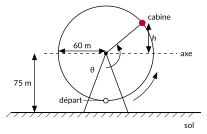
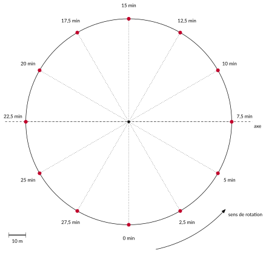
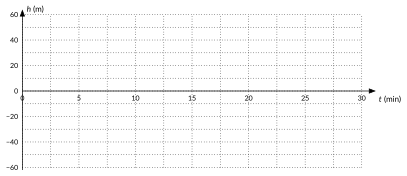
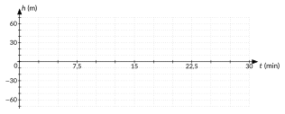

<!-- GÉNÉRÉ par typweb à partir des notes Typst : NE PAS ÉDITER (les modifications seraient écrasées). -->

::: {.callout-note title="Question Q0."}
À quelle hauteur sera une cabine au bout de $t$ minutes ? Quand dépassera-t-elle 100 m ?
:::

Le London Eye est une grande roue de 120 m de diamètre ; son sommet se trouve à 135 m au-dessus du sol^[Structurae, « London Eye », fiche de l’ouvrage, structurae.net/fr/ouvrages/london-eye (diamètre 120 m, hauteur 135 m).]. Un tour complet dure environ 30 minutes^[« The wheel rotates at 26 cm per second \[…] so that one revolution takes about 30 minutes », article « London Eye », Wikipédia (en anglais), qui renvoie au site officiel du London Eye.\]. Les passagers embarquent au point le plus bas. L’axe de la roue est donc à $135 - 60 = 75$ m du sol.

::: {.typst-fig}
{fig-alt="Figure du cours"}
:::

Dans tout le cours, nous repérons la cabine par sa **hauteur au-dessus de l’axe** de la roue, notée $h$ : elle est négative quand la cabine est sous l’axe. La hauteur au-dessus du sol s’obtient en ajoutant 75 m.

::: {#activite-1-1 data-sorte="activite" data-num="1.1" data-page="4" data-phys="7" data-id="5UAA5.quelle-hauteur-est-cabine" data-type="activite" data-tags="" .theo .theo-activite}
::: {.theo-head}
**Activité 1.1** — à quelle hauteur est la cabine ?
:::

::: {.theo-body}
La roue ci-dessous est dessinée à l’échelle : 1 cm représente 10 m. Les points indiquent la position de la cabine toutes les 2,5 minutes.

::: {.typst-fig}
{fig-alt="Figure du cours"}
:::

1. Mesure, sur le dessin, la distance entre chaque position et l’axe ; convertis-la en mètres et complète le tableau (hauteur au-dessus de l’axe, négative sous l’axe).

   ::: {.tableau}
   | $t$ (min) | $0$ | $2{,}5$ | $5$ | $7{,}5$ | $10$ | $12{,}5$ | $15$ |
   |:---:|:---:|:---:|:---:|:---:|:---:|:---:|:---:|
   | $h$ (m) | [$-60$]{.rep} | [$-52$]{.rep} | [$-30$]{.rep} | [$0$]{.rep} | [$30$]{.rep} | [$52$]{.rep} | [$60$]{.rep} |
   :::

   ::: {.tableau}
   | $t$ (min) | $17{,}5$ | $20$ | $22{,}5$ | $25$ | $27{,}5$ | $30$ |
   |:---:|:---:|:---:|:---:|:---:|:---:|:---:|
   | $h$ (m) | [$52$]{.rep} | [$30$]{.rep} | [$0$]{.rep} | [$-30$]{.rep} | [$-52$]{.rep} | [$-60$]{.rep} |
   :::
2. Place les points $(t ; h)$ dans le repère.

   ::: {.typst-fig}
   {fig-alt="Figure du cours"}
   :::
3. Faut-il relier ces points par des segments ? Pourquoi ?

   ::: {.rep-bloc}
   Non. La cabine passe par toutes les positions intermédiaires, et sa hauteur ne varie pas de la même quantité sur des durées égales (question 4) : entre deux points, elle ne suit pas un segment. Il faut relier les points par une courbe.
   :::
4. De combien de mètres la cabine monte-t-elle entre 0 et 2,5 min ? entre 2,5 et 5 min ? entre 5 et 7,5 min ? Que remarques-tu ?

   ::: {.rep-bloc}
   Environ 8 m, puis 22 m, puis 30 m. Sur des durées égales, la cabine monte de plus en plus : elle monte de plus en plus vite jusqu’au niveau de l’axe.
   :::
5. Et entre 7,5 et 10 min, 10 et 12,5 min, 12,5 et 15 min ?

   ::: {.rep-bloc}
   30 m, puis 22 m, puis 8 m : la cabine monte de moins en moins vite jusqu’au sommet.
   :::
6. Résume comment la hauteur de la cabine varie pendant un tour complet. Comment faut-il relier les points du repère ?

   ::: {.rep-bloc}
   Partie du point le plus bas, la cabine monte **de plus en plus vite** jusqu’au niveau de l’axe (à $t = 7{,}5$ min), puis **de moins en moins vite** jusqu’au sommet (à $t = 15$ min). Elle redescend ensuite de la même manière, en sens inverse : de plus en plus vite jusqu’au niveau de l’axe, puis de moins en moins vite jusqu’au point le plus bas. Les accroissements de la hauteur sur des durées égales ne sont pas constants : relier les points par des segments trahirait le mouvement. Les points se relient par une courbe « arrondie », plate près du sommet et du point le plus bas, et la plus raide au niveau de l’axe. Après 30 minutes, tout recommence.
   :::
:::
:::

::: {#exercice-1-1 data-sorte="exercice" data-num="1.1" data-page="6" data-phys="9" data-id="5UAA5.ex.001" data-type="exercice" data-tags="" .exo}
::: {.exo-tete}
[✎ Exercice 1.1]{.exo-titre} [[C6]{.exo-comp} ★★☆]{.exo-meta}
:::

::: {.exo-corps}
Une cabine du London Eye est au niveau de l’axe et monte à l’instant $t = 0$. Sans calcul, décris l’évolution de sa hauteur pendant un tour (30 min) : sur chaque quart de tour, dis si elle monte ou descend, et si c’est de plus en plus vite ou de moins en moins vite. Esquisse ensuite l’allure du graphique de sa hauteur au-dessus de l’axe.

::: {.typst-fig}
{fig-alt="Figure du cours"}
:::
:::
:::

::: {.aides}
::: {.panel-tabset}
## Indice 1 {.unlisted}

Relis la mise en commun de l’[activité 1.1](#activite-1-1) : près du sommet et du point le plus bas, la cabine se déplace presque horizontalement.

## Indice 2 {.unlisted}

Au départ, la cabine se déplace-t-elle plutôt verticalement ou horizontalement ? Et au sommet ?

## Indice 3 {.unlisted}

Découpe le tour en quatre quarts de $7{,}5$ min : axe → sommet, sommet → axe, axe → point bas, point bas → axe. Pour chacun, dis si la hauteur augmente ou diminue, puis si elle varie vite au début ou à la fin.

## Solution {.unlisted}

::: {.solution-classe}
De $0$ à $7{,}5$ min, la cabine monte de moins en moins vite (elle part en se déplaçant verticalement et arrive au sommet en se déplaçant horizontalement). De $7{,}5$ à $15$ min, elle descend de plus en plus vite jusqu’au niveau de l’axe. De $15$ à $22{,}5$ min, elle descend de moins en moins vite jusqu’au point le plus bas. De $22{,}5$ à $30$ min, elle monte de plus en plus vite jusqu’au niveau de l’axe. Le graphique part de $0$ avec sa plus forte pente, est plat au sommet ($60$ m à $7{,}5$ min) et au point le plus bas ($-60$ m à $22{,}5$ min), et le plus raide chaque fois qu’il coupe l’axe horizontal.
:::

## Pièges {.unlisted}

- Relier les positions par des segments : la hauteur ne varie pas de la même quantité sur des durées égales.
- Dessiner un graphique pointu au sommet : la cabine y passe en douceur, le graphique y est plat.
:::
:::

```{=html}
<div class="tg" id="anim-roue" data-tg="roue" data-cfg='{"rayon": 60, "periode": 30, "depart": "bas", "axe": 75}'></div>
```

::: {.tg-legende}
Animation : la cabine tourne ; sa hauteur au-dessus de l’axe se trace en fonction du temps. On peut changer le rayon, la durée d’un tour et la position de départ.
:::

Nous savons mesurer la hauteur, pas encore la calculer. Pour la calculer, il faudra :

1. mesurer l’angle dont la roue a tourné (chapitre 1) ;
2. calculer une hauteur à partir d’un angle, quel que soit l’angle (chapitre 2) ;
3. voir d’un seul coup l’évolution de la hauteur au cours du temps (chapitre 3) ;
4. écrire la formule de la hauteur en fonction du temps (chapitre 4), et l’utiliser (chapitre 5).

::: {.ae-lien}
[✔ S'autoévaluer sur cette section : test de 2 questions →](../autoeval.qmd#sections=sec-london-eye)
:::
