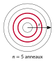
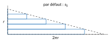
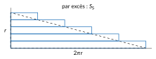

<!-- GÉNÉRÉ par typweb à partir des notes Typst : NE PAS ÉDITER (les modifications seraient écrasées). -->

::: {.callout-note title="Question Q1."}
Quelle distance la cabine parcourt-elle en $t$ minutes ? *Détour :* quelle aire balaie un rayon de la roue ?
:::

**Rappel.** Pour tous les cercles, le quotient du périmètre par le diamètre est le même nombre, noté $\pi$ ($\pi \approx 3{,}14159$). Un cercle de rayon $r$ a donc pour périmètre $2 \pi r$.

## L’aire du disque

L’aire balayée par un rayon de la roue en un tour est l’aire du disque. Comment la calculer à partir du périmètre ?

::: {#activite-1-2 data-sorte="activite" data-num="1.2" data-page="6" data-phys="9" data-id="5UAA5.eplucher-disque" data-type="activite" data-tags="" .theo .theo-activite}
::: {.theo-head}
**Activité 1.2** — éplucher le disque
:::

::: {.theo-body}
On découpe un disque de rayon $r$ en $n$ anneaux fins, tous de même épaisseur $\frac{r}{n}$.

::: {.typst-fig}
{fig-alt="Figure du cours"}
:::

1. Un anneau a pour rayon intérieur $\rho$ et pour rayon extérieur $\rho + \frac{r}{n}$. On le coupe et on le déroule. Ce n’est pas exactement un rectangle : son bord intérieur mesure $2 \pi \rho$, son bord extérieur $2 \pi (\rho + \frac{r}{n})$. Entre les aires de quels deux rectangles son aire est-elle comprise ?

   ::: {.rep-bloc}
   Entre l’aire du rectangle de dimensions $2 \pi \rho$ et $\frac{r}{n}$ (le « petit » rectangle) et celle du rectangle de dimensions $2 \pi (\rho + \frac{r}{n})$ et $\frac{r}{n}$ (le « grand » rectangle).
   :::
2. On empile les anneaux déroulés, du bord du disque (en bas) jusqu’au centre (en haut) : une fois avec les petits rectangles, une fois avec les grands. On obtient deux escaliers, d’aires $s_{n}$ et $S_{n}$.

   ::: {.grille style="--n:2"}
   ::: {.cellule}
   ::: {.typst-fig}
   {fig-alt="Figure du cours"}
   :::
   :::

   ::: {.cellule}
   ::: {.typst-fig}
   {fig-alt="Figure du cours"}
   :::
   :::
   :::

   Pourquoi a-t-on $s_{n} \leq A \leq S_{n}$, où $A$ est l’aire du disque ?

   ::: {.rep-bloc}
   Chaque anneau a une aire comprise entre celle de son petit rectangle et celle de son grand rectangle. En additionnant pour tous les anneaux, l’aire du disque est comprise entre l’aire totale des petits rectangles, $s_{n}$, et celle des grands, $S_{n}$.
   :::
3. On prend $r = 1$ et $n = 10$ : l’épaisseur vaut $0{,}1$ et les rayons intérieurs valent $0 ; 0{,}1 ; 0{,}2 ; … ; 0{,}9$. Calcule $s_{10}$ et $S_{10}$ (quatre décimales).

   ::: {.rep-bloc}
   $s_{10} = 2 \pi \cdot 0{,}1 \cdot 0{,}1 \cdot (0 + 1 + 2 + \cdots + 9) = 0{,}02 \pi \cdot 45 = 0{,}9 \pi \approx 2{,}8274$ ; \
   $S_{10} = 0{,}02 \pi \cdot (1 + 2 + \cdots + 10) = 0{,}02 \pi \cdot 55 = 1{,}1 \pi \approx 3{,}4558$.
   :::

   Recommence au tableur pour $n = 100$ et $n = 1000$ et complète le tableau.

   ::: {.tableau}
   | $n$ | $s_{n}$ (par défaut) | $S_{n}$ (par excès) | $S_{n} - s_{n}$ |
   |:---:|:---:|:---:|:---:|
   | $10$ | [$2{,}8274$]{.rep} | [$3{,}4558$]{.rep} | [$0{,}6283$]{.rep} |
   | $100$ | [$3{,}1102$]{.rep} | [$3{,}1730$]{.rep} | [$0{,}0628$]{.rep} |
   | $1000$ | [$3{,}1385$]{.rep} | [$3{,}1447$]{.rep} | [$0{,}0063$]{.rep} |
   :::
4. Pour $r$ et $n$ quelconques, exprime $s_{n}$ et $S_{n}$ à l’aide de la somme $1 + 2 + \cdots + m = \frac{m (m + 1)}{2}$. Que deviennent $s_{n}$ et $S_{n}$ quand $n$ devient très grand ? Conclus.

   ::: {.rep-bloc}
   On remplace chaque anneau par un rectangle : on commet une erreur, mais on l’encadre. Notons $\Delta \rho = \frac{r}{n}$ l’épaisseur d’un anneau.

   - **Approximation par défaut.** Les petits rectangles ont pour longueurs $2 \pi \cdot 0$, $2 \pi \Delta \rho$, $2 \pi \cdot 2 \Delta \rho$, …, $2 \pi (n-1) \Delta \rho$ et pour hauteur $\Delta \rho$ :

     $$
     s_{n} = 2 \pi (\Delta \rho)^{2} (0 + 1 + \cdots + (n - 1)) = \frac{2 \pi r^{2}}{n^{2}} \cdot \frac{(n - 1) n}{2} = \pi r^{2} (1 - \frac{1}{n}).
     $$
   - **Approximation par excès.** Les grands rectangles ont pour longueurs $2 \pi \Delta \rho$, $2 \pi \cdot 2 \Delta \rho$, …, $2 \pi n \Delta \rho$ :

     $$
     S_{n} = 2 \pi (\Delta \rho)^{2} (1 + 2 + \cdots + n) = \frac{2 \pi r^{2}}{n^{2}} \cdot \frac{n (n + 1)}{2} = \pi r^{2} (1 + \frac{1}{n}).
     $$
   - **L’erreur tend vers 0.** L’écart entre les deux approximations vaut $S_{n} - s_{n} = \frac{2 \pi r^{2}}{n}$ : il devient aussi petit qu’on veut quand $n$ devient grand. Les deux approximations ont la même limite, $\pi r^{2}$. L’aire $A$ du disque, qui ne dépend pas de $n$, est coincée entre elles pour tout $n$ : elle ne peut valoir que $\pi r^{2}$.

   Sur les escaliers, on voit les deux empilements se resserrer autour du triangle de base $2 \pi r$ (le périmètre) et de hauteur $r$, dont l’aire vaut $\frac{2 \pi r \cdot r}{2} = \pi r^{2}$.
   :::
:::
:::

::: {#propriete-1-1 data-sorte="propriete" data-num="1.1" data-page="8" data-phys="11" data-id="5UAA5.aire-disque" data-type="propriete" data-tags="" .theo .theo-propriete}
::: {.theo-head}
**Propriété 1.1** — aire du disque
:::

::: {.theo-body}
L’aire d’un disque de rayon $r$ vaut $A = \pi r^{2}$.
:::
:::

```{=html}
<div class="tg" id="anim-anneaux" data-tg="anneaux" data-cfg='{"n": 5}'></div>
```

::: {.tg-legende}
Animation : on choisit le nombre d’anneaux $n$ ; les deux escaliers, le triangle, $s_{n}$, $S_{n}$ et l’écart s’affichent.
:::

## Arcs et secteurs

Un **arc** de cercle est une portion de cercle ; un **secteur** est la portion de disque comprise entre deux rayons. L’angle formé par les deux rayons est l’**angle au centre**.

::: {#activite-1-3 data-sorte="activite" data-num="1.3" data-page="8" data-phys="11" data-id="5UAA5.faire-emerger-formules" data-type="activite" data-tags="" .theo .theo-activite}
::: {.theo-head}
**Activité 1.3** — faire émerger les formules
:::

::: {.theo-body}
Dans un cercle de rayon $r$, un arc de $90°$ est le quart du cercle. Complète le tableau ; la dernière colonne donne les formules.

::: {.tableau}
| angle au centre | $360°$ | $180°$ | $90°$ | $60°$ | $1°$ | $\alpha$ |
|:---:|:---:|:---:|:---:|:---:|:---:|:---:|
| fraction du tour | [$1$]{.rep} | [$\frac{1}{2}$]{.rep} | [$\frac{1}{4}$]{.rep} | [$\frac{1}{6}$]{.rep} | [$\frac{1}{360}$]{.rep} | [$\frac{\alpha}{360}$]{.rep} |
| longueur de l’arc | [$2 \pi r$]{.rep} | [$\pi r$]{.rep} | [$\frac{\pi r}{2}$]{.rep} | [$\frac{\pi r}{3}$]{.rep} | [$\frac{2 \pi r}{360}$]{.rep} | [$\frac{\alpha}{360} \cdot 2 \pi r$]{.rep} |
| aire du secteur | [$\pi r^{2}$]{.rep} | [$\frac{\pi r^{2}}{2}$]{.rep} | [$\frac{\pi r^{2}}{4}$]{.rep} | [$\frac{\pi r^{2}}{6}$]{.rep} | [$\frac{\pi r^{2}}{360}$]{.rep} | [$\frac{\alpha}{360} \cdot \pi r^{2}$]{.rep} |
:::

Les trois lignes sont-elles proportionnelles à l’angle ? Pourquoi ?

::: {.rep-bloc}
Oui : doubler l’angle, c’est prendre deux fois plus de cercle, donc un arc deux fois plus long et un secteur deux fois plus grand.
:::
:::
:::

::: {#propriete-1-2 data-sorte="propriete" data-num="1.2" data-page="8" data-phys="11" data-id="5UAA5.arc-secteur-angle-degres" data-type="propriete" data-tags="" .theo .theo-propriete}
::: {.theo-head}
**Propriété 1.2** — arc et secteur, angle en degrés
:::

::: {.theo-body}
Dans un cercle de rayon $r$, un angle au centre de $\alpha$ degrés intercepte un arc de longueur $\ell$ et délimite un secteur d’aire $A$ :

$$
\ell = \frac{\alpha}{360} \cdot 2 \pi r, \quad \quad A = \frac{\alpha}{360} \cdot \pi r^{2}.
$$
:::
:::

::: {#exemple-1-1 data-sorte="exemple" data-num="1.1" data-page="8" data-phys="11" data-id="5UAA5.exm.001" data-type="exemple" data-tags="" .theo .theo-exemple}
::: {.theo-head}
**Exemple 1.1**
:::

::: {.theo-body}
Une cabine du London Eye tourne de $36°$ (3 minutes). Elle parcourt un arc de longueur $\ell = \frac{36}{360} \cdot 2 \pi \cdot 60 = 12 \pi \approx 37{,}7$ m, et le rayon qui la porte balaie un secteur d’aire $A = \frac{36}{360} \cdot \pi \cdot 60^{2} = 360 \pi \approx 1131$ m².
:::
:::

::: {#exercice-1-2 data-sorte="exercice" data-num="1.2" data-page="8" data-phys="11" data-id="5UAA5.ex.002" data-type="exercice" data-tags="" .exo}
::: {.exo-tete}
[✎ Exercice 1.2]{.exo-titre} [[A1]{.exo-comp} ★☆☆]{.exo-meta}
:::

::: {.exo-corps}
Dans un cercle de rayon 5 cm, calcule la longueur de l’arc intercepté et l’aire du secteur délimité par un angle au centre de $72°$, de $150°$ et de $300°$ (au centième).
:::
:::

::: {.aides}
::: {.panel-tabset}
## Indice 1 {.unlisted}

Utilise la [propriété « arc et secteur, angle en degrés »](#propriete-1-2).

## Indice 2 {.unlisted}

Quelle fraction du tour représente un angle de $72°$ ? L’arc est cette fraction de quoi ? Et le secteur ?

## Indice 3 {.unlisted}

Pour $72°$ : $\frac{72}{360} = \frac{1}{5}$. L’arc vaut $\frac{1}{5}$ du périmètre $2 \pi \cdot 5$, le secteur $\frac{1}{5}$ de l’aire $\pi \cdot 5^{2}$.

## Solution {.unlisted}

::: {.solution-classe}
$\alpha = 72°$ : $\ell = \frac{72}{360} \cdot 2 \pi \cdot 5 = 2 \pi \approx 6{,}28$ cm ; $A = \frac{72}{360} \cdot \pi \cdot 25 = 5 \pi \approx 15{,}71$ cm². \
 $\alpha = 150°$ : $\ell = \frac{150}{360} \cdot 10 \pi = \frac{25 \pi}{6} \approx 13{,}09$ cm ; $A = \frac{150}{360} \cdot 25 \pi = \frac{125 \pi}{12} \approx 32{,}72$ cm². \
 $\alpha = 300°$ : $\ell = \frac{300}{360} \cdot 10 \pi = \frac{25 \pi}{3} \approx 26{,}18$ cm ; $A = \frac{300}{360} \cdot 25 \pi = \frac{125 \pi}{6} \approx 65{,}45$ cm².
:::

## Pièges {.unlisted}

- Confondre périmètre $2 \pi r$ et aire $\pi r^{2}$.
- Arrondir trop tôt : garde $\pi$ jusqu’au bout, puis arrondis au centième.
:::
:::

::: {#exercice-1-3 data-sorte="exercice" data-num="1.3" data-page="9" data-phys="12" data-id="5UAA5.ex.003" data-type="exercice" data-tags="" .exo}
::: {.exo-tete}
[✎ Exercice 1.3]{.exo-titre} [[A1]{.exo-comp} ★☆☆]{.exo-meta}
:::

::: {.exo-corps}
Une cabine du London Eye (rayon 60 m, un tour en 30 min) tourne pendant 5 minutes, puis pendant 12 minutes. De quel angle a-t-elle tourné chaque fois ? Quelle distance a-t-elle parcourue (au centimètre) ?
:::
:::

::: {.aides}
::: {.panel-tabset}
## Indice 1 {.unlisted}

Relis la [propriété « arc et secteur, angle en degrés »](#propriete-1-2).

## Indice 2 {.unlisted}

De combien de degrés la roue tourne-t-elle en une minute ?

## Indice 3 {.unlisted}

En 30 min : $360°$ ; en 1 min : $12°$. En 5 min : $60°$, donc l’arc vaut $\frac{60}{360}$ du périmètre $2 \pi \cdot 60$.

## Solution {.unlisted}

::: {.solution-classe}
En 30 min, la cabine tourne de $360°$, donc de $12°$ par minute. \
 En 5 min : $\alpha = 60°$ et $\ell = \frac{60}{360} \cdot 2 \pi \cdot 60 = 20 \pi \approx 62{,}83$ m. \
 En 12 min : $\alpha = 144°$ et $\ell = \frac{144}{360} \cdot 120 \pi = 48 \pi \approx 150{,}80$ m.
:::

## Pièges {.unlisted}

- Prendre le diamètre (120 m) comme rayon.
- Donner l’arc en degrés : l’angle est en degrés, la distance en mètres.
:::
:::

::: {#exercice-1-4 data-sorte="exercice" data-num="1.4" data-page="9" data-phys="12" data-id="5UAA5.ex.004" data-type="exercice" data-tags="" .exo}
::: {.exo-tete}
[✎ Exercice 1.4]{.exo-titre} [[A1]{.exo-comp} ★★☆]{.exo-meta}
:::

::: {.exo-corps}
L’aiguille des minutes d’une horloge mesure 12 cm. Quelle distance sa pointe parcourt-elle en 20 minutes ? Quelle aire l’aiguille balaie-t-elle pendant ce temps ?
:::
:::

::: {.aides}
::: {.panel-tabset}
## Indice 1 {.unlisted}

Relis la [propriété « arc et secteur, angle en degrés »](#propriete-1-2) : l’aiguille est un rayon de 12 cm.

## Indice 2 {.unlisted}

Quelle fraction de tour l’aiguille des minutes fait-elle en 20 minutes ?

## Indice 3 {.unlisted}

En 60 min, un tour ; en 20 min, un tiers de tour, soit $120°$. Calcule $\frac{120}{360} \cdot 2 \pi \cdot 12$ et $\frac{120}{360} \cdot \pi \cdot 12^{2}$.

## Solution {.unlisted}

::: {.solution-classe}
En 60 min, l’aiguille fait un tour ($360°$) ; en 20 min, elle tourne de $120°$. \
 $\ell = \frac{120}{360} \cdot 2 \pi \cdot 12 = 8 \pi \approx 25{,}13$ cm. $A = \frac{120}{360} \cdot \pi \cdot 12^{2} = 48 \pi \approx 150{,}80$ cm². \
 La pointe parcourt environ 25,13 cm et l’aiguille balaie environ 150,80 cm².
:::

## Pièges {.unlisted}

- Confondre l’aiguille des minutes (un tour par heure) et celle des heures.
- Oublier les unités : cm pour l’arc, cm² pour l’aire.
:::
:::

::: {#exercice-1-5 data-sorte="exercice" data-num="1.5" data-page="9" data-phys="12" data-id="5UAA5.ex.005" data-type="exercice" data-tags="maison" .exo}
::: {.exo-tete}
[✎ Exercice 1.5]{.exo-titre} [⟵ à faire à la maison]{.exo-maison} [[A1]{.exo-comp} ★★☆]{.exo-meta}
:::

::: {.exo-corps}
Le balai d’un essuie-glace mesure 45 cm. Il est fixé au bras de sorte qu’il nettoie la vitre entre 15 cm et 60 cm du pivot. Le bras tourne de $110°$. Quelle aire de vitre est nettoyée (au cm² près) ?
:::
:::

::: {.aides}
::: {.panel-tabset}
## Indice 1 {.unlisted}

Relis la [propriété « arc et secteur, angle en degrés »](#propriete-1-2) : la zone nettoyée n’est pas un secteur entier.

## Indice 2 {.unlisted}

Quelle forme a la zone nettoyée ? Peux-tu l’obtenir comme différence de deux secteurs ?

## Indice 3 {.unlisted}

Grand secteur de rayon 60 cm moins petit secteur de rayon 15 cm, même angle $110°$.

## Solution {.unlisted}

La zone nettoyée est le secteur de rayon 60 cm privé du secteur de rayon 15 cm, de même angle $110°$ :

$$
A = \frac{110}{360} \cdot \pi \cdot 60^{2} - \frac{110}{360} \cdot \pi \cdot 15^{2} = \frac{110}{360} \cdot \pi \cdot (3600 - 225) = 1031{,}25 \pi \approx 3240 \text{cm}^{2}.
$$

L’essuie-glace nettoie environ 3240 cm² de vitre.

## Pièges {.unlisted}

- Prendre 45 cm (la longueur du balai) comme rayon.
- Soustraire les rayons avant d’élever au carré : $(60 - 15)^{2} \neq 60^{2} - 15^{2}$.
:::
:::

::: {#exercice-1-6 data-sorte="exercice" data-num="1.6" data-page="9" data-phys="12" data-id="5UAA5.ex.006" data-type="exercice" data-tags="maison" .exo}
::: {.exo-tete}
[✎ Exercice 1.6]{.exo-titre} [⟵ à faire à la maison]{.exo-maison} [[A1]{.exo-comp} ★★★]{.exo-meta}
:::

::: {.exo-corps}
Un secteur de rayon 10 cm a une aire de 40 cm².

1. Calcule son angle au centre (au centième de degré) et la longueur de son arc.
2. Vérifie que $A = \frac{\ell \cdot r}{2}$. Interprète cette relation à l’aide d’un triangle.
:::
:::

::: {.aides}
::: {.panel-tabset}
## Indice 1 {.unlisted}

Pars de la formule de l’aire du [secteur](#propriete-1-2) : $A = \frac{\alpha}{360} \cdot \pi r^{2}$.

## Indice 2 {.unlisted}

Dans $40 = \frac{\alpha}{360} \cdot \pi \cdot 100$, quelle est l’inconnue ? Comment l’isoler ?

## Indice 3 {.unlisted}

$\alpha = \frac{40 \cdot 360}{100 \pi}$. Pour l’arc, remplace $\alpha$ dans $\ell = \frac{\alpha}{360} \cdot 2 \pi r$ : les $\pi$ se simplifient.

## Solution {.unlisted}

+ $\frac{\alpha}{360} \cdot \pi \cdot 100 = 40$, donc $\alpha = \frac{40 \cdot 360}{100 \pi} = \frac{144}{\pi} \approx 45{,}84°$. \
 $\ell = \frac{\alpha}{360} \cdot 2 \pi \cdot 10 = \frac{144}{\pi} \cdot \frac{20 \pi}{360} = 8$ cm.

1. $\frac{\ell \cdot r}{2} = \frac{8 \cdot 10}{2} = 40 = A$. En général, $\ell \cdot \frac{r}{2} = \frac{\alpha}{360} \cdot 2 \pi r \cdot \frac{r}{2} = \frac{\alpha}{360} \cdot \pi r^{2} = A$. Le secteur a la même aire qu’un triangle de base $\ell$ (l’arc déroulé) et de hauteur $r$, comme le disque entier a l’aire du triangle de base $2 \pi r$ et de hauteur $r$.

## Pièges {.unlisted}

- Arrondir $\alpha$ avant de calculer l’arc : garde $\frac{144}{\pi}$.
- Pour l’interprétation, le triangle a pour base l’arc déroulé et pour hauteur le rayon.
:::
:::

::: {.ae-lien}
[✔ S'autoévaluer sur cette section : test de 1 question →](../autoeval.qmd#sections=sec-arc-secteur)
:::
