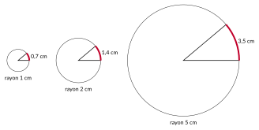
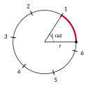
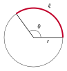

<!-- GÉNÉRÉ par typweb à partir des notes Typst : NE PAS ÉDITER (les modifications seraient écrasées). -->

::: {.callout-note title="Question Q2."}
Comment mesurer l’angle de rotation pour qu’il se calcule simplement à partir de la distance parcourue ?
:::

::: {#activite-1-4 data-sorte="activite" data-num="1.4" data-page="9" data-phys="12" data-id="5UAA5.trois-cercles-meme-angle" data-type="activite" data-tags="" .theo .theo-activite}
::: {.theo-head}
**Activité 1.4** — trois cercles, un même angle
:::

::: {.theo-body}
Dans chacun des trois cercles, on a représenté un même angle au centre $\alpha$ de $40{,}107\ldots$ degrés ; la longueur de l’arc intercepté est indiquée.

::: {.typst-fig}
{fig-alt="Figure du cours"}
:::

1. Divise la longueur de chaque arc par le rayon du cercle correspondant.

   ::: {.rep-bloc}
   $\frac{0{,}7}{1} = 0{,}7$ ; $\frac{1{,}4}{2} = 0{,}7$ ; $\frac{3{,}5}{5} = 0{,}7$.
   :::
2. Que constates-tu ?

   ::: {.rep-bloc}
   Le quotient est le même pour les trois cercles : il ne dépend pas du cercle, seulement de l’angle. L’arc mesure $0{,}7$ rayon, quel que soit le cercle.
   :::
:::
:::

Le quotient « longueur de l’arc / rayon » ne dépend que de l’angle : c’est une façon de **mesurer l’angle**, en comptant combien de rayons il faut mettre bout à bout le long de l’arc.

::: {#activite-1-5 data-sorte="activite" data-num="1.5" data-page="10" data-phys="13" data-id="5UAA5.combien-rayons-tour" data-type="activite" data-tags="" .theo .theo-activite}
::: {.theo-head}
**Activité 1.5** — combien de rayons dans un tour ?
:::

::: {.theo-body}
Avec une ficelle de la longueur du rayon d’un couvercle (ou en reportant le rayon au compas sur un cercle dessiné), reporte cette longueur le long du cercle, bout à bout.

::: {.typst-fig}
{fig-alt="Figure du cours"}
:::

1. Combien de fois peux-tu la reporter sur un tour complet ?

   ::: {.rep-bloc}
   Six fois, et il reste un petit morceau (environ $0{,}28$ rayon) : un tour mesure $2 \pi \approx 6{,}28$ rayons.
   :::
2. Mesure au rapporteur l’angle au centre qui intercepte un arc de longueur égale au rayon.

   ::: {.rep-bloc}
   Environ $57°$.
   :::
:::
:::

::: {.typst-fig}
{fig-alt="Figure du cours"}
:::

::: {#definition-1-1 data-sorte="definition" data-num="1.1" data-page="11" data-phys="14" data-id="5UAA5.radian" data-type="definition" data-tags="" .theo .theo-definition}
::: {.theo-head}
**Définition 1.1** — radian
:::

::: {.theo-body}
Un angle au centre mesure $\theta$ **radians** si l’arc qu’il intercepte a une longueur égale à $\theta$ fois le rayon :

$$
\theta = \frac{\ell}{r}.
$$

On écrit « $\theta$ rad », ou simplement $\theta$.
:::
:::

Tout le reste se **lit** sur cette définition :

- un tour complet intercepte un arc de longueur $2 \pi r$, c’est-à-dire $2 \pi$ rayons : $360° = 2 \pi$ rad, et un demi-tour, $180° = \pi$ rad ;
- un angle de 1 rad vaut $\frac{360}{2 \pi} \approx 57{,}3°$, ce qu’on a mesuré au rapporteur ;
- la longueur de l’arc s’obtient en multipliant : $\ell = r \theta$ ;
- l’aire du secteur reste proportionnelle à l’angle : un tour ($2 \pi$ rad) correspond à $\pi r^{2}$, donc un angle $\theta$ correspond à $\frac{\theta}{2 \pi} \cdot \pi r^{2} = \frac{r^{2} \theta}{2}$.

::: {#propriete-1-3 data-sorte="propriete" data-num="1.3" data-page="11" data-phys="14" data-id="5UAA5.arc-secteur-angle-radians" data-type="propriete" data-tags="" .theo .theo-propriete}
::: {.theo-head}
**Propriété 1.3** — arc et secteur, angle en radians
:::

::: {.theo-body}
Dans un cercle de rayon $r$, un angle au centre de $\theta$ radians intercepte un arc de longueur $\ell$ et délimite un secteur d’aire $A$ :

$$
\ell = r \theta, \quad \quad A = \frac{r^{2} \theta}{2}.
$$
:::
:::

::: {.callout-important title="Pourquoi les radians plutôt que les degrés ?"}
- **Le degré est une convention, le radian vient du cercle.** Le choix de 360 parts par tour est un héritage historique ; rien dans le cercle ne l’impose. Le radian compare deux longueurs du cercle lui-même, l’arc et le rayon.
- **Un angle en radians est un nombre.** C’est le quotient de deux longueurs : les mètres disparaissent. On peut donc le placer sur une droite graduée et en faire la variable d’une fonction. C’est ce qui permettra de passer des angles aux nombres réels (chapitre 2).
- **Les formules deviennent simples.** En degrés, l’arc vaut $\ell = \frac{\alpha}{360} \cdot 2 \pi r$ ; en radians, $\ell = r \theta$. Le facteur $\frac{\pi}{180}$ disparaît. Il disparaîtra aussi des formules de dérivées, qui ne sont simples qu’en radians.

Le degré reste commode pour mesurer au rapporteur ou communiquer un angle ; le radian est l’unité du calcul.
:::

**Retour à la cabine.** En $t$ minutes, la cabine tourne de $\frac{t}{30}$ de tour, soit d’un angle $\theta = \frac{2 \pi}{30} \cdot t = \frac{\pi}{15} t$ radians, et elle parcourt $\ell = 60 \theta = 4 \pi t$ mètres. La réponse à la question Q1 est donc : *environ $12{,}6$ m par minute*, et la réponse à la question Q2 : *en radians, l’angle est la distance parcourue divisée par le rayon*.

## Convertir

Puisque $180° = \pi$ rad, les mesures en degrés et en radians d’un même angle sont proportionnelles : on passe de l’une à l’autre par une règle de trois.

::: {.tableau}
| degrés | $30°$ | $45°$ | $60°$ | $90°$ | $180°$ | $360°$ |
|:---:|:---:|:---:|:---:|:---:|:---:|:---:|
| radians | $\frac{\pi}{6}$ | $\frac{\pi}{4}$ | $\frac{\pi}{3}$ | $\frac{\pi}{2}$ | $\pi$ | $2 \pi$ |
:::

Ces valeurs usuelles s’obtiennent en fractions de demi-tour : $60°$ est le tiers de $180°$, donc $\frac{\pi}{3}$. Pour les autres angles, on utilise les touches de conversion de la calculatrice.

::: {#exemple-1-2 data-sorte="exemple" data-num="1.2" data-page="12" data-phys="15" data-id="5UAA5.exm.002" data-type="exemple" data-tags="" .theo .theo-exemple}
::: {.theo-head}
**Exemple 1.2**
:::

::: {.theo-body}
Convertir $130°$ en radians : $130° = \frac{130}{180} \pi = \frac{13 \pi}{18} \approx 2{,}27$ rad. \
 Convertir $\frac{5 \pi}{4}$ en degrés : $\frac{5 \pi}{4} = \frac{5}{4} \cdot 180° = 225°$.
:::
:::

::: {.callout-warning title="Piège"}
« $\pi = 180$ ». Non : $\pi$ radians et $180°$ désignent le **même angle**, mais $\pi$ reste le nombre $3{,}14159\ldots$ On n’écrit jamais $\pi = 180$.
:::

::: {#exercice-1-7 data-sorte="exercice" data-num="1.7" data-page="12" data-phys="15" data-id="5UAA5.ex.007" data-type="exercice" data-tags="" .exo}
::: {.exo-tete}
[✎ Exercice 1.7]{.exo-titre} [[C7]{.exo-comp} ★☆☆]{.exo-meta}
:::

::: {.exo-corps}
Convertis en radians (valeur exacte) : $225°$ ; $315°$ ; $240°$ ; $210°$ ; $135°$ ; $300°$.
:::
:::

::: {.aides}
::: {.panel-tabset}
## Indice 1 {.unlisted}

Relis le paragraphe « Convertir » : $180° = \pi$ rad.

## Indice 2 {.unlisted}

Quelle fraction de $180°$ représente $225°$ ?

## Indice 3 {.unlisted}

$\frac{225}{180} = \frac{5}{4}$, donc $225° = \frac{5 \pi}{4}$. Simplifie chaque fraction avant d’écrire $\pi$.

## Solution {.unlisted}

::: {.solution-classe}
$225° = \frac{5 \pi}{4}$ ; $315° = \frac{7 \pi}{4}$ ; $240° = \frac{4 \pi}{3}$ ; $210° = \frac{7 \pi}{6}$ ; $135° = \frac{3 \pi}{4}$ ; $300° = \frac{5 \pi}{3}$.
:::

## Pièges {.unlisted}

- Écrire « $\pi = 180$ » : $\pi$ rad et $180°$ désignent le même angle, mais $\pi$ reste un nombre.
- Inverser la fraction ($\frac{180}{225}$).
:::
:::

::: {#exercice-1-8 data-sorte="exercice" data-num="1.8" data-page="12" data-phys="15" data-id="5UAA5.ex.008" data-type="exercice" data-tags="" .exo}
::: {.exo-tete}
[✎ Exercice 1.8]{.exo-titre} [[C7]{.exo-comp} ★☆☆]{.exo-meta}
:::

::: {.exo-corps}
Convertis en degrés : $\frac{2 \pi}{3}$ ; $\frac{7 \pi}{6}$ ; $\frac{5 \pi}{3}$ ; $\frac{3 \pi}{4}$ ; $\frac{7 \pi}{4}$.
:::
:::

::: {.aides}
::: {.panel-tabset}
## Indice 1 {.unlisted}

Relis le paragraphe « Convertir » : $\pi$ rad correspond à $180°$.

## Indice 2 {.unlisted}

Combien de degrés vaut $\frac{\pi}{3}$ ? Et $\frac{\pi}{6}$ ?

## Indice 3 {.unlisted}

Remplace $\pi$ par $180°$ : $\frac{2 \pi}{3} = 2 \cdot 180\frac{°}{3}$.

## Solution {.unlisted}

::: {.solution-classe}
$\frac{2 \pi}{3} = 120°$ ; $\frac{7 \pi}{6} = 210°$ ; $\frac{5 \pi}{3} = 300°$ ; $\frac{3 \pi}{4} = 135°$ ; $\frac{7 \pi}{4} = 315°$.
:::

## Pièges {.unlisted}

- Remplacer $\pi$ par $360°$.
- Garder $\pi$ dans la réponse en degrés.
:::
:::

::: {#exercice-1-9 data-sorte="exercice" data-num="1.9" data-page="12" data-phys="15" data-id="5UAA5.ex.009" data-type="exercice" data-tags="" .exo}
::: {.exo-tete}
[✎ Exercice 1.9]{.exo-titre} [[C7]{.exo-comp} ★☆☆]{.exo-meta}
:::

::: {.exo-corps}
À l’aide de la calculatrice, complète le tableau (au centième).

::: {.tableau}
| degrés | $3{,}145°$ | $30{,}204°$ | $-27{,}543°$ |
|:---:|:---:|:---:|:---:|
| radians | [$0{,}05$]{.rep} | [$0{,}53$]{.rep} | [$-0{,}48$]{.rep} |
:::

::: {.tableau}
| radians | $2{,}3$ | $0{,}012$ | $0{,}5$ |
|:---:|:---:|:---:|:---:|
| degrés | [$131{,}78°$]{.rep} | [$0{,}69°$]{.rep} | [$28{,}65°$]{.rep} |
:::
:::
:::

::: {.aides}
::: {.panel-tabset}
## Indice 1 {.unlisted}

Les mesures en degrés et en radians sont proportionnelles : $180° = \pi$ rad (paragraphe « Convertir »).

## Indice 2 {.unlisted}

Par quel nombre multiplier une mesure en degrés pour obtenir des radians ? Et inversement ?

## Indice 3 {.unlisted}

Degrés → radians : multiplier par $\frac{\pi}{180}$. Radians → degrés : multiplier par $\frac{180}{\pi}$.

## Solution {.unlisted}

::: {.solution-classe}
$3{,}145° \approx 0{,}05$ rad ; $30{,}204° \approx 0{,}53$ rad ; $-27{,}543° \approx -0{,}48$ rad. \
$2{,}3$ rad $\approx 131{,}78°$ ; $0{,}012$ rad $\approx 0{,}69°$ ; $0{,}5$ rad $\approx 28{,}65°$.
:::

## Pièges {.unlisted}

- Utiliser une valeur arrondie de $\pi$ trop tôt.
- Oublier le signe $-$ de $-27{,}543°$.
:::
:::

::: {#exercice-1-10 data-sorte="exercice" data-num="1.10" data-page="13" data-phys="16" data-id="5UAA5.ex.010" data-type="exercice" data-tags="maison" .exo}
::: {.exo-tete}
[✎ Exercice 1.10]{.exo-titre} [⟵ à faire à la maison]{.exo-maison} [[A1]{.exo-comp} ★★☆]{.exo-meta}
:::

::: {.exo-corps}
D’après la même source^[Article « London Eye », Wikipédia (en anglais) : « The wheel rotates at 26 cm per second \[…] so that one revolution takes about 30 minutes ».
:::
:::

::: {.aides}
::: {.panel-tabset}
## Indice 1 {.unlisted}

Relis la [propriété « arc et secteur »](2-longueur-dun-arc-aire-dun.qmd#propriete-1-2) : un tour, c’est le périmètre $2 \pi r$.

## Indice 2 {.unlisted}

Quelle distance la cabine parcourt-elle en 30 min à $0{,}26$ m/s ? Que devrait-elle parcourir en un tour ?

## Indice 3 {.unlisted}

Convertis 30 min en secondes ($1800$ s), calcule $0{,}26 \cdot 1800$ et compare avec $2 \pi \cdot 60$.

## Solution {.unlisted}

En 30 min $= 1800$ s, une cabine parcourt $0{,}26 \cdot 1800 = 468$ m. Le périmètre de la roue vaut $120 \pi \approx 377$ m. Les deux données ne sont pas compatibles : à 26 cm/s, un tour dure $\frac{377}{0{,}26} \approx 1450$ s, soit environ 24 min ; pour un tour en 30 min, la vitesse serait d’environ 21 cm/s. Il faut contrôler une donnée publiée avant de s’en servir.

## Pièges {.unlisted}

- Mélanger les unités (cm et m, minutes et secondes).
- Conclure que la source a forcément tort : on dit seulement que les deux données ne peuvent pas être exactes ensemble.
:::
:::

, les cabines du London Eye avancent à 26 cm par seconde, de sorte qu’un tour dure environ 30 minutes. Calcule la distance parcourue en 30 minutes à cette vitesse et compare-la au périmètre de la roue. Conclus. \]

::: {.ae-lien}
[✔ S'autoévaluer sur cette section : test de 4 questions →](../autoeval.qmd#sections=sec-radian)
:::
