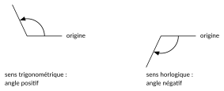
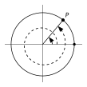
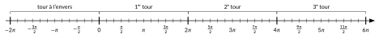
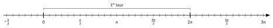
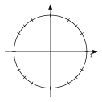

<!-- GÉNÉRÉ par typweb à partir des notes Typst : NE PAS ÉDITER (les modifications seraient écrasées). -->

::: {.callout-note title="Question Q3."}
La roue fait plusieurs tours, et pourrait tourner dans l’autre sens : comment repérer la position de la cabine après $t$ minutes ?
:::

Un angle « ordinaire » ne dit ni dans quel sens on tourne, ni combien de tours on fait. Pour décrire une rotation, il faut les deux.

::: {.typst-fig}
{fig-alt="Figure du cours"}
:::

::: {#definition-1-2 data-sorte="definition" data-num="1.2" data-page="13" data-phys="16" data-id="5UAA5.angle-oriente" data-type="definition" data-tags="" .theo .theo-definition}
::: {.theo-head}
**Définition 1.2** — angle orienté
:::

::: {.theo-body}
Un **angle orienté** est donné par deux demi-droites de même origine, prises dans un ordre : l’une est l’origine, l’autre l’extrémité. Il décrit une rotation de l’une vers l’autre. On compte positivement les rotations dans le **sens trigonométrique** (sens contraire des aiguilles d’une montre) et négativement celles dans le sens horlogique. Un angle orienté peut dépasser un tour.
:::
:::

Une même position finale correspond à plusieurs rotations : tourner de $\theta$, ou d’un tour de plus ($\theta + 2 \pi$), ou de deux tours de plus ($\theta + 4 \pi$), ou d’un tour dans l’autre sens ($\theta - 2 \pi$)…

::: {.typst-fig}
{fig-alt="Figure du cours"}
:::

Pour compter les tours, on gradue une droite en multiples de $\frac{\pi}{6}$ : le réel se lit sur la droite, la position sur le cercle. Chaque intervalle de longueur $2 \pi$ correspond à un tour complet.

::: {.typst-fig}
{fig-alt="Figure du cours"}
:::

```{=html}
<div class="tg" id="anim-axe-tours" data-tg="axe-tours" data-cfg='{"x": 7.330382858376184}'></div>
```

::: {.tg-legende}
Animation : un réel se déplace sur l’axe gradué ; le point correspondant tourne sur le cercle, et le nombre de tours s’affiche.
:::

::: {#definition-1-3 data-sorte="definition" data-num="1.3" data-page="14" data-phys="17" data-id="5UAA5.mesures-angle-oriente" data-type="definition" data-tags="" .theo .theo-definition}
::: {.theo-head}
**Définition 1.3** — mesures d’un angle orienté
:::

::: {.theo-body}
Si $\alpha$ est une mesure d’un angle orienté, ses autres mesures sont les réels $\alpha + 2 k \pi$, où $k \in \mathbb{Z}$. Sa **mesure principale** est celle qui appartient à l’intervalle $[0 ; 2 \pi[$.
:::
:::

::: {#exemple-1-3 data-sorte="exemple" data-num="1.3" data-page="14" data-phys="17" data-id="5UAA5.exm.003" data-type="exemple" data-tags="" .theo .theo-exemple}
::: {.theo-head}
**Exemple 1.3**
:::

::: {.theo-body}
$\frac{17 \pi}{6} = \frac{12 \pi}{6} + \frac{5 \pi}{6} = 2 \pi + \frac{5 \pi}{6}$ : la mesure principale de $\frac{17 \pi}{6}$ est $\frac{5 \pi}{6}$ (un tour, puis $150°$). \
 $-\frac{\pi}{4} + 2 \pi = \frac{7 \pi}{4}$ : la mesure principale de $-\frac{\pi}{4}$ est $\frac{7 \pi}{4}$.
:::
:::

::: {#remarque-1-1 data-sorte="remarque" data-num="1.1" data-page="14" data-phys="17" data-id="5UAA5.rem.001" data-type="remarque" data-tags="" .theo .theo-remarque}
::: {.theo-head}
**Remarque 1.1**
:::

::: {.theo-body}
Pour trouver la mesure principale de $\frac{p \pi}{q}$, on retire (ou on ajoute) autant de fois $2 \pi = \frac{2 q \pi}{q}$ qu’il faut pour tomber dans $[0 ; 2 \pi[$.
:::
:::

::: {#exercice-1-11 data-sorte="exercice" data-num="1.11" data-page="14" data-phys="17" data-id="5UAA5.ex.011" data-type="exercice" data-tags="" .exo}
::: {.exo-tete}
[✎ Exercice 1.11]{.exo-titre} [[C7]{.exo-comp} ★☆☆]{.exo-meta}
:::

::: {.exo-corps}
Place sur l’axe gradué, puis sur le cercle, les réels $\frac{7 \pi}{3}$, $-\frac{\pi}{4}$ et $\frac{17 \pi}{6}$. Donne leur mesure principale.

::: {.typst-fig}
{fig-alt="Figure du cours"}
:::

::: {.typst-fig}
{fig-alt="Figure du cours"}
:::
:::
:::

::: {.aides}
::: {.panel-tabset}
## Indice 1 {.unlisted}

Relis la [définition des mesures d’un angle orienté](#definition-1-3) : on ajoute ou retire des tours $2 \pi$.

## Indice 2 {.unlisted}

Combien de sixièmes de $\pi$ font un tour ?

## Indice 3 {.unlisted}

$2 \pi = \frac{6 \pi}{3} = \frac{12 \pi}{6} = \frac{8 \pi}{4}$. Retire ou ajoute ce nombre jusqu’à tomber dans $[0 ; 2 \pi[$.

## Solution {.unlisted}

::: {.solution-classe}
$\frac{7 \pi}{3} = 2 \pi + \frac{\pi}{3}$ : mesure principale $\frac{\pi}{3}$. $-\frac{\pi}{4} + 2 \pi = \frac{7 \pi}{4}$ : mesure principale $\frac{7 \pi}{4}$. $\frac{17 \pi}{6} = 2 \pi + \frac{5 \pi}{6}$ : mesure principale $\frac{5 \pi}{6}$.
:::

## Pièges {.unlisted}

- Retirer $2 \pi$ écrit avec un mauvais dénominateur.
- Donner une mesure principale négative : elle est dans $[0 ; 2 \pi[$.
:::
:::

::: {#exercice-1-12 data-sorte="exercice" data-num="1.12" data-page="14" data-phys="17" data-id="5UAA5.ex.012" data-type="exercice" data-tags="" .exo}
::: {.exo-tete}
[✎ Exercice 1.12]{.exo-titre} [[C7]{.exo-comp} ★★☆]{.exo-meta}
:::

::: {.exo-corps}
Même consigne pour $\frac{4 \pi}{3}$, $-\frac{2 \pi}{3}$, $-\frac{5 \pi}{4}$ et $\frac{5 \pi}{2}$. Quels réels sont représentés par le même point du cercle ?

::: {.typst-fig}
{fig-alt="Figure du cours"}
:::
:::
:::

::: {.aides}
::: {.panel-tabset}
## Indice 1 {.unlisted}

Même méthode que l’exercice précédent : [mesures d’un angle orienté](#definition-1-3).

## Indice 2 {.unlisted}

Pour $-\frac{2 \pi}{3}$ : combien faut-il ajouter pour tomber dans $[0 ; 2 \pi[$ ?

## Indice 3 {.unlisted}

Ajoute $2 \pi = \frac{6 \pi}{3}$ à $-\frac{2 \pi}{3}$ ; écris $\frac{5 \pi}{2} = \frac{4 \pi}{2} + \frac{\pi}{2}$. Deux réels donnent le même point si leur différence est un multiple de $2 \pi$.

## Solution {.unlisted}

::: {.solution-classe}
$\frac{4 \pi}{3}$ est déjà dans $[0 ; 2 \pi[$ : mesure principale $\frac{4 \pi}{3}$. \
 $-\frac{2 \pi}{3} + 2 \pi = \frac{4 \pi}{3}$ : mesure principale $\frac{4 \pi}{3}$. \
 $-\frac{5 \pi}{4} + 2 \pi = \frac{3 \pi}{4}$ : mesure principale $\frac{3 \pi}{4}$. \
 $\frac{5 \pi}{2} = 2 \pi + \frac{\pi}{2}$ : mesure principale $\frac{\pi}{2}$. \
 $\frac{4 \pi}{3}$ et $-\frac{2 \pi}{3}$ sont représentés par le même point : leur différence vaut $2 \pi$.
:::

## Pièges {.unlisted}

- Retirer $2 \pi$ écrit avec un mauvais dénominateur.
- Conclure « même point » parce que les fractions se ressemblent.
:::
:::

::: {#exercice-1-13 data-sorte="exercice" data-num="1.13" data-page="15" data-phys="18" data-id="5UAA5.ex.013" data-type="exercice" data-tags="" .exo}
::: {.exo-tete}
[✎ Exercice 1.13]{.exo-titre} [[A1]{.exo-comp} ★★☆]{.exo-meta}
:::

::: {.exo-corps}
Dans un cercle, un angle au centre de $\frac{\pi}{2}$ radians intercepte un arc de 3 cm. Calcule le rayon du cercle (au centième).
:::
:::

::: {.aides}
::: {.panel-tabset}
## Indice 1 {.unlisted}

Utilise la [définition du radian](3-le-radian-mesurer-un-arc.qmd#definition-1-1) : $\theta = \frac{\ell}{r}$.

## Indice 2 {.unlisted}

Dans $\ell = r \theta$, quelle grandeur est inconnue ?

## Indice 3 {.unlisted}

$r = \frac{\ell}{\theta} = \frac{3}{\frac{\pi}{2}}$ : diviser par $\frac{\pi}{2}$, c’est multiplier par $\frac{2}{\pi}$.

## Solution {.unlisted}

::: {.solution-classe}
$\ell = r \theta$, donc $r = \frac{\ell}{\theta} = \frac{3}{\frac{\pi}{2}} = \frac{6}{\pi} \approx 1{,}91$ cm.
:::

## Pièges {.unlisted}

- Utiliser la formule en degrés avec un angle en radians.
- Calculer $3 \cdot \frac{\pi}{2}$ au lieu de $3 : \frac{\pi}{2}$.
:::
:::

::: {#exercice-1-14 data-sorte="exercice" data-num="1.14" data-page="15" data-phys="18" data-id="5UAA5.ex.014" data-type="exercice" data-tags="" .exo}
::: {.exo-tete}
[✎ Exercice 1.14]{.exo-titre} [[A1]{.exo-comp} ★★☆]{.exo-meta}
:::

::: {.exo-corps}
1. Dans un cercle de rayon 4 cm, calcule la longueur de l’arc et l’aire du secteur interceptés par un angle de $2{,}5$ rad.
2. Un rayon du London Eye tourne pendant 10 minutes. Exprime l’angle en radians, puis calcule la distance parcourue par la cabine et l’aire balayée par le rayon.
:::
:::

::: {.aides}
::: {.panel-tabset}
## Indice 1 {.unlisted}

Utilise la [propriété « arc et secteur, angle en radians »](3-le-radian-mesurer-un-arc.qmd#propriete-1-3).

## Indice 2 {.unlisted}

Pour la roue : quelle fraction de tour fait-elle en 10 minutes ? Combien de radians cela fait-il ?

## Indice 3 {.unlisted}

Un tour vaut $2 \pi$ rad ; en 10 min, la roue fait $\frac{1}{3}$ de tour : $\theta = \frac{2 \pi}{3}$. Puis $\ell = r \theta$ et $A = \frac{r^{2} \theta}{2}$.

## Solution {.unlisted}

::: {.solution-classe}
+ $\ell = 4 \cdot 2{,}5 = 10$ cm ; $A = \frac{4^{2} \cdot 2{,}5}{2} = 20$ cm².

1. En 10 min, la roue fait un tiers de tour : $\theta = \frac{2 \pi}{3}$ rad. \
    $\ell = 60 \cdot \frac{2 \pi}{3} = 40 \pi \approx 125{,}7$ m ; $A = \frac{60^{2} \cdot \frac{2 \pi}{3}}{2} = 1200 \pi \approx 3770$ m².
:::

## Pièges {.unlisted}

- Oublier de diviser par 2 dans l’aire du secteur.
- Utiliser $\theta = 10$ (les minutes) comme angle.
:::
:::

::: {#exercice-1-15 data-sorte="exercice" data-num="1.15" data-page="15" data-phys="18" data-id="5UAA5.ex.015" data-type="exercice" data-tags="" .exo}
::: {.exo-tete}
[✎ Exercice 1.15]{.exo-titre} [[A1]{.exo-comp} ★★☆]{.exo-meta}
:::

::: {.exo-corps}
Une cabine du London Eye part du point le plus bas. Où se trouve-t-elle après 70 minutes ? Exprime l’angle dont elle a tourné en radians, donne sa mesure principale et la hauteur de la cabine au-dessus de l’axe (mesure-la sur la roue à l’échelle de l’activité 1.1).
:::
:::

::: {.aides}
::: {.panel-tabset}
## Indice 1 {.unlisted}

Relis le « Retour à la cabine » du radian : en $t$ minutes, la roue tourne de $\frac{\pi}{15} t$ radians.

## Indice 2 {.unlisted}

Combien de tours complets la roue fait-elle en 70 minutes ? Que reste-t-il ?

## Indice 3 {.unlisted}

$\frac{70}{30} = 2 + \frac{1}{3}$ : deux tours puis un tiers de tour. $\theta = \frac{14 \pi}{3} = 4 \pi + \frac{2 \pi}{3}$.

## Solution {.unlisted}

::: {.solution-classe}
En 70 min, la roue tourne de $\frac{70}{30}$ tour, soit $\theta = \frac{70}{30} \cdot 2 \pi = \frac{14 \pi}{3}$ rad. Or $\frac{14 \pi}{3} = 4 \pi + \frac{2 \pi}{3}$ : deux tours complets, puis $\frac{2 \pi}{3}$ ($120°$). La cabine est à la même position qu’après 10 minutes : à 30 m au-dessus de l’axe, soit à 105 m du sol.
:::

## Pièges {.unlisted}

- Oublier que la cabine part du point le plus bas : un tiers de tour depuis le bas n’amène pas au même endroit que depuis la droite.
- Donner la mesure principale sans retirer les deux tours.
:::
:::

::: {#exercice-1-16 data-sorte="exercice" data-num="1.16" data-page="15" data-phys="18" data-id="5UAA5.ex.016" data-type="exercice" data-tags="maison" .exo}
::: {.exo-tete}
[✎ Exercice 1.16]{.exo-titre} [⟵ à faire à la maison]{.exo-maison} [[C7]{.exo-comp} ★★☆]{.exo-meta}
:::

::: {.exo-corps}
Donne la mesure principale de : $\frac{9 \pi}{4}$ ; $-\frac{7 \pi}{6}$ ; $\frac{25 \pi}{6}$ ; $-3 \pi$ ; $\frac{11 \pi}{3}$. Pour chacun, indique combien de tours complets (et dans quel sens) il faut retirer.
:::
:::

::: {.aides}
::: {.panel-tabset}
## Indice 1 {.unlisted}

Relis la [définition](#definition-1-3) et la remarque qui la suit.

## Indice 2 {.unlisted}

Pour $-3 \pi$ : combien de fois faut-il ajouter $2 \pi$ pour arriver dans $[0 ; 2 \pi[$ ?

## Indice 3 {.unlisted}

Écris $2 \pi$ avec le dénominateur de la fraction, puis retire (ou ajoute) des tours un par un.

## Solution {.unlisted}

$\frac{9 \pi}{4} = 2 \pi + \frac{\pi}{4}$ : $\frac{\pi}{4}$ (un tour dans le sens trigonométrique). \
 $-\frac{7 \pi}{6} + 2 \pi = \frac{5 \pi}{6}$ : $\frac{5 \pi}{6}$ (on ajoute un tour). \
 $\frac{25 \pi}{6} = 4 \pi + \frac{\pi}{6}$ : $\frac{\pi}{6}$ (deux tours). \
 $-3 \pi + 4 \pi = \pi$ : $\pi$ (on ajoute deux tours). \
 $\frac{11 \pi}{3} = 2 \pi + \frac{5 \pi}{3}$ : $\frac{5 \pi}{3}$ (un tour).

## Pièges {.unlisted}

- S’arrêter à une mesure négative.
- Confondre « un tour » et « un demi-tour » ($\pi$).
:::
:::

::: {.ae-lien}
[✔ S'autoévaluer sur cette section : test de 3 questions →](../autoeval.qmd#sections=sec-angles-orientes)
:::
