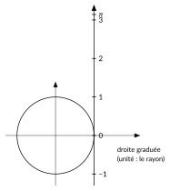
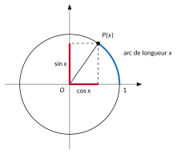
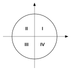
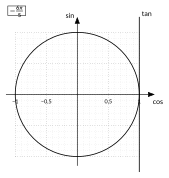

<!-- GÉNÉRÉ par typweb à partir des notes Typst : NE PAS ÉDITER (les modifications seraient écrasées). -->

::: {.callout-note title="Question Q4."}
Connaissant l’angle, comment calculer la hauteur et l’écart horizontal de la cabine, quel que soit l’angle ?
:::

::: {.callout-important title="Pourquoi passer des angles aux nombres réels ?"}
- **Ce qui varie, c’est le temps.** La hauteur de la cabine dépend du temps écoulé. Le temps n’est pas un angle : c’est un nombre réel, qui peut dépasser n’importe quelle valeur. Pour écrire « hauteur = fonction du temps », il faut un sinus qui accepte **n’importe quel réel**.
- **Les angles d’un triangle ne suffisent pas.** Dans un triangle rectangle, un angle aigu est compris entre $0°$ et $90°$. Une roue qui tourne dépasse un quart de tour, un demi-tour, un tour, et peut tourner dans l’autre sens.
- **Le radian fait le lien.** Si on enroule la droite réelle sur un cercle dont le rayon est l’unité, le réel $x$ est exactement la longueur de l’arc parcouru, donc l’angle en radians. Un réel *est* un angle (avec ses tours), et un angle en radians *est* un réel. Avec les degrés, ce lien n’existerait pas.
:::

::: {#activite-2-1 data-sorte="activite" data-num="2.1" data-page="16" data-phys="19" data-id="5UAA5.enrouler-droite-graduee" data-type="activite" data-tags="" .theo .theo-activite}
::: {.theo-head}
**Activité 2.1** — enrouler une droite graduée
:::

::: {.theo-body}
Dans un repère, on trace le cercle de centre $O$ dont le rayon est pris comme unité. Une droite graduée, de même unité, touche le cercle au point $(1 ; 0)$ ; son zéro est en ce point. On l’enroule autour du cercle : la partie positive dans le sens trigonométrique, la partie négative dans l’autre sens.

::: {.typst-fig}
{fig-alt="Figure du cours"}
:::

1. Où arrivent les graduations $1$, $2$ et $3$ ? Mesure au rapporteur l’angle correspondant.

   ::: {.rep-bloc}
   La graduation $1$ arrive au point situé à un arc de longueur 1 de $(1 ; 0)$, c’est-à-dire à $1$ rad $\approx 57{,}3°$ ; la graduation $2$ à environ $114{,}6°$ ; la graduation $3$ à environ $171{,}9°$, un peu avant le point $(-1 ; 0)$.
   :::
2. Où arrive la graduation $\pi$ ? Et la graduation $-1$ ?

   ::: {.rep-bloc}
   La graduation $\pi$ arrive au point $(-1 ; 0)$ : un demi-tour mesure $\pi$ rayons. La graduation $-1$ arrive à environ $-57{,}3°$, sous l’axe horizontal.
   :::
3. Où arrivent les graduations $2 \pi$ et $2 \pi + 1$ ?

   ::: {.rep-bloc}
   $2 \pi$ arrive en $(1 ; 0)$ (un tour complet) ; $2 \pi + 1$ arrive au même point que $1$.
   :::
:::
:::

::: {#definition-2-1 data-sorte="definition" data-num="2.1" data-page="17" data-phys="20" data-id="5UAA5.cercle-trigonometrique-2" data-type="definition" data-tags="" .theo .theo-definition}
::: {.theo-head}
**Définition 2.1** — cercle trigonométrique
:::

::: {.theo-body}
Le **cercle trigonométrique** est le cercle centré à l’origine $O$ d’un repère orthonormé, dont le **rayon est pris comme unité**. À tout réel $x$, on associe le point $P(x)$ du cercle obtenu en parcourant, à partir du point $(1 ; 0)$, un arc de longueur $|x|$, dans le sens trigonométrique si $x > 0$, dans l’autre sens si $x < 0$.
:::
:::

::: {.typst-fig}
{fig-alt="Figure du cours"}
:::

::: {#definition-2-2 data-sorte="definition" data-num="2.2" data-page="18" data-phys="21" data-id="5UAA5.cosinus-sinus-reel" data-type="definition" data-tags="" .theo .theo-definition}
::: {.theo-head}
**Définition 2.2** — cosinus et sinus d’un réel
:::

::: {.theo-body}
Soit $x$ un réel et $P(x)$ le point correspondant du cercle trigonométrique.

- Le **cosinus** de $x$, noté $\cos x$, est l’**abscisse** de $P(x)$.
- Le **sinus** de $x$, noté $\sin x$, est l’**ordonnée** de $P(x)$.
:::
:::

Trois conséquences se lisent directement sur le cercle :

- $P(x)$ est sur un cercle de rayon 1 : $-1 \leq \cos x \leq 1$ et $-1 \leq \sin x \leq 1$ ;
- $x$ et $x + 2 k \pi$ ($k \in \mathbb{Z}$) donnent le même point, donc $\cos(x + 2 k \pi) = \cos x$ et $\sin(x + 2 k \pi) = \sin x$ ;
- en particulier, $\cos 0 = 1$, $\sin 0 = 0$, $\cos \frac{\pi}{2} = 0$, $\sin \frac{\pi}{2} = 1$, $\cos \pi = -1$, $\sin \pi = 0$.

::: {#remarque-2-1 data-sorte="remarque" data-num="2.1" data-page="18" data-phys="21" data-id="5UAA5.rappel-3-e" data-type="remarque" data-tags="" .theo .theo-remarque}
::: {.theo-head}
**Remarque 2.1**
:::

::: {.theo-body}
Dans un triangle rectangle, pour un angle aigu $\alpha$ :

$$
\sin \alpha = \frac{\text{côté opposé}}{\text{hypoténuse}}, \quad \cos \alpha = \frac{\text{côté adjacent}}{\text{hypoténuse}}, \quad \tan \alpha = \frac{\text{côté opposé}}{\text{côté adjacent}}.
$$

Ces définitions n’ont de sens que pour $0° < \alpha < 90°$.
:::
:::

**Cohérence avec la 3^e^.** Pour $0 < x < \frac{\pi}{2}$, le triangle formé par $O$, $P(x)$ et sa projection sur l’axe horizontal est rectangle, d’hypoténuse $1$ (le rayon) : « côté adjacent / hypoténuse » vaut l’abscisse de $P(x)$, et « côté opposé / hypoténuse » son ordonnée. La nouvelle définition **prolonge** l’ancienne : elle donne les mêmes valeurs pour les angles aigus, et elle a un sens pour tous les réels.

::: {#remarque-2-2 data-sorte="remarque" data-num="2.2" data-page="18" data-phys="21" data-id="5UAA5.rayon-est-unite" data-type="remarque" data-tags="" .theo .theo-remarque}
::: {.theo-head}
**Remarque 2.2**
:::

::: {.theo-body}
$\sin x$ est une ordonnée **comptée en rayons**. Pour un cercle de rayon $r$, le point qui a tourné de $x$ radians à partir du rayon horizontal de droite est à la hauteur $r \sin x$ au-dessus du centre. Pour la roue du London Eye ($r = 60$ m), une cabine repérée par l’angle $\theta$ mesuré depuis le rayon horizontal de droite est à $60 \sin \theta$ mètres au-dessus de l’axe.
:::
:::

## Quadrants et signes

Les axes partagent le cercle en quatre **quadrants**, numérotés dans le sens trigonométrique.

::: {.grille style="--n:2"}
::: {.cellule}
::: {.tableau}
| **Quadrant** | **en degrés** | **en radians** |
|:---:|:---:|:---:|
| I | $]0° ; 90°[$ | $]0 ; \frac{\pi}{2}[$ |
| II | $]90° ; 180°[$ | $]\frac{\pi}{2} ; \pi[$ |
| III | $]180° ; 270°[$ | $]\pi ; \frac{3 \pi}{2}[$ |
| IV | $]270° ; 360°[$ | $]\frac{3 \pi}{2} ; 2 \pi[$ |
:::
:::

::: {.cellule}
::: {.typst-fig}
{fig-alt="Figure du cours"}
:::
:::
:::

::: {#activite-2-2 data-sorte="activite" data-num="2.2" data-page="19" data-phys="22" data-id="5UAA5.signe-se-lit-axes" data-type="activite" data-tags="" .theo .theo-activite}
::: {.theo-head}
**Activité 2.2** — le signe se lit sur les axes
:::

::: {.theo-body}
Sur la figure ci-dessus, indique dans chaque quadrant le signe de $\cos x$ (à droite ou à gauche de l’axe vertical ?) et celui de $\sin x$ (au-dessus ou en dessous de l’axe horizontal ?).

::: {.rep-bloc}
I : $\cos x > 0$, $\sin x > 0$. II : $\cos x < 0$, $\sin x > 0$. III : $\cos x < 0$, $\sin x < 0$. IV : $\cos x > 0$, $\sin x < 0$.
:::
:::
:::

::: {#exemple-2-1 data-sorte="exemple" data-num="2.1" data-page="19" data-phys="22" data-id="5UAA5.exm.004" data-type="exemple" data-tags="" .theo .theo-exemple}
::: {.theo-head}
**Exemple 2.1**
:::

::: {.theo-body}
On veut $\cos x$ et $\sin x$ pour $x = \frac{2 \pi}{9}$ ($40°$). On place $P(\frac{2 \pi}{9})$ sur un cercle quadrillé (gabarit), puis on lit ses coordonnées : $\cos(\frac{2 \pi}{9}) \approx 0{,}77$ et $\sin(\frac{2 \pi}{9}) \approx 0{,}64$. La calculatrice, réglée en radians, confirme : $\cos(\frac{2 \pi}{9}) = 0{,}766\ldots$ et $\sin(\frac{2 \pi}{9}) = 0{,}642\ldots$
:::
:::

::: {.callout-warning title="Piège"}
La calculatrice doit être en mode **radians** (RAD) quand $x$ est un réel. En mode degrés, $\sin 2$ donne le sinus de $2°$ ($\approx 0{,}035$) au lieu de $\sin 2 \approx 0{,}909$.
:::

::: {#exercice-2-1 data-sorte="exercice" data-num="2.1" data-page="19" data-phys="22" data-id="5UAA5.ex.017" data-type="exercice" data-tags="" .exo}
::: {.exo-tete}
[✎ Exercice 2.1]{.exo-titre} [[C1]{.exo-comp} ★☆☆]{.exo-meta}
:::

::: {.exo-corps}
Sur les gabarits, représente $P(x)$ pour chacun des réels suivants, puis **mesure** son cosinus et son sinus sur le quadrillage. Vérifie à la calculatrice.

::: {.grille style="--n:2"}
::: {.cellule}
::: {.typst-fig}
{fig-alt="Figure du cours"}
:::
:::

::: {.cellule}
::: {.typst-fig}
{fig-alt="Figure du cours"}
:::
:::

::: {.cellule}
::: {.typst-fig}
{fig-alt="Figure du cours"}
:::
:::

::: {.cellule}
::: {.typst-fig}
{fig-alt="Figure du cours"}
:::
:::
:::
:::
:::

::: {.aides}
::: {.panel-tabset}
## Indice 1 {.unlisted}

Relis la [définition du cercle trigonométrique](#definition-2-1) et celle du [cosinus et du sinus](#definition-2-2).

## Indice 2 {.unlisted}

Dans quel quadrant est chaque point ? Quels signes auront son abscisse et son ordonnée ?

## Indice 3 {.unlisted}

Convertis en degrés pour placer au rapporteur : $\frac{2 \pi}{9} = 40°$, $\frac{4 \pi}{5} = 144°$, $-\frac{6 \pi}{5} = -216°$, $-\frac{\pi}{9} = -20°$.

## Solution {.unlisted}

::: {.solution-classe}
$\frac{2 \pi}{9}$ : $\cos \approx 0{,}77$, $\sin \approx 0{,}64$. $\frac{4 \pi}{5}$ : $\cos \approx -0{,}81$, $\sin \approx 0{,}59$. \
 $-\frac{6 \pi}{5}$ : $\cos \approx -0{,}81$, $\sin \approx 0{,}59$ (même point que $\frac{4 \pi}{5}$ : $-\frac{6 \pi}{5} + 2 \pi = \frac{4 \pi}{5}$). $-\frac{\pi}{9}$ : $\cos \approx 0{,}94$, $\sin \approx -0{,}34$.
:::

## Pièges {.unlisted}

- Tourner dans le mauvais sens pour un réel négatif.
- Lire l’abscisse pour le sinus : le sinus est l’ordonnée.
:::
:::

::: {#exercice-2-2 data-sorte="exercice" data-num="2.2" data-page="20" data-phys="23" data-id="5UAA5.ex.018" data-type="exercice" data-tags="" .exo}
::: {.exo-tete}
[✎ Exercice 2.2]{.exo-titre} [[C1]{.exo-comp} ★☆☆]{.exo-meta}
:::

::: {.exo-corps}
Détermine le quadrant de chaque réel et donne le signe de son cosinus et de son sinus : $\frac{7 \pi}{5}$ ; $-\frac{\pi}{7}$ ; $\frac{3 \pi}{11}$ ; $\frac{15 \pi}{17}$.
:::
:::

::: {.aides}
::: {.panel-tabset}
## Indice 1 {.unlisted}

Relis le tableau « Quadrants et signes ».

## Indice 2 {.unlisted}

Entre quels multiples de $\frac{\pi}{2}$ se trouve $\frac{7 \pi}{5}$ ?

## Indice 3 {.unlisted}

Compare avec $\frac{\pi}{2}$, $\pi$, $\frac{3 \pi}{2}$ en mettant les fractions au même dénominateur : $\frac{7 \pi}{5} = \frac{14 \pi}{10}$ et $\frac{3 \pi}{2} = \frac{15 \pi}{10}$.

## Solution {.unlisted}

::: {.solution-classe}
$\frac{7 \pi}{5}$ : $\pi < \frac{7 \pi}{5} < \frac{3 \pi}{2}$, quadrant III : $\cos < 0$, $\sin < 0$. \
 $-\frac{\pi}{7}$ : $-\frac{\pi}{2} < -\frac{\pi}{7} < 0$, quadrant IV : $\cos > 0$, $\sin < 0$. \
 $\frac{3 \pi}{11}$ : $0 < \frac{3 \pi}{11} < \frac{\pi}{2}$, quadrant I : $\cos > 0$, $\sin > 0$. \
 $\frac{15 \pi}{17}$ : $\frac{\pi}{2} < \frac{15 \pi}{17} < \pi$, quadrant II : $\cos < 0$, $\sin > 0$.
:::

## Pièges {.unlisted}

- Comparer les numérateurs sans tenir compte des dénominateurs.
- Placer un réel négatif dans le quadrant I.
:::
:::

::: {#exercice-2-3 data-sorte="exercice" data-num="2.3" data-page="20" data-phys="23" data-id="5UAA5.ex.019" data-type="exercice" data-tags="" .exo}
::: {.exo-tete}
[✎ Exercice 2.3]{.exo-titre} [[C1]{.exo-comp} ★★☆]{.exo-meta}
:::

::: {.exo-corps}
Une cabine du London Eye est repérée par l’angle $\theta$ (en radians) mesuré depuis le rayon horizontal de droite, dans le sens trigonométrique. Calcule sa hauteur au-dessus de l’axe et au-dessus du sol pour $\theta = 1$, $\theta = 2{,}5$ et $\theta = 4$ (au cm). Situe chaque fois la cabine sur la roue.
:::
:::

::: {.aides}
::: {.panel-tabset}
## Indice 1 {.unlisted}

Relis la remarque « le rayon est l’unité ».

## Indice 2 {.unlisted}

$\sin \theta$ est une hauteur comptée en rayons : comment l’obtenir en mètres ?

## Indice 3 {.unlisted}

Hauteur au-dessus de l’axe : $60 \sin \theta$, calculatrice en radians. Au-dessus du sol : ajoute $75$.

## Solution {.unlisted}

::: {.solution-classe}
$h = 60 \sin \theta$ au-dessus de l’axe, $75 + 60 \sin \theta$ au-dessus du sol. \
 $\theta = 1$ : $h \approx 50{,}49$ m, soit $125{,}49$ m du sol (quadrant I, en haut à droite). \
 $\theta = 2{,}5$ : $h \approx 35{,}91$ m, soit $110{,}91$ m du sol (quadrant II, en haut à gauche). \
 $\theta = 4$ : $h \approx -45{,}41$ m, soit $29{,}59$ m du sol (quadrant III, en bas à gauche).
:::

## Pièges {.unlisted}

- Calculatrice en degrés : $\sin 1$ ne vaut pas $\sin 1°$.
- Oublier d’ajouter la hauteur de l’axe.
:::
:::

::: {.ae-lien}
[✔ S'autoévaluer sur cette section : test de 3 questions →](../autoeval.qmd#sections=sec-enroulement)
:::
