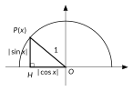
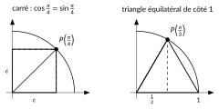
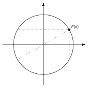
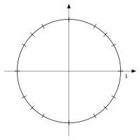

<!-- GÉNÉRÉ par typweb à partir des notes Typst : NE PAS ÉDITER (les modifications seraient écrasées). -->

::: {.callout-note title="Question Q4′."}
Peut-on obtenir des valeurs exactes ? Que deviennent la hauteur et l’écart horizontal pour des positions symétriques ?
:::

## Pythagore dans le cercle

::: {.typst-fig}
{fig-alt="Figure du cours"}
:::

Pour tout réel $x$, le point $P(x)$, sa projection $H$ sur l’axe horizontal et l’origine $O$ forment un triangle rectangle (aplati si $P(x)$ est sur un axe). Ses côtés de l’angle droit mesurent $|\cos x|$ et $|\sin x|$, son hypoténuse mesure $1$. Le théorème de Pythagore donne :

::: {#propriete-2-1 data-sorte="propriete" data-num="2.1" data-page="21" data-phys="24" data-id="5UAA5.relation-fondamentale" data-type="propriete" data-tags="" .theo .theo-propriete}
::: {.theo-head}
**Propriété 2.1** — relation fondamentale
:::

::: {.theo-body}
Pour tout réel $x$ : $\quad \cos^{2} x + \sin^{2} x = 1$.
:::
:::

On écrit $\cos^{2} x$ pour $(\cos x)^{2}$.

## Trois valeurs exactes

::: {#activite-2-3 data-sorte="activite" data-num="2.3" data-page="21" data-phys="24" data-id="5UAA5.carre-triangle-equilateral" data-type="activite" data-tags="" .theo .theo-activite}
::: {.theo-head}
**Activité 2.3** — le carré et le triangle équilatéral
:::

::: {.theo-body}
::: {.typst-fig}
{fig-alt="Figure du cours"}
:::

1. **Le carré.** Le point $P(\frac{\pi}{4})$ est sur la bissectrice du premier quadrant : ses deux coordonnées sont égales, notons-les $c$. À l’aide de la relation fondamentale, calcule $c$.

   ::: {.rep-bloc}
   $c^{2} + c^{2} = 1$, donc $c^{2} = \frac{1}{2}$ et $c = \sqrt{\frac{1}{2}} = \frac{1}{\sqrt{2}} = \frac{\sqrt{2}}{2}$ (positif dans le quadrant I). Donc $\cos \frac{\pi}{4} = \sin \frac{\pi}{4} = \frac{\sqrt{2}}{2} \approx 0{,}71$.
   :::
2. **Le triangle équilatéral.** Le triangle formé par $O$, $(1 ; 0)$ et $P(\frac{\pi}{3})$ a deux côtés de longueur 1 (des rayons) et un angle de $60°$ entre eux : il est équilatéral. Sa hauteur issue de $P(\frac{\pi}{3})$ coupe le côté horizontal en son milieu. Déduis-en $\cos \frac{\pi}{3}$, puis $\sin \frac{\pi}{3}$.

   ::: {.rep-bloc}
   La hauteur tombe au milieu du côté $[O ; (1 ; 0)]$ : $\cos \frac{\pi}{3} = \frac{1}{2}$. Puis $\sin^{2} \frac{\pi}{3} = 1 - \frac{1}{4} = \frac{3}{4}$, donc $\sin \frac{\pi}{3} = \frac{\sqrt{3}}{2} \approx 0{,}87$.
   :::
3. **Le point $P(\frac{\pi}{6})$** est le symétrique de $P(\frac{\pi}{3})$ par rapport à la bissectrice du premier quadrant (les arcs $\frac{\pi}{6}$ et $\frac{\pi}{3}$ se complètent pour faire $\frac{\pi}{2}$). Que deviennent les coordonnées ?

   ::: {.rep-bloc}
   La symétrie par rapport à la bissectrice échange abscisse et ordonnée : $\cos \frac{\pi}{6} = \frac{\sqrt{3}}{2}$ et $\sin \frac{\pi}{6} = \frac{1}{2}$.
   :::
4. Complète le tableau.

   ::: {.tableau}
   | $x$ | $0$ | $\frac{\pi}{6}$ | $\frac{\pi}{4}$ | $\frac{\pi}{3}$ | $\frac{\pi}{2}$ |
   |:---:|:---:|:---:|:---:|:---:|:---:|
   | $\cos x$ | [$1$]{.rep} | [$\frac{\sqrt{3}}{2}$]{.rep} | [$\frac{\sqrt{2}}{2}$]{.rep} | [$\frac{1}{2}$]{.rep} | [$0$]{.rep} |
   | $\sin x$ | [$0$]{.rep} | [$\frac{1}{2}$]{.rep} | [$\frac{\sqrt{2}}{2}$]{.rep} | [$\frac{\sqrt{3}}{2}$]{.rep} | [$1$]{.rep} |
   :::
:::
:::

::: {#remarque-2-3 data-sorte="remarque" data-num="2.3" data-page="21" data-phys="24" data-id="5UAA5.rem.002" data-type="remarque" data-tags="" .theo .theo-remarque}
::: {.theo-head}
**Remarque 2.3**
:::

::: {.theo-body}
Ce tableau ne s’apprend pas par cœur : il se **reconstruit** en quelques secondes. Le carré donne $\frac{\sqrt{2}}{2}$ ; le triangle équilatéral donne $\frac{1}{2}$ et $\frac{\sqrt{3}}{2}$ ; sur le cercle, on voit lequel est le cosinus (l’abscisse) et lequel est le sinus (l’ordonnée) : pour $\frac{\pi}{3}$, le point est plus haut qu’il n’est à droite, donc $\sin \frac{\pi}{3} > \cos \frac{\pi}{3}$.
:::
:::

## Ce que le cercle dit sans formule

::: {#activite-2-4 data-sorte="activite" data-num="2.4" data-page="22" data-phys="25" data-id="5UAA5.symetries-cercle" data-type="activite" data-tags="" .theo .theo-activite}
::: {.theo-head}
**Activité 2.4** — les symétries du cercle
:::

::: {.theo-body}
On a placé $P(x)$ pour $x = \frac{\pi}{6}$.

::: {.typst-fig}
{fig-alt="Figure du cours"}
:::

1. Place le symétrique de $P(\frac{\pi}{6})$ par rapport à l’axe vertical. Quel réel de $[0 ; 2 \pi[$ lui correspond ? Quelles sont ses coordonnées ?

   ::: {.rep-bloc}
   Le point $P(\pi - \frac{\pi}{6}) = P(\frac{5 \pi}{6})$ : même hauteur, abscisse opposée. $\cos(\frac{5 \pi}{6}) = -\frac{\sqrt{3}}{2}$, $\sin(\frac{5 \pi}{6}) = \frac{1}{2}$.
   :::
2. Même question pour la symétrie par rapport à l’axe horizontal, puis par rapport à l’origine.

   ::: {.rep-bloc}
   Axe horizontal : $P(-\frac{\pi}{6})$, aussi noté $P(\frac{11 \pi}{6})$ ; $\cos = \frac{\sqrt{3}}{2}$, $\sin = -\frac{1}{2}$. \
   Origine : $P(\pi + \frac{\pi}{6}) = P(\frac{7 \pi}{6})$ ; $\cos = -\frac{\sqrt{3}}{2}$, $\sin = -\frac{1}{2}$.
   :::
3. Les mêmes symétries fonctionnent-elles pour n’importe quel $x$ ? Écris ce que deviennent cosinus et sinus.

   ::: {.rep-bloc}
   Oui : voir la propriété ci-dessous. La symétrie d’axe vertical correspond à l’arc parcouru dans l’autre sens à partir de $(-1 ; 0)$, c’est-à-dire à $\pi - x$ ; d’axe horizontal, à $-x$ ; de centre $O$, à un demi-tour de plus, $\pi + x$.
   :::
:::
:::

::: {#propriete-2-2 data-sorte="propriete" data-num="2.2" data-page="22" data-phys="25" data-id="5UAA5.angles-associes-lus-cercle" data-type="propriete" data-tags="" .theo .theo-propriete}
::: {.theo-head}
**Propriété 2.2** — angles associés, lus sur le cercle
:::

::: {.theo-body}
Pour tout réel $x$ :

::: {.tableau}
| **symétrie** | **réel associé** | **cosinus** | **sinus** |
|:---:|:---:|:---:|:---:|
| axe horizontal | $-x$ | $\cos(-x) = \cos x$ | $\sin(-x) = -\sin x$ |
| axe vertical | $\pi - x$ | $\cos(\pi - x) = -\cos x$ | $\sin(\pi - x) = \sin x$ |
| origine | $\pi + x$ | $\cos(\pi + x) = -\cos x$ | $\sin(\pi + x) = -\sin x$ |
:::
:::
:::

::: {#remarque-2-4 data-sorte="remarque" data-num="2.4" data-page="22" data-phys="25" data-id="5UAA5.rem.003" data-type="remarque" data-tags="" .theo .theo-remarque}
::: {.theo-head}
**Remarque 2.4**
:::

::: {.theo-body}
Aucune ligne de ce tableau n’est à mémoriser : on la retrouve en dessinant $P(x)$ et son symétrique, puis en comparant leurs coordonnées.
:::
:::

::: {#exemple-2-2 data-sorte="exemple" data-num="2.2" data-page="23" data-phys="26" data-id="5UAA5.exm.005" data-type="exemple" data-tags="" .theo .theo-exemple}
::: {.theo-head}
**Exemple 2.2**
:::

::: {.theo-body}
Calculer $\sin(\frac{5 \pi}{6})$, $\cos(\frac{4 \pi}{3})$ et $\cos(-\frac{\pi}{4})$.

- $\frac{5 \pi}{6} = \pi - \frac{\pi}{6}$ : $P(\frac{5 \pi}{6})$ est le symétrique de $P(\frac{\pi}{6})$ par rapport à l’axe vertical ; même ordonnée, donc $\sin(\frac{5 \pi}{6}) = \sin \frac{\pi}{6} = \frac{1}{2}$.
- $\frac{4 \pi}{3} = \pi + \frac{\pi}{3}$ : $P(\frac{4 \pi}{3})$ est le symétrique de $P(\frac{\pi}{3})$ par rapport à l’origine ; abscisse opposée, donc $\cos(\frac{4 \pi}{3}) = -\cos \frac{\pi}{3} = -\frac{1}{2}$.
- $P(-\frac{\pi}{4})$ est le symétrique de $P(\frac{\pi}{4})$ par rapport à l’axe horizontal ; même abscisse, donc $\cos(-\frac{\pi}{4}) = \frac{\sqrt{2}}{2}$.
:::
:::

::: {#activite-2-5 data-sorte="activite" data-num="2.5" data-page="23" data-phys="26" data-id="5UAA5.seize-points-remarquables" data-type="activite" data-tags="" .theo .theo-activite}
::: {.theo-head}
**Activité 2.5** — seize points remarquables
:::

::: {.theo-body}
À partir du tableau et des symétries, place sur le cercle les points $P(x)$ pour tous les multiples de $\frac{\pi}{6}$ et de $\frac{\pi}{4}$ de l’intervalle $[0 ; 2 \pi[$, et note à côté de chacun ses coordonnées exactes.

::: {.typst-fig}
{fig-alt="Figure du cours"}
:::
:::
:::

::: {#exercice-2-4 data-sorte="exercice" data-num="2.4" data-page="23" data-phys="26" data-id="5UAA5.ex.020" data-type="exercice" data-tags="maison" .exo}
::: {.exo-tete}
[✎ Exercice 2.4]{.exo-titre} [⟵ à faire à la maison]{.exo-maison} [[C1]{.exo-comp} ★☆☆]{.exo-meta}
:::

::: {.exo-corps}
Donne la valeur exacte de $\cos x$ et $\sin x$ en dessinant $P(x)$ et, s’il le faut, la symétrie utilisée : $-2 \pi$ ; $\frac{7 \pi}{6}$ ; $\frac{3 \pi}{4}$ ; $-\frac{2 \pi}{3}$ ; $3 \pi$.
:::
:::

::: {.aides}
::: {.panel-tabset}
## Indice 1 {.unlisted}

Relis la [propriété des angles associés](#propriete-2-2) et le tableau des valeurs remarquables.

## Indice 2 {.unlisted}

Quel point du premier quadrant a la même position, à une symétrie près ?

## Indice 3 {.unlisted}

$\frac{7 \pi}{6} = \pi + \frac{\pi}{6}$ : symétrique de $P(\frac{\pi}{6})$ par rapport à l’origine. Change les deux signes.

## Solution {.unlisted}

$-2 \pi$ : même point que $0$ ; $\cos = 1$, $\sin = 0$. \
 $\frac{7 \pi}{6} = \pi + \frac{\pi}{6}$ (symétrie de centre $O$) : $\cos = -\frac{\sqrt{3}}{2}$, $\sin = -\frac{1}{2}$. \
 $\frac{3 \pi}{4} = \pi - \frac{\pi}{4}$ (symétrie d’axe vertical) : $\cos = -\frac{\sqrt{2}}{2}$, $\sin = \frac{\sqrt{2}}{2}$. \
 $-\frac{2 \pi}{3}$ : symétrique de $P(\frac{2 \pi}{3})$ par rapport à l’axe horizontal, et $\frac{2 \pi}{3} = \pi - \frac{\pi}{3}$ ; $\cos = -\frac{1}{2}$, $\sin = -\frac{\sqrt{3}}{2}$. \
 $3 \pi = 2 \pi + \pi$ : même point que $\pi$ ; $\cos = -1$, $\sin = 0$.

## Pièges {.unlisted}

- Oublier le signe : regarde où est le point.
- Confondre $\frac{\sqrt{3}}{2}$ et $\frac{1}{2}$ : pour $\frac{\pi}{6}$, le point est plus à droite qu’il n’est haut.
:::
:::

::: {#exercice-2-5 data-sorte="exercice" data-num="2.5" data-page="23" data-phys="26" data-id="5UAA5.ex.021" data-type="exercice" data-tags="maison" .exo}
::: {.exo-tete}
[✎ Exercice 2.5]{.exo-titre} [⟵ à faire à la maison]{.exo-maison} [[C8]{.exo-comp} ★★☆]{.exo-meta}
:::

::: {.exo-corps}
Même consigne pour : $\frac{4 \pi}{3}$ ; $-\frac{2 \pi}{3}$ ; $-\frac{5 \pi}{4}$ ; $\frac{5 \pi}{2}$. Quels réels de la liste ont les mêmes nombres trigonométriques ? Pourquoi ?
:::
:::

::: {.aides}
::: {.panel-tabset}
## Indice 1 {.unlisted}

Relis la [propriété des angles associés](#propriete-2-2) et les [mesures d’un angle orienté](../ch1-tourner-angles-arcs/4-angles-orientes-plusieurs-tours.qmd#definition-1-3).

## Indice 2 {.unlisted}

Deux réels qui diffèrent d’un tour ont-ils les mêmes nombres trigonométriques ?

## Indice 3 {.unlisted}

Ramène chaque réel dans $[0 ; 2 \pi[$, puis utilise une symétrie.

## Solution {.unlisted}

$\frac{4 \pi}{3} = \pi + \frac{\pi}{3}$ : $\cos = -\frac{1}{2}$, $\sin = -\frac{\sqrt{3}}{2}$. \
 $-\frac{2 \pi}{3}$ : même point que $\frac{4 \pi}{3}$ ($-\frac{2 \pi}{3} + 2 \pi = \frac{4 \pi}{3}$) : $\cos = -\frac{1}{2}$, $\sin = -\frac{\sqrt{3}}{2}$. \
 $-\frac{5 \pi}{4}$ : même point que $\frac{3 \pi}{4}$ ($-\frac{5 \pi}{4} + 2 \pi = \frac{3 \pi}{4}$) : $\cos = -\frac{\sqrt{2}}{2}$, $\sin = \frac{\sqrt{2}}{2}$. \
 $\frac{5 \pi}{2} = 2 \pi + \frac{\pi}{2}$ : même point que $\frac{\pi}{2}$ : $\cos = 0$, $\sin = 1$. \
 $\frac{4 \pi}{3}$ et $-\frac{2 \pi}{3}$ diffèrent de $2 \pi$ : ils sont représentés par le même point.

## Pièges {.unlisted}

- Oublier d’ajouter un tour à $-\frac{2 \pi}{3}$ avant de lire le cercle.
- Croire que deux réels opposés ont les mêmes nombres trigonométriques : seul le cosinus est le même.
:::
:::

::: {#exercice-2-6 data-sorte="exercice" data-num="2.6" data-page="23" data-phys="26" data-id="5UAA5.ex.022" data-type="exercice" data-tags="" .exo}
::: {.exo-tete}
[✎ Exercice 2.6]{.exo-titre} [[C8]{.exo-comp} ★★☆]{.exo-meta}
:::

::: {.exo-corps}
1. On sait que $\sin x = 0{,}6$ et que $P(x)$ est dans le deuxième quadrant. Calcule $\cos x$ sans calculatrice.
2. On sait que $\cos x = 0{,}28$ et que $P(x)$ est dans le quatrième quadrant. Calcule $\sin x$.
:::
:::

::: {.aides}
::: {.panel-tabset}
## Indice 1 {.unlisted}

Utilise la [relation fondamentale](#propriete-2-1) $\cos^{2} x + \sin^{2} x = 1$.

## Indice 2 {.unlisted}

La relation donne $\cos^{2} x$. Combien de valeurs de $\cos x$ ont ce carré ? Laquelle choisir ?

## Indice 3 {.unlisted}

$\cos^{2} x = 1 - 0{,}36$ ; puis le signe se lit sur le quadrant.

## Solution {.unlisted}

::: {.solution-classe}
+ $\cos^{2} x = 1 - \sin^{2} x = 1 - 0{,}36 = 0{,}64$, donc $\cos x = 0{,}8$ ou $\cos x = -0{,}8$. Dans le deuxième quadrant, $\cos x < 0$ : $\cos x = -0{,}8$.

1. $\sin^{2} x = 1 - 0{,}0784 = 0{,}9216$, donc $\sin x = \pm 0{,}96$. Dans le quatrième quadrant, $\sin x < 0$ : $\sin x = -0{,}96$.
:::

## Pièges {.unlisted}

- Écrire $\cos x = 1 - \sin x$ : la relation porte sur les carrés.
- Oublier le signe imposé par le quadrant.
:::
:::

::: {#exercice-2-7 data-sorte="exercice" data-num="2.7" data-page="24" data-phys="27" data-id="5UAA5.ex.023" data-type="exercice" data-tags="maison" .exo}
::: {.exo-tete}
[✎ Exercice 2.7]{.exo-titre} [⟵ à faire à la maison]{.exo-maison} [[C8]{.exo-comp} ★★★]{.exo-meta}
:::

::: {.exo-corps}
Sans calculatrice, range dans l’ordre croissant : $\sin 1$, $\sin 2$, $\sin 3$, $\sin 4$. Justifie à l’aide du cercle.
:::
:::

::: {.aides}
::: {.panel-tabset}
## Indice 1 {.unlisted}

Relis la [propriété des angles associés](#propriete-2-2) : $\sin(\pi - x) = \sin x$.

## Indice 2 {.unlisted}

Dans quel quadrant est chaque point $P(1)$, $P(2)$, $P(3)$, $P(4)$ ($\pi \approx 3{,}14$) ?

## Indice 3 {.unlisted}

Ramène $\sin 2$ et $\sin 3$ à des sinus de réels de $[0 ; \frac{\pi}{2}]$ : $\sin 2 = \sin(\pi - 2)$, $\sin 3 = \sin(\pi - 3)$.

## Solution {.unlisted}

$P(1)$ (environ $57°$) et $P(2)$ (environ $115°$) sont dans le haut du cercle ; $2 = \pi - (\pi - 2)$ avec $\pi - 2 \approx 1{,}14$, donc $\sin 2 = \sin(\pi - 2) = \sin 1{,}14$, et $\sin$ croît sur $[0 ; \frac{\pi}{2}]$ (le point monte) : $\sin 1 < \sin 1{,}14 = \sin 2$. $P(3)$ est juste avant $(-1 ; 0)$ : $\sin 3 = \sin(\pi - 3) = \sin 0{,}14$, petit et positif. $P(4)$ est dans le quadrant III : $\sin 4 < 0$. Donc $\sin 4 < \sin 3 < \sin 1 < \sin 2$.

## Pièges {.unlisted}

- Croire que $\sin$ augmente avec $x$ sur tout $[0 ; 4]$.
- Oublier que $\sin 4 < 0$.
:::
:::

::: {.ae-lien}
[✔ S'autoévaluer sur cette section : test de 5 questions →](../autoeval.qmd#sections=sec-valeurs-remarquables)
:::
