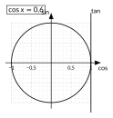
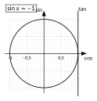
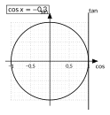
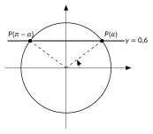

<!-- GÉNÉRÉ par typweb à partir des notes Typst : NE PAS ÉDITER (les modifications seraient écrasées). -->

::: {.callout-note title="Question Q5."}
À quel(s) instant(s) la cabine est-elle à une hauteur donnée ?
:::

::: {#activite-2-6 data-sorte="activite" data-num="2.6" data-page="24" data-phys="27" data-id="5UAA5.combien-points" data-type="activite" data-tags="" .theo .theo-activite}
::: {.theo-head}
**Activité 2.6** — combien de points ?
:::

::: {.theo-body}
Sur chaque gabarit, représente les réels $x$ (entre $0$ et $2 \pi$) dont…

::: {.grille style="--n:4"}
::: {.cellule}
::: {.typst-fig}
{fig-alt="Figure du cours"}
:::
:::

::: {.cellule}
::: {.typst-fig}
{fig-alt="Figure du cours"}
:::
:::

::: {.cellule}
::: {.typst-fig}
{fig-alt="Figure du cours"}
:::
:::

::: {.cellule}
::: {.typst-fig}
{fig-alt="Figure du cours"}
:::
:::
:::

Combien de points trouves-tu chaque fois ? Comment les trouver ?

::: {.rep-bloc}
On trace la droite $x = a$ (cosinus) ou $y = a$ (sinus), et on prend ses points d’intersection avec le cercle. Deux points dans chaque cas, sauf pour $\sin x = -1$ : la droite $y = -1$ touche le cercle en un seul point, $P(\frac{3 \pi}{2})$.
:::
:::
:::

::: {#activite-2-7 data-sorte="activite" data-num="2.7" data-page="24" data-phys="27" data-id="5UAA5.calculatrice-deux-reponses" data-type="activite" data-tags="" .theo .theo-activite}
::: {.theo-head}
**Activité 2.7** — une calculatrice, deux réponses
:::

::: {.theo-body}
On cherche tous les réels $x$ tels que $\sin x = 0{,}6$.

1. La touche $\sin^{-1}$ (ou « asin ») de la calculatrice, en radians, affiche $\sin^{-1}(0{,}6) \approx 0{,}6435$. Vérifie que $\sin 0{,}6435 \approx 0{,}6$.
2. Place $P(0{,}6435)$ et trace la droite $y = 0{,}6$. Combien de points du cercle ont cette ordonnée ? Quel réel de $[0 ; 2 \pi[$ correspond au second ?

   ::: {.typst-fig}
   {fig-alt="Figure du cours"}
   :::

   ::: {.rep-bloc}
   Deux points, symétriques par rapport à l’axe vertical. Le second correspond à $\pi - 0{,}6435 \approx 2{,}4981$.
   :::
3. Donne tous les réels $x$ tels que $\sin x = 0{,}6$.

   ::: {.rep-bloc}
   On ajoute un nombre quelconque de tours : $x \approx 0{,}6435 + 2 k \pi$ ou $x \approx 2{,}4981 + 2 k \pi$, avec $k \in \mathbb{Z}$.
   :::
:::
:::

La calculatrice donne une solution, le cercle donne la deuxième, les tours donnent toutes les autres. Pour le cosinus, la droite est verticale et les deux points sont symétriques par rapport à l’axe horizontal.

::: {#propriete-2-3 data-sorte="propriete" data-num="2.3" data-page="25" data-phys="28" data-id="5UAA5.equations-2" data-type="propriete" data-tags="" .theo .theo-propriete}
::: {.theo-head}
**Propriété 2.3** — équations $\sin x = a$ et $\cos x = a$
:::

::: {.theo-body}
Soit $-1 \leq a \leq 1$.

- $\sin x = a$ ssi $x = \alpha + 2 k \pi$ ou $x = \pi - \alpha + 2 k \pi$ ($k \in \mathbb{Z}$), où $\alpha = \sin^{-1}(a)$, réel de $[-\frac{\pi}{2} ; \frac{\pi}{2}]$ donné par la calculatrice ;
- $\cos x = a$ ssi $x = \alpha + 2 k \pi$ ou $x = -\alpha + 2 k \pi$ ($k \in \mathbb{Z}$), où $\alpha = \cos^{-1}(a)$, réel de $[0 ; \pi]$ donné par la calculatrice.

Si $a > 1$ ou $a < -1$, l’équation n’a pas de solution.
:::
:::

::: {#exemple-2-3 data-sorte="exemple" data-num="2.3" data-page="25" data-phys="28" data-id="5UAA5.valeur-remarquable" data-type="exemple" data-tags="" .theo .theo-exemple}
::: {.theo-head}
**Exemple 2.3** — valeur remarquable
:::

::: {.theo-body}
Résoudre $\sin x = \frac{1}{2}$. Le tableau donne $\sin \frac{\pi}{6} = \frac{1}{2}$ ; le second point est $P(\pi - \frac{\pi}{6}) = P(\frac{5 \pi}{6})$. Solutions : $x = \frac{\pi}{6} + 2 k \pi$ ou $x = \frac{5 \pi}{6} + 2 k \pi$ ($k \in \mathbb{Z}$). Dans $[0 ; 2 \pi]$ : $\frac{\pi}{6}$ et $\frac{5 \pi}{6}$.
:::
:::

::: {#exemple-2-4 data-sorte="exemple" data-num="2.4" data-page="25" data-phys="28" data-id="5UAA5.calculatrice-intervalle" data-type="exemple" data-tags="" .theo .theo-exemple}
::: {.theo-head}
**Exemple 2.4** — avec la calculatrice, dans un intervalle
:::

::: {.theo-body}
Résoudre $\cos x = -0{,}3$ dans $[-2 \pi ; 2 \pi]$. La calculatrice donne $\alpha = \cos^{-1}(-0{,}3) \approx 1{,}8755$. Solutions : $x \approx \pm 1{,}8755 + 2 k \pi$. On garde celles de $[-2 \pi ; 2 \pi]$ ($2 \pi \approx 6{,}2832$) : $k = 0$ donne $1{,}8755$ et $-1{,}8755$ ; $k = 1$ donne $-1{,}8755 + 2 \pi \approx 4{,}4077$ ; $k = -1$ donne $1{,}8755 - 2 \pi \approx -4{,}4077$. Quatre solutions : $-4{,}4077$ ; $-1{,}8755$ ; $1{,}8755$ ; $4{,}4077$.
:::
:::

::: {.callout-warning title="Piège"}
Oublier la deuxième solution : la calculatrice n’en donne qu’une. Toujours dessiner la droite sur le cercle pour voir combien de points il y a.
:::

::: {#exercice-2-8 data-sorte="exercice" data-num="2.8" data-page="26" data-phys="29" data-id="5UAA5.ex.024" data-type="exercice" data-tags="" .exo}
::: {.exo-tete}
[✎ Exercice 2.8]{.exo-titre} [[A5]{.exo-comp} ★★☆]{.exo-meta}
:::

::: {.exo-corps}
Une cabine du London Eye est repérée par l’angle $\theta$ mesuré depuis le rayon horizontal de droite ; sa hauteur au-dessus de l’axe vaut $60 \sin \theta$. Pour quels angles $\theta$ de $[0 ; 2 \pi[$ la cabine est-elle à 30 m au-dessus de l’axe ? À 45 m en dessous ?
:::
:::

::: {.aides}
::: {.panel-tabset}
## Indice 1 {.unlisted}

Relis la [propriété des équations sin x = a](#propriete-2-3).

## Indice 2 {.unlisted}

Quelle équation en $\sin \theta$ obtiens-tu si $60 \sin \theta = 30$ ?

## Indice 3 {.unlisted}

Divise par 60 : $\sin \theta = \frac{1}{2}$ (valeur remarquable), puis $\sin \theta = -0{,}75$ (calculatrice).

## Solution {.unlisted}

::: {.solution-classe}
$60 \sin \theta = 30$ ssi $\sin \theta = \frac{1}{2}$ : $\theta = \frac{\pi}{6}$ ou $\theta = \frac{5 \pi}{6}$. \
 $60 \sin \theta = -45$ ssi $\sin \theta = -0{,}75$ : la calculatrice donne $\alpha \approx -0{,}8481$, hors de $[0 ; 2 \pi[$ ; on ajoute un tour : $\alpha + 2 \pi \approx 5{,}4351$. Le second point : $\pi - \alpha \approx 3{,}9897$. Solutions : $\theta \approx 3{,}9897$ et $\theta \approx 5{,}4351$.
:::

## Pièges {.unlisted}

- Oublier d’ajouter $2 \pi$ à une solution négative.
- Confondre 45 m « en dessous » de l’axe avec $+45$.
:::
:::

::: {#exercice-2-9 data-sorte="exercice" data-num="2.9" data-page="26" data-phys="29" data-id="5UAA5.ex.025" data-type="exercice" data-tags="maison" .exo}
::: {.exo-tete}
[✎ Exercice 2.9]{.exo-titre} [⟵ à faire à la maison]{.exo-maison} [[A5]{.exo-comp} ★★★]{.exo-meta}
:::

::: {.exo-corps}
Résous $\cos x = 0{,}25$ dans $[0 ; 4 \pi]$. Combien de solutions y a-t-il ? Explique le nombre de solutions sans les calculer.
:::
:::

::: {.aides}
::: {.panel-tabset}
## Indice 1 {.unlisted}

Relis la [propriété des équations cos x = a](#propriete-2-3).

## Indice 2 {.unlisted}

Combien de tours compte l’intervalle $[0 ; 4 \pi]$ ? Combien de points par tour ?

## Indice 3 {.unlisted}

$\alpha \approx 1{,}3181$ ; solutions $\pm \alpha + 2 k \pi$ ; garde celles de $[0 ; 4 \pi]$.

## Solution {.unlisted}

$\alpha = \cos^{-1}(0{,}25) \approx 1{,}3181$. Solutions : $x \approx \pm 1{,}3181 + 2 k \pi$. Dans $[0 ; 4 \pi]$ : $1{,}3181$ ; $2 \pi - 1{,}3181 \approx 4{,}9651$ ; $1{,}3181 + 2 \pi \approx 7{,}6013$ ; $4 \pi - 1{,}3181 \approx 11{,}2483$. Quatre solutions : l’intervalle $[0 ; 4 \pi]$ correspond à deux tours, et à chaque tour la droite $x = 0{,}25$ coupe le cercle en deux points.

## Pièges {.unlisted}

- S’arrêter au premier tour.
- Oublier $-\alpha + 4 \pi$.
:::
:::

::: {.ae-lien}
[✔ S'autoévaluer sur cette section : test de 4 questions →](../autoeval.qmd#sections=sec-equations-sin-cos)
:::
