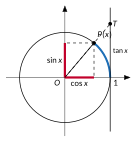
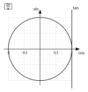

<!-- GÉNÉRÉ par typweb à partir des notes Typst : NE PAS ÉDITER (les modifications seraient écrasées). -->

::: {.callout-note title="Question Q5′."}
*Détour.* Quelle est l’inclinaison du bras qui porte la cabine ?
:::

L’inclinaison d’une droite se mesure par sa **pente** : de combien elle monte quand on avance de 1 vers la droite. La droite $O P(x)$ passe par l’origine et par le point $(\cos x ; \sin x)$ : quand on avance de $\cos x$, elle monte de $\sin x$.

::: {#definition-2-3 data-sorte="definition" data-num="2.3" data-page="26" data-phys="29" data-id="5UAA5.tangente-reel" data-type="definition" data-tags="" .theo .theo-definition}
::: {.theo-head}
**Définition 2.3** — tangente d’un réel
:::

::: {.theo-body}
La **tangente** de $x$, notée $\tan x$, est la **pente** de la droite $O P(x)$ :

$$
\tan x = \frac{\sin x}{\cos x},
$$

définie lorsque $\cos x \neq 0$, c’est-à-dire pour $x \neq \frac{\pi}{2} + k \pi$ ($k \in \mathbb{Z}$).
:::
:::

::: {.grille style="--n:2"}
::: {.cellule}
**L’axe des tangentes.** La droite $O P(x)$ coupe la droite verticale d’équation $x = 1$ en un point $T$. Pour aller de $O$ à $T$, on avance de 1 : on monte donc de la pente. L’ordonnée de $T$ est $\tan x$. Cette droite verticale est l’**axe des tangentes** ; elle est tracée sur les gabarits.

Pour $x = \frac{\pi}{2} + k \pi$, la droite $O P(x)$ est verticale : elle n’a pas de pente, et elle ne coupe pas l’axe des tangentes. C’est pourquoi $\tan x$ n’existe pas pour ces réels.
:::

::: {.cellule}
::: {.typst-fig}
{fig-alt="Figure du cours"}
:::
:::
:::

::: {#activite-2-8 data-sorte="activite" data-num="2.8" data-page="26" data-phys="29" data-id="5UAA5.valeurs-signes-tangente" data-type="activite" data-tags="" .theo .theo-activite}
::: {.theo-head}
**Activité 2.8** — valeurs et signes de la tangente
:::

::: {.theo-body}
1. À l’aide du tableau des valeurs remarquables, complète.

   ::: {.tableau}
   | $x$ | $0$ | $\frac{\pi}{6}$ | $\frac{\pi}{4}$ | $\frac{\pi}{3}$ | $\frac{\pi}{2}$ |
   |:---:|:---:|:---:|:---:|:---:|:---:|
   | $\tan x$ | [$0$]{.rep} | [$\frac{1}{\sqrt{3}} = \frac{\sqrt{3}}{3}$]{.rep} | [$1$]{.rep} | [$\sqrt{3}$]{.rep} | [n’existe pas]{.rep} |
   :::
2. Quel est le signe de $\tan x$ dans chaque quadrant ? Justifie par le signe de la pente de $O P(x)$.

   ::: {.rep-bloc}
   Quadrants I et III : la droite $O P(x)$ monte vers la droite, $\tan x > 0$. Quadrants II et IV : elle descend, $\tan x < 0$. On le retrouve par le quotient : $\sin x$ et $\cos x$ de même signe ou de signes contraires.
   :::
3. Pourquoi $\tan(x + \pi) = \tan x$ ?

   ::: {.rep-bloc}
   $P(x + \pi)$ est le symétrique de $P(x)$ par rapport à l’origine : il est sur la même droite passant par $O$, qui a donc la même pente.
   :::
:::
:::

::: {#exercice-2-10 data-sorte="exercice" data-num="2.10" data-page="27" data-phys="30" data-id="5UAA5.ex.026" data-type="exercice" data-tags="" .exo}
::: {.exo-tete}
[✎ Exercice 2.10]{.exo-titre} [[C1]{.exo-comp} ★☆☆]{.exo-meta}
:::

::: {.exo-corps}
Donne la valeur exacte de $\tan x$ pour $x = \frac{3 \pi}{4}$ ; $\frac{7 \pi}{6}$ ; $-\frac{\pi}{3}$ ; $\frac{3 \pi}{2}$ ; $\frac{5 \pi}{3}$.
:::
:::

::: {.aides}
::: {.panel-tabset}
## Indice 1 {.unlisted}

Relis la [définition de la tangente](#definition-2-3) : $\tan x = \frac{\sin x}{\cos x}$.

## Indice 2 {.unlisted}

Pour quel réel de la liste la droite $O P(x)$ est-elle verticale ?

## Indice 3 {.unlisted}

Calcule d’abord $\cos x$ et $\sin x$ exacts, puis le quotient.

## Solution {.unlisted}

::: {.solution-classe}
$\tan(\frac{3 \pi}{4}) = \frac{\sqrt{2}}{2} : (-\frac{\sqrt{2}}{2}) = -1$. \
 $\tan(\frac{7 \pi}{6}) = (-\frac{1}{2}) : (-\frac{\sqrt{3}}{2}) = \frac{1}{\sqrt{3}} = \frac{\sqrt{3}}{3}$. \
 $\tan(-\frac{\pi}{3}) = (-\frac{\sqrt{3}}{2}) : \frac{1}{2} = -\sqrt{3}$. \
 $\tan(\frac{3 \pi}{2})$ n’existe pas, car $\cos(\frac{3 \pi}{2}) = 0$. \
 $\tan(\frac{5 \pi}{3}) = (-\frac{\sqrt{3}}{2}) : \frac{1}{2} = -\sqrt{3}$.
:::

## Pièges {.unlisted}

- Calculer $\cos \frac{x}{\sin} x$.
- Écrire $\tan(\frac{3 \pi}{2}) = 0$ : elle n’existe pas.
:::
:::

::: {#exercice-2-11 data-sorte="exercice" data-num="2.11" data-page="27" data-phys="30" data-id="5UAA5.ex.027" data-type="exercice" data-tags="" .exo}
::: {.exo-tete}
[✎ Exercice 2.11]{.exo-titre} [[C1]{.exo-comp} ★★☆]{.exo-meta}
:::

::: {.exo-corps}
Sur le gabarit, représente $P(\frac{2 \pi}{9})$ et lis $\tan(\frac{2 \pi}{9})$ sur l’axe des tangentes. Vérifie à la calculatrice.

::: {.typst-fig}
{fig-alt="Figure du cours"}
:::
:::
:::

::: {.aides}
::: {.panel-tabset}
## Indice 1 {.unlisted}

Relis le paragraphe « L’axe des tangentes ».

## Indice 2 {.unlisted}

Où la droite $O P(\frac{2 \pi}{9})$ coupe-t-elle la droite verticale $x = 1$ ?

## Indice 3 {.unlisted}

Trace la demi-droite $[O P)$ jusqu’à l’axe des tangentes et lis la hauteur du point d’intersection.

## Solution {.unlisted}

::: {.solution-classe}
La droite $O P(\frac{2 \pi}{9})$ coupe l’axe des tangentes à la hauteur $0{,}84$ environ : $\tan(\frac{2 \pi}{9}) \approx 0{,}84$ (calculatrice : $0{,}839\ldots$).
:::

## Pièges {.unlisted}

- Lire l’ordonnée de $P$ (c’est le sinus).
- Calculatrice en degrés.
:::
:::

::: {.ae-lien}
[✔ S'autoévaluer sur cette section : test de 2 questions →](../autoeval.qmd#sections=sec-tangente)
:::
