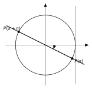

<!-- GÉNÉRÉ par typweb à partir des notes Typst : NE PAS ÉDITER (les modifications seraient écrasées). -->

::: {.callout-note title="Question Q5."}
(suite) Toutes les solutions, sur un intervalle de temps donné.
:::

Pour $\tan x = a$, on trace la droite de pente $a$ passant par $O$ : elle coupe le cercle en deux points **diamétralement opposés**, qui correspondent à des réels distants de $\pi$.

::: {.grille style="--n:2"}
::: {.cellule}
::: {.typst-fig}
{fig-alt="Figure du cours"}
:::
:::

::: {.cellule}
::: {#propriete-2-4 data-sorte="propriete" data-num="2.4" data-page="28" data-phys="31" data-id="5UAA5.equation-tan" data-type="propriete" data-tags="" .theo .theo-propriete}
::: {.theo-head}
**Propriété 2.4** — équation $\tan x = a$
:::

::: {.theo-body}
Pour tout réel $a$ : $\tan x = a$ ssi $x = \alpha + k \pi$ ($k \in \mathbb{Z}$), où $\alpha = \tan^{-1}(a)$, réel de $]-\frac{\pi}{2} ; \frac{\pi}{2}[$ donné par la calculatrice.
:::
:::
:::
:::

::: {#exemple-2-5 data-sorte="exemple" data-num="2.5" data-page="28" data-phys="31" data-id="5UAA5.exm.006" data-type="exemple" data-tags="" .theo .theo-exemple}
::: {.theo-head}
**Exemple 2.5**
:::

::: {.theo-body}
Résoudre $\tan x = -0{,}5$ dans $[0 ; 2 \pi]$. La calculatrice donne $\alpha \approx -0{,}4636$. Solutions : $x \approx -0{,}4636 + k \pi$. Dans $[0 ; 2 \pi]$ : $k = 1$ donne $2{,}6779$ et $k = 2$ donne $5{,}8195$.
:::
:::

::: {#exercice-2-12 data-sorte="exercice" data-num="2.12" data-page="28" data-phys="31" data-id="5UAA5.ex.028" data-type="exercice" data-tags="" .exo}
::: {.exo-tete}
[✎ Exercice 2.12]{.exo-titre} [[A5]{.exo-comp} ★☆☆]{.exo-meta}
:::

::: {.exo-corps}
Résous dans $\mathbb{R}$, sans calculatrice, à l’aide du cercle :

::: {.colonnes style="--n:2"}
1. $\sin x = \frac{\sqrt{2}}{2}$
2. $\cos x = \frac{1}{2}$
3. $\sin x = -\frac{\sqrt{3}}{2}$
4. $\tan x = \sqrt{3}$
5. $\cos x = -\frac{\sqrt{2}}{2}$
6. $\sin x = 1{,}2$
:::
:::
:::

::: {.aides}
::: {.panel-tabset}
## Indice 1 {.unlisted}

Relis la [propriété des équations](3-equations-sin-x-a-et.qmd#propriete-2-3) et l’[exemple « valeur remarquable »](3-equations-sin-x-a-et.qmd#exemple-2-3).

## Indice 2 {.unlisted}

Quel réel du tableau des valeurs remarquables a ce sinus (ou ce cosinus) ? Où est le second point sur le cercle ?

## Indice 3 {.unlisted}

Pour $\sin$ : $\alpha$ et $\pi - \alpha$ ; pour $\cos$ : $\alpha$ et $-\alpha$ ; pour $\tan$ : $\alpha + k \pi$. Ajoute toujours les tours.

## Solution {.unlisted}

::: {.solution-classe}
+ $x = \frac{\pi}{4} + 2 k \pi$ ou $x = \frac{3 \pi}{4} + 2 k \pi$ ($k \in \mathbb{Z}$).

1. $x = \frac{\pi}{3} + 2 k \pi$ ou $x = -\frac{\pi}{3} + 2 k \pi$.
2. $x = -\frac{\pi}{3} + 2 k \pi$ ou $x = \pi + \frac{\pi}{3} + 2 k \pi = \frac{4 \pi}{3} + 2 k \pi$.
3. $x = \frac{\pi}{3} + k \pi$.
4. $x = \frac{3 \pi}{4} + 2 k \pi$ ou $x = -\frac{3 \pi}{4} + 2 k \pi$.
5. Aucune solution : $1{,}2 > 1$ et $\sin x \leq 1$ pour tout réel $x$.
:::

## Pièges {.unlisted}

- Oublier la seconde famille de solutions.
- Pour $\sin x = 1{,}2$ : chercher une solution alors qu’il n’y en a aucune.
:::
:::

::: {#exercice-2-13 data-sorte="exercice" data-num="2.13" data-page="28" data-phys="31" data-id="5UAA5.ex.029" data-type="exercice" data-tags="" .exo}
::: {.exo-tete}
[✎ Exercice 2.13]{.exo-titre} [[A5]{.exo-comp} ★★☆]{.exo-meta}
:::

::: {.exo-corps}
Résous à l’aide de la calculatrice et du cercle (quatre décimales) :

1. $\sin x = 0{,}2$ dans $[0 ; 2 \pi]$ ;
2. $\cos x = 0{,}6$ dans $\mathbb{R}$ ;
3. $\tan x = 0{,}8$ dans $[0 ; 2 \pi]$ ;
4. $\sin x = -0{,}4$ dans $[-\pi ; \pi]$.
:::
:::

::: {.aides}
::: {.panel-tabset}
## Indice 1 {.unlisted}

Relis l’[exemple « avec la calculatrice, dans un intervalle »](3-equations-sin-x-a-et.qmd#exemple-2-4).

## Indice 2 {.unlisted}

La calculatrice donne une solution. Où est le second point ? Les deux sont-ils dans l’intervalle demandé ?

## Indice 3 {.unlisted}

Calcule $\alpha$, puis le second point ($\pi - \alpha$, $-\alpha$ ou $\alpha + \pi$), puis ajoute ou retire $2 \pi$ (ou $\pi$) pour rester dans l’intervalle.

## Solution {.unlisted}

::: {.solution-classe}
+ $\alpha = \sin^{-1}(0{,}2) \approx 0{,}2014$ ; second point : $\pi - \alpha \approx 2{,}9402$. Solutions dans $[0 ; 2 \pi]$ : $0{,}2014$ et $2{,}9402$.

1. $\alpha = \cos^{-1}(0{,}6) \approx 0{,}9273$. Solutions : $x \approx 0{,}9273 + 2 k \pi$ ou $x \approx -0{,}9273 + 2 k \pi$ ($k \in \mathbb{Z}$).
2. $\alpha = \tan^{-1}(0{,}8) \approx 0{,}6747$. Solutions : $x \approx 0{,}6747 + k \pi$ ; dans $[0 ; 2 \pi]$ : $0{,}6747$ et $3{,}8163$.
3. $\alpha = \sin^{-1}(-0{,}4) \approx -0{,}4115$ ; second point : $\pi - \alpha \approx 3{,}5531$, hors de $[-\pi ; \pi]$ ; on retire un tour : $3{,}5531 - 2 \pi \approx -2{,}7301$. Solutions : $-2{,}7301$ et $-0{,}4115$.
:::

## Pièges {.unlisted}

- Calculatrice en degrés.
- Garder une solution hors de l’intervalle, ou en oublier une.
:::
:::

::: {#exercice-2-14 data-sorte="exercice" data-num="2.14" data-page="28" data-phys="31" data-id="5UAA5.ex.030" data-type="exercice" data-tags="maison" .exo}
::: {.exo-tete}
[✎ Exercice 2.14]{.exo-titre} [⟵ à faire à la maison]{.exo-maison} [[A5]{.exo-comp} ★★☆]{.exo-meta}
:::

::: {.exo-corps}
Résous dans $[0 ; 2 \pi]$ : (a) $2 \sin x = 1$ ; (b) $\cos x + 1 = 0$ ; (c) $\tan x = -1$.
:::
:::

::: {.aides}
::: {.panel-tabset}
## Indice 1 {.unlisted}

Isole d’abord $\sin x$, $\cos x$ ou $\tan x$, puis utilise la [propriété des équations](3-equations-sin-x-a-et.qmd#propriete-2-3).

## Indice 2 {.unlisted}

Que vaut $\sin x$ si $2 \sin x = 1$ ? Que vaut $\cos x$ si $\cos x + 1 = 0$ ?

## Indice 3 {.unlisted}

Pour $\cos x = -1$, trace la droite $x = -1$ : combien de points du cercle ?

## Solution {.unlisted}

(a) $\sin x = \frac{1}{2}$ : $\frac{\pi}{6}$ et $\frac{5 \pi}{6}$. (b) $\cos x = -1$ : la droite $x = -1$ touche le cercle en un seul point ; $x = \pi$. (c) $\tan x = -1$ : $\alpha = -\frac{\pi}{4}$, solutions $-\frac{\pi}{4} + k \pi$ ; dans $[0 ; 2 \pi]$ : $\frac{3 \pi}{4}$ et $\frac{7 \pi}{4}$.

## Pièges {.unlisted}

- Donner deux solutions pour $\cos x = -1$.
- Pour la tangente, utiliser $\pi - \alpha$.
:::
:::

```{=html}
<div class="tg" id="anim-cercle-equation" data-tg="cercle-equation" data-cfg='{"fonction": "sin", "a": 0.6}'></div>
```

::: {.tg-legende}
Animation : on choisit $a$ ; les points du cercle et toutes les solutions sur l’axe gradué apparaissent, pour $\sin x = a$, $\cos x = a$ et $\tan x = a$.
:::

::: {.callout-tip title="En ligne"}
Autoévaluation sur le cercle trigonométrique : pour préparer l’interro. [→ ouvrir](../autoeval.html)
:::

::: {.ae-lien}
[✔ S'autoévaluer sur cette section : test de 1 question →](../autoeval.qmd#sections=sec-equations-tan)
:::
