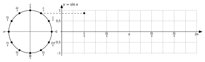
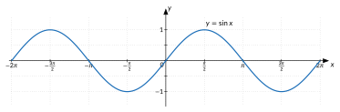
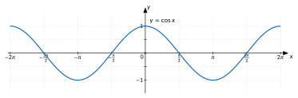
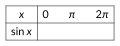
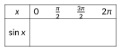
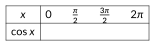
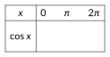
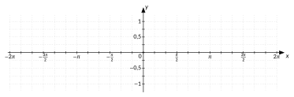

<!-- GÉNÉRÉ par typweb à partir des notes Typst : NE PAS ÉDITER (les modifications seraient écrasées). -->

::: {.callout-note title="Question Q6."}
Comment voir d’un seul coup toute l’évolution de la hauteur ?
:::

::: {.callout-important title="Pourquoi des fonctions trigonométriques ?"}
- **Beaucoup de phénomènes se répètent.** La hauteur d’une cabine, la durée du jour au fil de l’année, la position d’un pendule, la tension du courant alternatif : ces grandeurs reprennent les mêmes valeurs à intervalles réguliers. Elles sont **périodiques**.
- **Aucune fonction connue jusqu’ici ne l’est.** Une fonction polynôme non constante $p$ ne peut pas être périodique. Si elle l’était, de période $T$, elle reprendrait la valeur $p(0)$ en $0$, $T$, $2 T$, $3 T$, … : une infinité de fois. Or l’équation $p(x) = p(0)$ est une équation polynomiale de degré au moins 1 : elle n’a qu’un nombre fini de solutions. Il en va de même pour les fonctions rationnelles.
- **Sinus et cosinus sont les fonctions périodiques de base.** Avec $a \sin(b x + c)$ (chapitre 4), on règle l’amplitude, la période et le décalage d’une oscillation régulière. Plus tard, on verra que tout signal périodique, même compliqué, se décompose en une somme de sinusoïdes : c’est le principe de l’analyse des sons.
:::

::: {#activite-3-1 data-sorte="activite" data-num="3.1" data-page="31" data-phys="34" data-id="5UAA5.derouler-cercle" data-type="activite" data-tags="" .theo .theo-activite}
::: {.theo-head}
**Activité 3.1** — dérouler le cercle
:::

::: {.theo-body}
Le point $P(x)$ parcourt le cercle trigonométrique de gauche. Pour chacun des douze points $P(k \frac{\pi}{6})$, reporte son ordonnée $\sin(k \frac{\pi}{6})$ au-dessus du réel $k \frac{\pi}{6}$ sur le repère de droite (même unité : le rayon). Le report de $P(\frac{\pi}{3})$ est fait en exemple : une horizontale relie $P(\frac{\pi}{3})$ au point $(\frac{\pi}{3} ; \sin \frac{\pi}{3})$.

::: {.typst-fig}
{fig-alt="Figure du cours"}
:::

1. Relie les points. Compare avec le graphique de la hauteur de la cabine (activité 1.1).

   ::: {.rep-bloc}
   Même forme : la courbe part de $0$, monte jusqu’à $1$ en $\frac{\pi}{2}$, redescend à $0$ en $\pi$, atteint $-1$ en $\frac{3 \pi}{2}$ et revient à $0$ en $2 \pi$. Pour la cabine, la courbe commence au point bas : elle est décalée d’un quart de tour.
   :::
2. Calcule les accroissements de $\sin$ entre $0$ et $\frac{\pi}{6}$, entre $\frac{\pi}{6}$ et $\frac{\pi}{3}$, entre $\frac{\pi}{3}$ et $\frac{\pi}{2}$. Que remarques-tu ?

   ::: {.rep-bloc}
   $0{,}5$ ; $\frac{\sqrt{3}}{2} - \frac{1}{2} \approx 0{,}37$ ; $1 - \frac{\sqrt{3}}{2} \approx 0{,}13$. Sur des pas égaux, le sinus augmente de moins en moins : la courbe monte de moins en moins vite et s’aplatit près du maximum.
   :::
:::
:::

**Démarche pour tracer le graphique de $\sin$.** On place les points des valeurs remarquables sur $[0 ; \frac{\pi}{2}]$ et on les relie par une courbe ; la symétrie $\sin(\pi - x) = \sin x$ (lue sur le cercle) prolonge la courbe à $[0 ; \pi]$ ; la symétrie $\sin(-x) = -\sin x$ la prolonge à $[-\pi ; \pi]$ ; enfin, $\sin(x + 2 \pi) = \sin x$ la reproduit sur tout l’axe.

::: {.typst-fig}
{fig-alt="Figure du cours"}
:::

```{=html}
<div class="tg" id="anim-enroulement" data-tg="enroulement" data-cfg='{"fonction": "sin"}'></div>
```

::: {.tg-legende}
Animation : le point tourne sur le cercle, sa hauteur se trace en même temps sur le graphique.
:::

Le graphique du cosinus s’obtient de la même manière, en reportant cette fois l’**abscisse** de $P(x)$ au-dessus de $x$.

::: {.typst-fig}
{fig-alt="Figure du cours"}
:::

::: {#activite-3-2 data-sorte="activite" data-num="3.2" data-page="32" data-phys="35" data-id="5UAA5.cosinus-sinus-meme-courbe" data-type="activite" data-tags="" .theo .theo-activite}
::: {.theo-head}
**Activité 3.2** — cosinus et sinus : la même courbe ?
:::

::: {.theo-body}
Compare les deux graphiques. De combien faut-il décaler le graphique du cosinus pour obtenir celui du sinus ? Vérifie sur le cercle que $\cos x = \sin(x + \frac{\pi}{2})$.

::: {.rep-bloc}
Le graphique du sinus est celui du cosinus décalé de $\frac{\pi}{2}$ vers la droite. Sur le cercle, $P(x + \frac{\pi}{2})$ s’obtient en tournant $P(x)$ d’un quart de tour : la nouvelle hauteur est l’ancienne abscisse. Donc $\sin(x + \frac{\pi}{2}) = \cos x$.
:::
:::
:::

## Fonctions périodiques

::: {#definition-3-1 data-sorte="definition" data-num="3.1" data-page="32" data-phys="35" data-id="5UAA5.fonction-periodique" data-type="definition" data-tags="" .theo .theo-definition}
::: {.theo-head}
**Définition 3.1** — fonction périodique
:::

::: {.theo-body}
Une fonction $f$ est **périodique** s’il existe un réel $T > 0$ tel que, pour tout $x$ du domaine de $f$, $x + T$ appartient au domaine et $f(x + T) = f(x)$. Le plus petit réel $T > 0$ qui convient est la **période** de $f$.

- La **fréquence** de $f$ est $\frac{1}{T}$ : le nombre de périodes par unité de la variable.
- Si $f$ a un maximum $M$ et un minimum $m$, son **amplitude** est $\frac{M - m}{2}$.
:::
:::

::: {#exemple-3-1 data-sorte="exemple" data-num="3.1" data-page="32" data-phys="35" data-id="5UAA5.exm.007" data-type="exemple" data-tags="" .theo .theo-exemple}
::: {.theo-head}
**Exemple 3.1**
:::

::: {.theo-body}
- La hauteur de la cabine a pour période 30 min, pour fréquence $\frac{1}{30}$ tour par minute et pour amplitude $\frac{60 - (-60)}{2} = 60$ m.
- $\sin$ et $\cos$ ont pour période $2 \pi$ (un tour) et pour amplitude $\frac{1 - (-1)}{2} = 1$.
- Aucune fonction polynôme non constante n’est périodique (encadré « Pourquoi des fonctions trigonométriques ? »).
:::
:::

## Cartes d’identité

::: {#cadre-carte-didentite-de-la-fonction .cadre-info}
**Carte d’identité de la fonction sinus**

**Expression :** $f(x) = \sin x$ : à tout réel $x$, elle associe l’ordonnée de $P(x)$.

**Valeurs particulières :**

::: {.tableau}
| $x$ | $0$ | $\frac{\pi}{6}$ | $\frac{\pi}{4}$ | $\frac{\pi}{3}$ | $\frac{\pi}{2}$ | $\frac{2 \pi}{3}$ | $\frac{3 \pi}{4}$ | $\frac{5 \pi}{6}$ | $\pi$ |
|:---:|:---:|:---:|:---:|:---:|:---:|:---:|:---:|:---:|:---:|
| $\sin x$ | $0$ | $\frac{1}{2}$ | $\frac{\sqrt{2}}{2}$ | $\frac{\sqrt{3}}{2}$ | $1$ | [$\frac{\sqrt{3}}{2}$]{.rep} | [$\frac{\sqrt{2}}{2}$]{.rep} | [$\frac{1}{2}$]{.rep} | [$0$]{.rep} |
:::

::: {.grille style="--n:2"}
::: {.cellule}
Domaine : [$\mathbb{R}$]{.rep}
:::

::: {.cellule}
Ensemble image : [$[-1 ; 1]$]{.rep}
:::

::: {.cellule}
Racines : [$k \pi$, $k \in \mathbb{Z}$]{.rep}
:::

::: {.cellule}
Parité : [impaire : $\sin(-x) = -\sin x$]{.rep}
:::

::: {.cellule}
Maximum : [$1$, en $\frac{\pi}{2} + 2 k \pi$]{.rep}
:::

::: {.cellule}
Minimum : [$-1$, en $\frac{3 \pi}{2} + 2 k \pi$]{.rep}
:::

::: {.cellule}
Période : [$2 \pi$]{.rep}
:::

::: {.cellule}
Amplitude : [$1$]{.rep}
:::
:::

**Signe sur $[0 ; 2 \pi]$ :**

::: {.typst-fig}
{fig-alt="Figure du cours"}
:::

**Variations sur $[0 ; 2 \pi]$ :**

::: {.typst-fig}
{fig-alt="Figure du cours"}
:::

**Fonction dérivée (module dérivées) :** $(\sin x)' =$ [$\cos x$]{.rep}
:::

::: {#cadre-carte-didentite-de-la-fonction .cadre-info}
**Carte d’identité de la fonction cosinus**

**Expression :** $f(x) = \cos x$ : à tout réel $x$, elle associe l’abscisse de $P(x)$.

**Valeurs particulières :**

::: {.tableau}
| $x$ | $0$ | $\frac{\pi}{6}$ | $\frac{\pi}{4}$ | $\frac{\pi}{3}$ | $\frac{\pi}{2}$ | $\frac{2 \pi}{3}$ | $\frac{3 \pi}{4}$ | $\frac{5 \pi}{6}$ | $\pi$ |
|:---:|:---:|:---:|:---:|:---:|:---:|:---:|:---:|:---:|:---:|
| $\cos x$ | $1$ | $\frac{\sqrt{3}}{2}$ | $\frac{\sqrt{2}}{2}$ | $\frac{1}{2}$ | $0$ | [$-\frac{1}{2}$]{.rep} | [$-\frac{\sqrt{2}}{2}$]{.rep} | [$-\frac{\sqrt{3}}{2}$]{.rep} | [$-1$]{.rep} |
:::

::: {.grille style="--n:2"}
::: {.cellule}
Domaine : [$\mathbb{R}$]{.rep}
:::

::: {.cellule}
Ensemble image : [$[-1 ; 1]$]{.rep}
:::

::: {.cellule}
Racines : [$\frac{\pi}{2} + k \pi$, $k \in \mathbb{Z}$]{.rep}
:::

::: {.cellule}
Parité : [paire : $\cos(-x) = \cos x$]{.rep}
:::

::: {.cellule}
Maximum : [$1$, en $2 k \pi$]{.rep}
:::

::: {.cellule}
Minimum : [$-1$, en $\pi + 2 k \pi$]{.rep}
:::

::: {.cellule}
Période : [$2 \pi$]{.rep}
:::

::: {.cellule}
Amplitude : [$1$]{.rep}
:::
:::

**Signe sur $[0 ; 2 \pi]$ :**

::: {.typst-fig}
{fig-alt="Figure du cours"}
:::

**Variations sur $[0 ; 2 \pi]$ :**

::: {.typst-fig}
{fig-alt="Figure du cours"}
:::

**Fonction dérivée (module dérivées) :** $(\cos x)' =$ [$-\sin x$]{.rep}
:::

::: {#exercice-3-1 data-sorte="exercice" data-num="3.1" data-page="33" data-phys="36" data-id="5UAA5.ex.031" data-type="exercice" data-tags="" .exo}
::: {.exo-tete}
[✎ Exercice 3.1]{.exo-titre} [[C2]{.exo-comp} ★☆☆]{.exo-meta}
:::

::: {.exo-corps}
Trace le graphique de $\sin$ sur $[-2 \pi ; 2 \pi]$ en suivant la démarche : points des valeurs remarquables sur $[0 ; \frac{\pi}{2}]$, courbe, symétries, périodicité.

::: {.typst-fig}
{fig-alt="Figure du cours"}
:::
:::
:::

::: {.aides}
::: {.panel-tabset}
## Indice 1 {.unlisted}

Relis la démarche après l’[activité « dérouler le cercle »](#activite-3-1).

## Indice 2 {.unlisted}

Quelles sont les valeurs exactes de $\sin$ en $0$, $\frac{\pi}{6}$, $\frac{\pi}{4}$, $\frac{\pi}{3}$, $\frac{\pi}{2}$ ?

## Indice 3 {.unlisted}

Place ces points, relie-les par une courbe arrondie, puis utilise $\sin(\pi - x) = \sin x$, $\sin(-x) = -\sin x$ et la période $2 \pi$.

## Solution {.unlisted}

::: {.solution-classe}
Points : $(0 ; 0)$, $(\frac{\pi}{6} ; \frac{1}{2})$, $(\frac{\pi}{4} ; \frac{\sqrt{2}}{2})$, $(\frac{\pi}{3} ; \frac{\sqrt{3}}{2})$, $(\frac{\pi}{2} ; 1)$. Par $\sin(\pi - x) = \sin x$, la courbe redescend symétriquement jusqu’à $(\pi ; 0)$ ; par $\sin(-x) = -\sin x$, elle se prolonge sur $[-\pi ; 0]$ (symétrie par rapport à l’origine) ; la période $2 \pi$ la reproduit sur $[-2 \pi ; 2 \pi]$. Zéros en $k \pi$, maximums $1$ en $\frac{\pi}{2}$ et $-\frac{3 \pi}{2}$, minimums $-1$ en $-\frac{\pi}{2}$ et $\frac{3 \pi}{2}$.
:::

## Pièges {.unlisted}

- Relier les points par des segments.
- Faire un graphique pointu en $\frac{\pi}{2}$.
:::
:::

::: {#exercice-3-2 data-sorte="exercice" data-num="3.2" data-page="34" data-phys="37" data-id="5UAA5.ex.032" data-type="exercice" data-tags="maison" .exo}
::: {.exo-tete}
[✎ Exercice 3.2]{.exo-titre} [⟵ à faire à la maison]{.exo-maison} [[C2]{.exo-comp} ★☆☆]{.exo-meta}
:::

::: {.exo-corps}
Même consigne pour $\cos$ sur $[-2 \pi ; 2 \pi]$ : utilise $\cos(-x) = \cos x$ et $\cos(\pi - x) = -\cos x$.

::: {.typst-fig}
{fig-alt="Figure du cours"}
:::
:::
:::

::: {.aides}
::: {.panel-tabset}
## Indice 1 {.unlisted}

Relis la carte d’identité du cosinus.

## Indice 2 {.unlisted}

Quelles sont les valeurs exactes de $\cos$ en $0$, $\frac{\pi}{6}$, $\frac{\pi}{4}$, $\frac{\pi}{3}$, $\frac{\pi}{2}$ ?

## Indice 3 {.unlisted}

Place ces points, puis utilise $\cos(\pi - x) = -\cos x$ pour $[\frac{\pi}{2} ; \pi]$, $\cos(-x) = \cos x$ pour les négatifs et la période $2 \pi$.

## Solution {.unlisted}

Points : $(0 ; 1)$, $(\frac{\pi}{6} ; \frac{\sqrt{3}}{2})$, $(\frac{\pi}{4} ; \frac{\sqrt{2}}{2})$, $(\frac{\pi}{3} ; \frac{1}{2})$, $(\frac{\pi}{2} ; 0)$. Par $\cos(\pi - x) = -\cos x$, la courbe continue jusqu’à $(\pi ; -1)$ ; par $\cos(-x) = \cos x$, elle est symétrique par rapport à l’axe vertical ; la période $2 \pi$ la reproduit. Maximums $1$ en $0$ et $\pm 2 \pi$, minimums $-1$ en $\pm \pi$, zéros en $\frac{\pi}{2} + k \pi$.

## Pièges {.unlisted}

- Confondre les valeurs de $\cos$ et de $\sin$.
- Oublier que $\cos$ est paire : le graphique est symétrique par rapport à l’axe vertical.
:::
:::

::: {#exercice-3-3 data-sorte="exercice" data-num="3.3" data-page="34" data-phys="37" data-id="5UAA5.ex.033" data-type="exercice" data-tags="" .exo}
::: {.exo-tete}
[✎ Exercice 3.3]{.exo-titre} [[C5]{.exo-comp} ★★☆]{.exo-meta}
:::

::: {.exo-corps}
Pour chacune des grandeurs suivantes, dis si elle est périodique ; si oui, donne sa période et sa fréquence (avec les unités).

1. L’aiguille des secondes d’une horloge : l’angle dont elle a tourné depuis midi, et la hauteur de sa pointe.
2. La hauteur d’une cabine du London Eye, et la distance qu’elle a parcourue depuis le départ.
3. La fonction $f(x) = x^{2}$.
:::
:::

::: {.aides}
::: {.panel-tabset}
## Indice 1 {.unlisted}

Relis la [définition d’une fonction périodique](#definition-3-1).

## Indice 2 {.unlisted}

La grandeur reprend-elle les mêmes valeurs après une durée fixe ?

## Indice 3 {.unlisted}

Une grandeur qui augmente sans cesse ne peut pas être périodique. Pour la fréquence : $\frac{1}{T}$, avec l’unité « par minute ».

## Solution {.unlisted}

::: {.solution-classe}
+ L’angle dont l’aiguille a tourné augmente sans cesse : il n’est pas périodique. La hauteur de la pointe reprend les mêmes valeurs chaque minute : période 1 min, fréquence 1 par minute.

1. La hauteur est périodique : période 30 min, fréquence $\frac{1}{30}$ par minute. La distance parcourue augmente sans cesse : elle n’est pas périodique.
2. $f(x) = x^{2}$ est un polynôme non constant : elle n’est pas périodique ($x^{2} = 0$ n’a qu’une solution).
:::

## Pièges {.unlisted}

- Confondre l’angle total parcouru (qui augmente sans cesse) et la position (qui se répète).
- Oublier les unités.
:::
:::

::: {#exercice-3-4 data-sorte="exercice" data-num="3.4" data-page="34" data-phys="37" data-id="5UAA5.ex.034" data-type="exercice" data-tags="" .exo}
::: {.exo-tete}
[✎ Exercice 3.4]{.exo-titre} [[C5]{.exo-comp} ★☆☆]{.exo-meta}
:::

::: {.exo-corps}
1. Une fonction $f$ est périodique de période $6$ ; $f(1) = 2$ et $f(4) = -1$. Calcule $f(7)$, $f(-5)$ et $f(10)$.
2. Un pendule fait $15$ oscillations complètes en $30$ secondes. Donne la période et la fréquence de son mouvement.
3. Une grandeur périodique varie entre $-4$ et $10$. Quelle est son amplitude ?
:::
:::

::: {.aides}
::: {.panel-tabset}
## Indice 1 {.unlisted}

Relis la [définition d’une fonction périodique](#definition-3-1) : période, fréquence, amplitude.

## Indice 2 {.unlisted}

Comment écrire $7$ à partir de $1$ et de la période $6$ ?

## Indice 3 {.unlisted}

$7 = 1 + 6$, $-5 = 1 - 6$, $10 = 4 + 6$. Période du pendule : durée d’une oscillation.

## Solution {.unlisted}

::: {.solution-classe}
+ $7 = 1 + 6$, donc $f(7) = f(1) = 2$ ; $-5 = 1 - 6$, donc $f(-5) = 2$ ; $10 = 4 + 6$, donc $f(10) = f(4) = -1$.

1. Période : $\frac{30}{15} = 2$ s ; fréquence : $\frac{1}{2} = 0{,}5$ oscillation par seconde.
2. Amplitude : $\frac{10 - (-4)}{2} = 7$.
:::

## Pièges {.unlisted}

- Ajouter la période à la valeur $f(1)$ au lieu de la variable.
- Amplitude : prendre l’écart total au lieu du demi-écart.
:::
:::

::: {.ae-lien}
[✔ S'autoévaluer sur cette section : test de 4 questions →](../autoeval.qmd#sections=sec-sinus-cosinus)
:::
