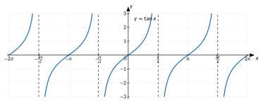
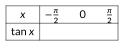
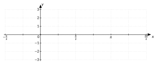
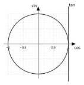
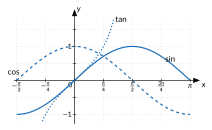

<!-- GÉNÉRÉ par typweb à partir des notes Typst : NE PAS ÉDITER (les modifications seraient écrasées). -->

::: {.callout-note title="Question Q6."}
(suite) Et l’inclinaison du bras : comment évolue-t-elle ?
:::

::: {#activite-3-3 data-sorte="activite" data-num="3.3" data-page="35" data-phys="38" data-id="5UAA5.pente-bras" data-type="activite" data-tags="" .theo .theo-activite}
::: {.theo-head}
**Activité 3.3** — la pente du bras
:::

::: {.theo-body}
1. Complète le tableau (calculatrice en radians, deux décimales).

   ::: {.tableau}
   | $x$ | $-\frac{\pi}{3}$ | $-\frac{\pi}{4}$ | $-\frac{\pi}{6}$ | $0$ | $\frac{\pi}{6}$ | $\frac{\pi}{4}$ | $\frac{\pi}{3}$ | $1{,}4$ | $1{,}5$ | $1{,}55$ | $1{,}57$ |
   |:---:|:---:|:---:|:---:|:---:|:---:|:---:|:---:|:---:|:---:|:---:|:---:|
   | $\tan x$ | [$-1{,}73$]{.rep} | [$-1$]{.rep} | [$-0{,}58$]{.rep} | [$0$]{.rep} | [$0{,}58$]{.rep} | [$1$]{.rep} | [$1{,}73$]{.rep} | [$5{,}80$]{.rep} | [$14{,}10$]{.rep} | [$48{,}08$]{.rep} | [$1255{,}77$]{.rep} |
   :::
2. Que devient la pente de $O P(x)$ quand $x$ s’approche de $\frac{\pi}{2}$ en restant plus petit ? Et quand $x$ s’approche de $-\frac{\pi}{2}$ en restant plus grand ?

   ::: {.rep-bloc}
   Quand $x$ s’approche de $\frac{\pi}{2}$ par la gauche, la droite $O P(x)$ devient presque verticale et sa pente devient aussi grande qu’on veut : $\lim\limits_{x \overset{<}{\to} \frac{\pi}{2}} \tan x = +\infty$. Quand $x$ s’approche de $-\frac{\pi}{2}$ par la droite, la pente devient aussi négative qu’on veut : $\lim\limits_{x \overset{>}{\to} -\frac{\pi}{2}} \tan x = -\infty$.
   :::
:::
:::

Les droites $x = \frac{\pi}{2}$ et $x = -\frac{\pi}{2}$ sont des **asymptotes verticales** du graphique de $\tan$. Comme $\tan(x + \pi) = \tan x$, la courbe obtenue sur $]-\frac{\pi}{2} ; \frac{\pi}{2}[$ se répète tous les $\pi$.

::: {.typst-fig}
{fig-alt="Figure du cours"}
:::

```{=html}
<div class="tg" id="anim-enroulement-tan" data-tg="enroulement" data-cfg='{"fonction": "tan"}'></div>
```

::: {.tg-legende}
Animation : le point tourne sur le cercle ; la droite $O P(x)$ coupe l’axe des tangentes à la hauteur $\tan x$, qui se trace en même temps sur le graphique.
:::

::: {#cadre-carte-didentite-de-la-fonction .cadre-info}
**Carte d’identité de la fonction tangente**

**Expression :** $f(x) = \tan x = \frac{\sin x}{\cos x}$ : à tout réel $x$ pour lequel elle existe, elle associe la pente de $O P(x)$.

**Valeurs particulières :**

::: {.tableau}
| $x$ | $-\frac{\pi}{2}$ | $-\frac{\pi}{3}$ | $-\frac{\pi}{4}$ | $-\frac{\pi}{6}$ | $0$ | $\frac{\pi}{6}$ | $\frac{\pi}{4}$ | $\frac{\pi}{3}$ | $\frac{\pi}{2}$ |
|:---:|:---:|:---:|:---:|:---:|:---:|:---:|:---:|:---:|:---:|
| $\tan x$ | [n’existe pas]{.rep} | [$-\sqrt{3}$]{.rep} | [$-1$]{.rep} | [$-\frac{\sqrt{3}}{3}$]{.rep} | $0$ | $\frac{\sqrt{3}}{3}$ | $1$ | $\sqrt{3}$ | n’existe pas |
:::

::: {.grille style="--n:2"}
::: {.cellule}
Condition d’existence : [$\cos x \neq 0$]{.rep}
:::

::: {.cellule}
Domaine : [$\mathbb{R} \setminus \{\frac{\pi}{2} + k \pi : k \in \mathbb{Z}\}$]{.rep}
:::

::: {.cellule}
Ensemble image : [$\mathbb{R}$]{.rep}
:::

::: {.cellule}
Racines : [$k \pi$, $k \in \mathbb{Z}$]{.rep}
:::

::: {.cellule}
Parité : [impaire : $\tan(-x) = -\tan x$]{.rep}
:::

::: {.cellule}
Extremums : [aucun]{.rep}
:::

::: {.cellule}
Période : [$\pi$]{.rep}
:::

::: {.cellule}
Asymptotes : [verticales, $x = \frac{\pi}{2} + k \pi$]{.rep}
:::
:::

**Signe sur $]-\frac{\pi}{2} ; \frac{\pi}{2}[$ :**

::: {.typst-fig}
{fig-alt="Figure du cours"}
:::

**Variations sur $]-\frac{\pi}{2} ; \frac{\pi}{2}[$ :** [croissante]{.rep}

**Fonction dérivée (module dérivées) :** $(\tan x)' =$ [$\frac{1}{\cos^{2} x} = 1 + \tan^{2} x$]{.rep}
:::

::: {#exercice-3-5 data-sorte="exercice" data-num="3.5" data-page="36" data-phys="39" data-id="5UAA5.ex.035" data-type="exercice" data-tags="" .exo}
::: {.exo-tete}
[✎ Exercice 3.5]{.exo-titre} [[C2]{.exo-comp} ★★☆]{.exo-meta}
:::

::: {.exo-corps}
Trace le graphique de $\tan$ sur $]-\frac{\pi}{2} ; \frac{3 \pi}{2}[$, sauf en $\frac{\pi}{2}$ : place les points d’abscisses $-\frac{\pi}{3}$, $-\frac{\pi}{4}$, $-\frac{\pi}{6}$, $0$, $\frac{\pi}{6}$, $\frac{\pi}{4}$, $\frac{\pi}{3}$, trace les asymptotes, puis utilise $\tan(x + \pi) = \tan x$.

::: {.typst-fig}
{fig-alt="Figure du cours"}
:::
:::
:::

::: {.aides}
::: {.panel-tabset}
## Indice 1 {.unlisted}

Relis la carte d’identité de la tangente.

## Indice 2 {.unlisted}

Que se passe-t-il pour $\tan x$ quand $x$ s’approche de $\frac{\pi}{2}$ ?

## Indice 3 {.unlisted}

Place les sept points de $]-\frac{\pi}{2} ; \frac{\pi}{2}[$, trace les asymptotes $x = -\frac{\pi}{2}$ et $x = \frac{\pi}{2}$, puis translate la courbe de $\pi$ vers la droite.

## Solution {.unlisted}

::: {.solution-classe}
Valeurs : $\tan(-\frac{\pi}{3}) = -\sqrt{3} \approx -1{,}73$ ; $\tan(-\frac{\pi}{4}) = -1$ ; $\tan(-\frac{\pi}{6}) = -\frac{\sqrt{3}}{3} \approx -0{,}58$ ; $\tan 0 = 0$, puis les opposées en $\frac{\pi}{6}$, $\frac{\pi}{4}$, $\frac{\pi}{3}$. Asymptotes verticales $x = -\frac{\pi}{2}$, $x = \frac{\pi}{2}$, $x = \frac{3 \pi}{2}$. Sur $]\frac{\pi}{2} ; \frac{3 \pi}{2}[$, la courbe est celle de $]-\frac{\pi}{2} ; \frac{\pi}{2}[$ translatée de $\pi$ vers la droite.
:::

## Pièges {.unlisted}

- Relier les branches à travers l’asymptote.
- Translater de $2 \pi$ au lieu de $\pi$.
:::
:::

::: {#exercice-3-6 data-sorte="exercice" data-num="3.6" data-page="36" data-phys="39" data-id="5UAA5.ex.036" data-type="exercice" data-tags="" .exo}
::: {.exo-tete}
[✎ Exercice 3.6]{.exo-titre} [[C3]{.exo-comp} ★★☆]{.exo-meta}
:::

::: {.exo-corps}
1. Sur le cercle trigonométrique, représente $\sin 2$, $\cos(-1)$ et $\tan 1$ par des segments.
2. Sur les graphiques de $\sin$, $\cos$ et $\tan$, représente les mêmes nombres par des segments verticaux.
3. Vérifie à la calculatrice (trois décimales).

::: {.grille style="--n:2"}
::: {.cellule}
::: {.typst-fig}
{fig-alt="Figure du cours"}
:::
:::

::: {.cellule}
::: {.typst-fig}
{fig-alt="Figure du cours"}
:::
:::
:::
:::
:::

::: {.aides}
::: {.panel-tabset}
## Indice 1 {.unlisted}

Relis le paragraphe « Démarche pour tracer le graphique de sin » et l’axe des tangentes.

## Indice 2 {.unlisted}

Sur le cercle, $\sin x$ est-il une longueur horizontale ou verticale ? Et sur le graphique ?

## Indice 3 {.unlisted}

Sinus : segment vertical de l’axe horizontal à $P(x)$ ; cosinus : segment horizontal de l’axe vertical à $P(x)$ ; tangente : sur l’axe des tangentes.

## Solution {.unlisted}

::: {.solution-classe}
+ $\sin 2$ : ordonnée de $P(2)$ (segment vertical de l’axe horizontal à $P(2)$) ; $\cos(-1)$ : abscisse de $P(-1)$ ; $\tan 1$ : ordonnée du point où la droite $O P(1)$ coupe l’axe des tangentes.

1. Sur chaque graphique : le segment vertical qui va de l’axe horizontal au point de la courbe d’abscisse $2$ (sinus), $-1$ (cosinus) ou $1$ (tangente).
2. $\sin 2 \approx 0{,}909$ ; $\cos(-1) \approx 0{,}540$ ; $\tan 1 \approx 1{,}557$.
:::

## Pièges {.unlisted}

- Sur le graphique du cosinus, tracer un segment horizontal : sur un graphique, l’image est toujours une hauteur.
- Calculatrice en degrés.
:::
:::

::: {#exercice-3-7 data-sorte="exercice" data-num="3.7" data-page="37" data-phys="40" data-id="5UAA5.ex.037" data-type="exercice" data-tags="" .exo}
::: {.exo-tete}
[✎ Exercice 3.7]{.exo-titre} [[C3]{.exo-comp} ★★☆]{.exo-meta}
:::

::: {.exo-corps}
Associe chaque lecture sur le cercle à une lecture sur un graphique.

::: {.grille style="--n:2"}
::: {.cellule}
1. L’ordonnée de $P(x)$ quand $P(x)$ fait un tour.
2. L’abscisse de $P(x)$ quand $P(x)$ fait un tour.
3. La pente de $O P(x)$ quand $P(x)$ fait un demi-tour.
4. $P(x)$ passe par le point le plus haut du cercle.
:::

::: {.cellule}
a) Une période du graphique de $\tan$.
b) Un maximum du graphique de $\sin$.
c) Une période du graphique de $\sin$.
d) Une période du graphique de $\cos$.
:::
:::
:::
:::

::: {.aides}
::: {.panel-tabset}
## Indice 1 {.unlisted}

Relis les cartes d’identité : périodes et maximums.

## Indice 2 {.unlisted}

Un tour de $P(x)$ correspond à quelle longueur sur l’axe horizontal ?

## Indice 3 {.unlisted}

Un tour = $2 \pi$ = une période de $\sin$ et de $\cos$ ; un demi-tour = $\pi$ = une période de $\tan$.

## Solution {.unlisted}

::: {.solution-classe}
1 → c (une période de $\sin$) ; 2 → d (une période de $\cos$) ; 3 → a (la tangente a pour période $\pi$) ; 4 → b (maximum $1$ de $\sin$, en $\frac{\pi}{2} + 2 k \pi$).
:::

## Pièges {.unlisted}

- Associer la tangente à un tour complet.
- Confondre maximum de $\sin$ et maximum de $\cos$.
:::
:::

::: {.ae-lien}
[✔ S'autoévaluer sur cette section : test de 2 questions →](../autoeval.qmd#sections=sec-fonction-tangente)
:::
