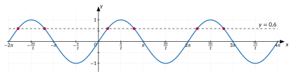

<!-- GÉNÉRÉ par typweb à partir des notes Typst : NE PAS ÉDITER (les modifications seraient écrasées). -->

::: {.callout-note title="Question Q5."}
(retour) Le graphique permet-il de répondre plus vite que le cercle ?
:::

::: {#activite-3-4 data-sorte="activite" data-num="3.4" data-page="37" data-phys="40" data-id="5UAA5.graphique" data-type="activite" data-tags="" .theo .theo-activite}
::: {.theo-head}
**Activité 3.4** — $\sin x = 0{,}6$ sur un graphique
:::

::: {.theo-body}
::: {.typst-fig}
{fig-alt="Figure du cours"}
:::

a) Combien de solutions l’équation $\sin x = 0{,}6$ a-t-elle dans $[0 ; 2 \pi]$ ? Dans $[-2 \pi ; 4 \pi]$ ?

   ::: {.rep-bloc}
   Deux dans $[0 ; 2 \pi]$ ; six dans $[-2 \pi ; 4 \pi]$ (deux par période).
   :::
b) Calcule-les à l’aide du chapitre 2 et vérifie qu’elles correspondent aux points du graphique.

   ::: {.rep-bloc}
   $\alpha \approx 0{,}6435$ et $\pi - \alpha \approx 2{,}4981$ ; en ajoutant ou retirant $2 \pi$ : $-5{,}6397$ ; $-3{,}7851$ ; $0{,}6435$ ; $2{,}4981$ ; $6{,}9267$ ; $8{,}7813$.
   :::
:::
:::

::: {#remarque-3-1 data-sorte="remarque" data-num="3.1" data-page="37" data-phys="40" data-id="5UAA5.quel-outil-quelle-question" data-type="remarque" data-tags="" .theo .theo-remarque}
::: {.theo-head}
**Remarque 3.1**
:::

::: {.theo-body}
- **Le nombre de solutions** sur un intervalle se voit le plus vite sur le **graphique** : on compte les intersections de la courbe avec la droite horizontale.
- **Les valeurs exactes** (valeurs remarquables) se lisent sur le **cercle**.
- **Une valeur approchée** s’obtient à la **calculatrice** ; le cercle ou le graphique donnent les autres.
:::
:::

::: {#exercice-3-8 data-sorte="exercice" data-num="3.8" data-page="38" data-phys="41" data-id="5UAA5.ex.038" data-type="exercice" data-tags="" .exo}
::: {.exo-tete}
[✎ Exercice 3.8]{.exo-titre} [[A5]{.exo-comp} ★☆☆]{.exo-meta}
:::

::: {.exo-corps}
À l’aide des graphiques, donne le nombre de solutions de chaque équation dans l’intervalle indiqué, puis calcule-les (quatre décimales).

a) $\cos x = -0{,}4$ dans $[0 ; 3 \pi]$ ;
b) $\sin x = -0{,}8$ dans $[-\pi ; 3 \pi]$ ;
c) $\tan x = 2$ dans $]-\frac{\pi}{2} ; \frac{5 \pi}{2}[$.
:::
:::

::: {.aides}
::: {.panel-tabset}
## Indice 1 {.unlisted}

Relis la remarque « quel outil pour quelle question ? ».

## Indice 2 {.unlisted}

Combien de fois la droite horizontale coupe-t-elle la courbe sur l’intervalle ?

## Indice 3 {.unlisted}

Compte d’abord sur le graphique, puis calcule $\alpha$ et ajoute des tours jusqu’à en avoir autant.

## Solution {.unlisted}

::: {.solution-classe}
+ La droite $y = -0{,}4$ coupe la courbe de $\cos$ trois fois sur $[0 ; 3 \pi]$. $\alpha = \cos^{-1}(-0{,}4) \approx 1{,}9823$ ; solutions : $1{,}9823$ ; $2 \pi - \alpha \approx 4{,}3009$ ; $\alpha + 2 \pi \approx 8{,}2655$.

a) Quatre intersections. $\alpha = \sin^{-1}(-0{,}8) \approx -0{,}9273$ ; second point : $\pi - \alpha \approx 4{,}0689$ ; solutions : $4{,}0689 - 2 \pi \approx -2{,}2143$ ; $-0{,}9273$ ; $4{,}0689$ ; $-0{,}9273 + 2 \pi \approx 5{,}3559$.
b) Trois intersections (une par période de longueur $\pi$). $\alpha = \tan^{-1}(2) \approx 1{,}1071$ ; solutions : $1{,}1071$ ; $4{,}2487$ ; $7{,}3903$.
:::

## Pièges {.unlisted}

- Calculer deux solutions par habitude alors que l’intervalle en contient trois ou quatre.
- Pour $\tan$, utiliser $2 \pi$ comme période.
:::
:::

::: {#exercice-3-9 data-sorte="exercice" data-num="3.9" data-page="38" data-phys="41" data-id="5UAA5.ex.039" data-type="exercice" data-tags="" .exo}
::: {.exo-tete}
[✎ Exercice 3.9]{.exo-titre} [[A5]{.exo-comp} ★★☆]{.exo-meta}
:::

::: {.exo-corps}
Sans calcul, explique à l’aide d’un graphique pourquoi l’équation $\sin x = a$ a toujours le même nombre de solutions dans $[0 ; 2 \pi[$ lorsque $-1 < a < 1$ et $a \neq 0$. Que se passe-t-il pour $a = 1$ ? pour $a = 0$ ?
:::
:::

::: {.aides}
::: {.panel-tabset}
## Indice 1 {.unlisted}

Relis l’[activité « sin x = 0,6 sur un graphique »](#activite-3-4).

## Indice 2 {.unlisted}

Sur une période, comment varie $\sin$ ? Combien de fois une droite horizontale peut-elle couper la courbe ?

## Indice 3 {.unlisted}

Sépare les cas $-1 < a < 1$ ($a \neq 0$), $a = 1$ (sommet) et $a = 0$ (attention : $2 \pi$ est exclu).

## Solution {.unlisted}

::: {.solution-classe}
Sur une période $[0 ; 2 \pi[$, la courbe de $\sin$ monte de $0$ à $1$, descend jusqu’à $-1$ et remonte vers $0$ : une droite horizontale $y = a$ avec $-1 < a < 1$, $a \neq 0$, la coupe exactement deux fois. Pour $a = 1$, la droite touche la courbe en un seul point ($x = \frac{\pi}{2}$). Pour $a = 0$, elle la coupe en $0$ et en $\pi$ ($2 \pi$ est exclu).
:::

## Pièges {.unlisted}

- Compter $2 \pi$ comme solution pour $a = 0$ alors que l’intervalle est ouvert en $2 \pi$.
- Oublier le cas où la droite ne fait que toucher la courbe.
:::
:::

::: {.ae-lien}
[✔ S'autoévaluer sur cette section : test de 1 question →](../autoeval.qmd#sections=sec-resoudre-graphiquement)
:::
