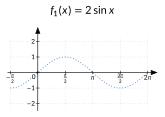
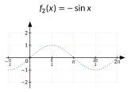
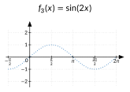
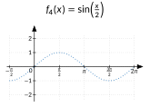

<!-- GÉNÉRÉ par typweb à partir des notes Typst : NE PAS ÉDITER (les modifications seraient écrasées). -->

::: {.callout-note title="Question Q8."}
Comment écrire la hauteur à l’instant $t$ à partir du rayon et de la durée d’un tour ?
:::

::: {#activite-4-1 data-sorte="activite" data-num="4.1" data-page="39" data-phys="42" data-id="5UAA5.predire-puis-verifier" data-type="activite" data-tags="" .theo .theo-activite}
::: {.theo-head}
**Activité 4.1** — prédire, puis vérifier
:::

::: {.theo-body}
Sans calculatrice, esquisse sur chaque repère le graphique de la fonction (le graphique de $\sin$ est en pointillés). Vérifie ensuite avec les curseurs du site.

::: {.grille style="--n:2"}
::: {.cellule}
::: {.typst-fig}
{fig-alt="Figure du cours"}
:::
:::

::: {.cellule}
::: {.typst-fig}
{fig-alt="Figure du cours"}
:::
:::

::: {.cellule}
::: {.typst-fig}
{fig-alt="Figure du cours"}
:::
:::

::: {.cellule}
::: {.typst-fig}
{fig-alt="Figure du cours"}
:::
:::
:::

1. Quel est l’effet du facteur $2$ devant $\sin x$ ? du signe $-$ ?

   ::: {.rep-bloc}
   Chaque ordonnée est multipliée par $2$ : la courbe est étirée verticalement, elle varie entre $-2$ et $2$. Le signe $-$ change chaque ordonnée en son opposée : la courbe est retournée (symétrie par rapport à l’axe horizontal).
   :::
2. Pour $f_{3}$, quand $x$ va de $0$ à $\pi$, de combien l’argument $2 x$ avance-t-il ? Combien de tours le point $P(2 x)$ fait-il ? Quelle est la période de $f_{3}$ ? Même question pour $f_{4}$.

   ::: {.rep-bloc}
   Quand $x$ va de $0$ à $\pi$, $2 x$ va de $0$ à $2 \pi$ : le point fait un tour complet ; la période de $f_{3}$ est $\pi$. Pour $f_{4}$, l’argument $\frac{x}{2}$ ne fait un tour que lorsque $x$ va de $0$ à $4 \pi$ : la période est $4 \pi$.
   :::
:::
:::

```{=html}
<div class="tg" id="anim-parametres" data-tg="parametres" data-cfg='{"a": 2, "b": 1, "c": 0}'></div>
```

::: {.tg-legende}
Curseurs $a$, $b$, $c$ avec un mode « prédiction » : on esquisse d’abord, la courbe apparaît ensuite.
:::

::: {#propriete-4-1 data-sorte="propriete" data-num="4.1" data-page="40" data-phys="43" data-id="5UAA5.role-2" data-type="propriete" data-tags="" .theo .theo-propriete}
::: {.theo-head}
**Propriété 4.1** — rôle de $a$ et de $b$
:::

::: {.theo-body}
Pour $a \neq 0$ et $b \neq 0$, la fonction $f(x) = a \sin(b x)$ :

- varie entre $-|a|$ et $|a|$ : son **amplitude** vaut $|a|$ (si $a < 0$, la courbe est de plus retournée) ;
- a pour **période** $T = \frac{2 \pi}{|b|}$ : l’argument $b x$ fait un tour complet quand $x$ parcourt un intervalle de longueur $\frac{2 \pi}{|b|}$.
:::
:::

**Retour à la cabine.** La roue a un rayon de 60 m : $a = 60$. Elle fait un tour en 30 minutes : il faut $\frac{2 \pi}{b} = 30$, donc $b = \frac{2 \pi}{30} = \frac{\pi}{15}$. C’est l’angle (en radians) dont la roue tourne en une minute : on l’appelle la **pulsation** ($\frac{\pi}{15} \approx 0{,}21$ rad/min). Une cabine qui serait au niveau de l’axe et monterait à l’instant $t = 0$ serait donc à la hauteur $60 \sin(\frac{\pi}{15} t)$.

::: {.callout-warning title="Piège"}
$\sin(2 x) \neq 2 \sin x$. Contre-exemple : pour $x = \frac{\pi}{2}$, $\sin(2 \cdot \frac{\pi}{2}) = \sin \pi = 0$, alors que $2 \sin \frac{\pi}{2} = 2$. Le $2$ dans l’argument agit sur la période, le $2$ devant agit sur l’amplitude.
:::

::: {#exercice-4-1 data-sorte="exercice" data-num="4.1" data-page="40" data-phys="43" data-id="5UAA5.ex.040" data-type="exercice" data-tags="" .exo}
::: {.exo-tete}
[✎ Exercice 4.1]{.exo-titre} [[C4]{.exo-comp} ★☆☆]{.exo-meta}
:::

::: {.exo-corps}
Donne l’amplitude et la période de chaque fonction : $f(x) = 5 \sin x$ ; $g(x) = \sin(3 x)$ ; $h(x) = -0{,}5 \sin(\frac{x}{3})$ ; $k(x) = 2 \sin(\pi x)$.
:::
:::

::: {.aides}
::: {.panel-tabset}
## Indice 1 {.unlisted}

Relis la [propriété « rôle de a et de b »](#propriete-4-1).

## Indice 2 {.unlisted}

Le nombre devant $\sin$ agit-il sur la hauteur ou sur la largeur des vagues ?

## Indice 3 {.unlisted}

Amplitude $|a|$ ; période $\frac{2 \pi}{|b|}$. Pour $h$, $b = \frac{1}{3}$.

## Solution {.unlisted}

::: {.solution-classe}
$f$ : amplitude 5, période $2 \pi$. $g$ : amplitude 1, période $\frac{2 \pi}{3}$. $h$ : amplitude $0{,}5$, période $\frac{2 \pi}{\frac{1}{3}} = 6 \pi$. $k$ : amplitude 2, période $\frac{2 \pi}{\pi} = 2$.
:::

## Pièges {.unlisted}

- Prendre $b$ pour la période.
- Donner une amplitude négative.
:::
:::

::: {#exercice-4-2 data-sorte="exercice" data-num="4.2" data-page="41" data-phys="44" data-id="5UAA5.ex.041" data-type="exercice" data-tags="" .exo}
::: {.exo-tete}
[✎ Exercice 4.2]{.exo-titre} [[C4]{.exo-comp} ★★☆]{.exo-meta}
:::

::: {.exo-corps}
Trouve $a > 0$ et $b > 0$ pour que $f(x) = a \sin(b x)$ ait :

1. une amplitude de 3 et une période de $\pi$ ;
2. une amplitude de $0{,}2$ et une période de 4 ;
3. une hauteur maximale de 50 m et une période de 20 min (une roue de 100 m de diamètre qui fait un tour en 20 minutes, cabine au niveau de l’axe et qui monte à $t = 0$).
:::
:::

::: {.aides}
::: {.panel-tabset}
## Indice 1 {.unlisted}

Relis la [propriété « rôle de a et de b »](#propriete-4-1) et le « Retour à la cabine ».

## Indice 2 {.unlisted}

Si la période vaut $\pi$, quelle équation vérifie $b$ ?

## Indice 3 {.unlisted}

Résous $\frac{2 \pi}{b} = T$, c’est-à-dire $b = \frac{2 \pi}{T}$.

## Solution {.unlisted}

::: {.solution-classe}
+ $a = 3$ et $\frac{2 \pi}{b} = \pi$, donc $b = 2$ : $f(x) = 3 \sin(2 x)$.

1. $a = 0{,}2$ et $\frac{2 \pi}{b} = 4$, donc $b = \frac{\pi}{2}$ : $f(x) = 0{,}2 \sin(\frac{\pi}{2} x)$.
2. $a = 50$ et $\frac{2 \pi}{b} = 20$, donc $b = \frac{\pi}{10}$ : $h(t) = 50 \sin(\frac{\pi}{10} t)$ ($t$ en min, $h$ en m).
:::

## Pièges {.unlisted}

- Écrire $b = T$.
- Pour la roue, prendre le diamètre comme amplitude.
:::
:::

::: {.ae-lien}
[✔ S'autoévaluer sur cette section : test de 3 questions →](../autoeval.qmd#sections=sec-a-b)
:::
