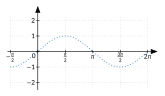
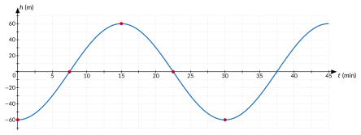

<!-- GÉNÉRÉ par typweb à partir des notes Typst : NE PAS ÉDITER (les modifications seraient écrasées). -->

::: {.callout-note title="Question Q8."}
(suite) Et si la cabine ne part pas du point le plus bas ?
:::

::: {#activite-4-2 data-sorte="activite" data-num="4.2" data-page="41" data-phys="44" data-id="5UAA5.sinusoide-commence-t-elle" data-type="activite" data-tags="" .theo .theo-activite}
::: {.theo-head}
**Activité 4.2** — où la sinusoïde commence-t-elle ?
:::

::: {.theo-body}
Le graphique de $\sin$ « commence » (passage par $0$ en montant) quand son argument vaut $0$.

1. Pour $f(x) = \sin(x + \frac{\pi}{3})$, pour quelle valeur de $x$ l’argument $x + \frac{\pi}{3}$ vaut-il $0$ ? Où le graphique de $f$ commence-t-il ? Esquisse-le.

   ::: {.typst-fig}
   {fig-alt="Figure du cours"}
   :::

   ::: {.rep-bloc}
   $x + \frac{\pi}{3} = 0$ pour $x = -\frac{\pi}{3}$ : le graphique de $f$ est celui de $\sin$ décalé de $\frac{\pi}{3}$ **vers la gauche**.
   :::
2. Même question pour $g(x) = \sin(2 x - \frac{\pi}{2})$.

   ::: {.typst-fig}
   {fig-alt="Figure du cours"}
   :::

   ::: {.rep-bloc}
   $2 x - \frac{\pi}{2} = 0$ pour $x = \frac{\pi}{4}$ : le graphique de $g$ est celui de $\sin(2 x)$ (période $\pi$) décalé de $\frac{\pi}{4}$ vers la droite.
   :::
:::
:::

::: {#propriete-4-2 data-sorte="propriete" data-num="4.2" data-page="41" data-phys="44" data-id="5UAA5.role-3" data-type="propriete" data-tags="" .theo .theo-propriete}
::: {.theo-head}
**Propriété 4.2** — rôle de $c$
:::

::: {.theo-body}
Pour $b \neq 0$, on a $a \sin(b x + c) = a \sin(b(x + \frac{c}{b}))$ : le graphique de $x \mapsto a \sin(b x + c)$ est celui de $x \mapsto a \sin(b x)$ translaté horizontalement de $-\frac{c}{b}$. Le nombre $-\frac{c}{b}$, valeur de $x$ pour laquelle l’argument s’annule, est le **déphasage**.
:::
:::

::: {.callout-warning title="Piège"}
« $+ \frac{\pi}{3}$ décale vers la droite. » Non : vers la **gauche**. Plutôt que de mémoriser un sens, on cherche **quand l’argument vaut 0**.
:::

**Vocabulaire du mouvement harmonique.** Quand la variable est le temps $t$ et que $y(t) = a \sin(b t + c)$ décrit un mouvement qui se répète régulièrement (un **mouvement harmonique**), on appelle $|a|$ l’**amplitude** (élongation maximale), $b$ la **pulsation**, $c$ la **phase à l’origine** ; la période vaut $T = \frac{2 \pi}{b}$ et la **fréquence** est son inverse, $\frac{1}{T}$.

::: {#remarque-4-1 data-sorte="remarque" data-num="4.1" data-page="42" data-phys="45" data-id="5UAA5.notation-physique" data-type="remarque" data-tags="" .theo .theo-remarque}
::: {.theo-head}
**Remarque 4.1**
:::

::: {.theo-body}
En physique, un mouvement harmonique s’écrit $y(t) = A \sin(\omega t + \varphi)$ : $A$ est l’amplitude, $\omega$ la pulsation (en rad/s ou en rad/min), $\varphi$ la phase à l’origine ; la période vaut $T = \frac{2 \pi}{\omega}$ et la fréquence $f = \frac{1}{T} = \frac{\omega}{2 \pi}$. C’est la même fonction que $a \sin(b x + c)$, avec d’autres lettres.
:::
:::

**Retour à la cabine.** La cabine part du point le plus bas : à $t = 0$, elle a un quart de tour de retard sur une cabine qui partirait du niveau de l’axe en montant. Elle passe au niveau de l’axe en montant après un quart de tour, soit $7{,}5$ min : l’argument doit s’annuler en $t = 7{,}5$. Avec $b = \frac{\pi}{15}$, $\frac{\pi}{15} \cdot 7{,}5 + c = 0$ donne $c = -\frac{\pi}{2}$ :

$$
h(t) = 60 \sin(\frac{\pi}{15} t - \frac{\pi}{2}) \quad (h \text{en m au-dessus de l'axe}, t \text{en min}).
$$

Vérification : $h(0) = 60 \sin(-\frac{\pi}{2}) = -60$ (point bas) ; $h(7{,}5) = 60 \sin 0 = 0$ (axe) ; $h(15) = 60 \sin(\frac{\pi}{2}) = 60$ (sommet). En notation physique : $A = 60$ m, $\omega = \frac{\pi}{15}$ rad/min, $\varphi = -\frac{\pi}{2}$.

::: {.typst-fig}
{fig-alt="Figure du cours"}
:::

::: {#exercice-4-3 data-sorte="exercice" data-num="4.3" data-page="42" data-phys="45" data-id="5UAA5.ex.042" data-type="exercice" data-tags="" .exo}
::: {.exo-tete}
[✎ Exercice 4.3]{.exo-titre} [[A7]{.exo-comp} ★☆☆]{.exo-meta}
:::

::: {.exo-corps}
Donne l’amplitude, la période et le déphasage de : $f(x) = 3 \sin(x - \frac{\pi}{4})$ ; $g(x) = 2 \sin(2 x + \frac{\pi}{3})$ ; $h(t) = 10 \sin(\frac{\pi}{6} t - \frac{\pi}{3})$.
:::
:::

::: {.aides}
::: {.panel-tabset}
## Indice 1 {.unlisted}

Relis la [propriété « rôle de c »](#propriete-4-2) : le déphasage est la valeur de $x$ qui annule l’argument.

## Indice 2 {.unlisted}

Pour quelle valeur de $x$ l’argument $2 x + \frac{\pi}{3}$ vaut-il $0$ ?

## Indice 3 {.unlisted}

Résous « argument $= 0$ » pour chaque fonction ; la période vaut $\frac{2 \pi}{b}$.

## Solution {.unlisted}

::: {.solution-classe}
$f$ : amplitude 3, période $2 \pi$ ; l’argument s’annule pour $x = \frac{\pi}{4}$ : déphasage $\frac{\pi}{4}$. \
 $g$ : amplitude 2, période $\pi$ ; $2 x + \frac{\pi}{3} = 0$ pour $x = -\frac{\pi}{6}$ : déphasage $-\frac{\pi}{6}$. \
 $h$ : amplitude 10, période $\frac{2 \pi}{\frac{\pi}{6}} = 12$ ; $\frac{\pi}{6} t - \frac{\pi}{3} = 0$ pour $t = 2$ : déphasage 2.
:::

## Pièges {.unlisted}

- Prendre $c$ comme déphasage sans diviser par $b$.
- Se tromper de signe : $+ \frac{\pi}{3}$ décale vers la gauche.
:::
:::

::: {#exercice-4-4 data-sorte="exercice" data-num="4.4" data-page="42" data-phys="45" data-id="5UAA5.ex.043" data-type="exercice" data-tags="" .exo}
::: {.exo-tete}
[✎ Exercice 4.4]{.exo-titre} [[A7]{.exo-comp} ★★☆]{.exo-meta}
:::

::: {.exo-corps}
Détermine l’amplitude, la période, le déphasage et les extremums (valeurs et réels où ils sont atteints) de :

1. $f(x) = 4 \sin(3 x - \frac{\pi}{2})$ ;
2. $g(x) = -2 \sin(\frac{x}{2} + \frac{\pi}{4})$.
:::
:::

::: {.aides}
::: {.panel-tabset}
## Indice 1 {.unlisted}

Relis la [propriété « rôle de c »](#propriete-4-2) et la méthode des cinq points.

## Indice 2 {.unlisted}

Quand $\sin(u)$ vaut-il $1$ ? $-1$ ? Que change le signe de $a$ ?

## Indice 3 {.unlisted}

Écris « argument $= \frac{\pi}{2} + 2 k \pi$ » pour le maximum (si $a > 0$), puis isole $x$ en divisant aussi $2 k \pi$ par $b$.

## Solution {.unlisted}

::: {.solution-classe}
+ Amplitude 4 ; période $\frac{2 \pi}{3}$ ; $3 x - \frac{\pi}{2} = 0$ pour $x = \frac{\pi}{6}$ : déphasage $\frac{\pi}{6}$. \
 Maximum $4$ quand $3 x - \frac{\pi}{2} = \frac{\pi}{2} + 2 k \pi$, c’est-à-dire $x = \frac{\pi}{3} + \frac{2 k \pi}{3}$ ; minimum $-4$ quand $3 x - \frac{\pi}{2} = \frac{3 \pi}{2} + 2 k \pi$, c’est-à-dire $x = \frac{2 \pi}{3} + \frac{2 k \pi}{3}$ ($k \in \mathbb{Z}$).

1. Amplitude 2 ; période $\frac{2 \pi}{\frac{1}{2}} = 4 \pi$ ; $\frac{x}{2} + \frac{\pi}{4} = 0$ pour $x = -\frac{\pi}{2}$ : déphasage $-\frac{\pi}{2}$. \
    Comme $a = -2 < 0$, le maximum $2$ est atteint quand $\sin(\frac{x}{2} + \frac{\pi}{4}) = -1$ : $\frac{x}{2} + \frac{\pi}{4} = \frac{3 \pi}{2} + 2 k \pi$, $x = \frac{5 \pi}{2} + 4 k \pi$ ; le minimum $-2$ quand $\sin(\frac{x}{2} + \frac{\pi}{4}) = 1$ : $x = \frac{\pi}{2} + 4 k \pi$.
:::

## Pièges {.unlisted}

- Oublier de diviser $2 k \pi$ par $b$.
- Pour $a < 0$ : le maximum est atteint quand le sinus vaut $-1$.
:::
:::

::: {#exercice-4-5 data-sorte="exercice" data-num="4.5" data-page="43" data-phys="46" data-id="5UAA5.ex.044" data-type="exercice" data-tags="" .exo}
::: {.exo-tete}
[✎ Exercice 4.5]{.exo-titre} [[C4]{.exo-comp} ★★☆]{.exo-meta}
:::

::: {.exo-corps}
Une cabine du London Eye part (à $t = 0$) du **sommet** de la roue. Écris sa hauteur au-dessus de l’axe en fonction du temps, sous la forme $a \sin(b t + c)$. Vérifie avec trois valeurs de $t$.
:::
:::

::: {.aides}
::: {.panel-tabset}
## Indice 1 {.unlisted}

Relis le « Retour à la cabine » après la [propriété « rôle de c »](#propriete-4-2).

## Indice 2 {.unlisted}

Que doit valoir l’argument au sommet ?

## Indice 3 {.unlisted}

$a = 60$, $b = \frac{\pi}{15}$ ; l’argument vaut $\frac{\pi}{2}$ à $t = 0$, donc $c = \frac{\pi}{2}$. Vérifie en $t = 0$, $7{,}5$ et $15$.

## Solution {.unlisted}

::: {.solution-classe}
$a = 60$, $b = \frac{\pi}{15}$. Partie du sommet, la cabine a un quart de tour d’avance sur une cabine qui part du niveau de l’axe en montant : celle-ci passerait au sommet à $t = 7{,}5$. L’argument doit valoir $\frac{\pi}{2}$ en $t = 0$ : $c = \frac{\pi}{2}$. Donc $h(t) = 60 \sin(\frac{\pi}{15} t + \frac{\pi}{2})$. Vérification : $h(0) = 60$ (sommet), $h(7{,}5) = 60 \sin \pi = 0$ (axe), $h(15) = 60 \sin(\frac{3 \pi}{2}) = -60$ (point bas).
:::

## Pièges {.unlisted}

- Garder $c = -\frac{\pi}{2}$ du départ au point bas.
- Vérifier avec un seul instant.
:::
:::

::: {.ae-lien}
[✔ S'autoévaluer sur cette section : test de 4 questions →](../autoeval.qmd#sections=sec-c)
:::
