<!-- GÉNÉRÉ par typweb à partir des notes Typst : NE PAS ÉDITER (les modifications seraient écrasées). -->

::: {.callout-note title="Question Q8′."}
Comment reconnaître une telle fonction sur un graphique, et inversement ?
:::

## Tracer par cinq points clés

Sur une période, le graphique de $\sin$ passe par cinq points remarquables : quand l’argument vaut $0$ (zéro, en montant), $\frac{\pi}{2}$ (maximum), $\pi$ (zéro, en descendant), $\frac{3 \pi}{2}$ (minimum) et $2 \pi$ (zéro, fin de la période). Pour $a \sin(b x + c)$ avec $a > 0$, on cherche les valeurs de $x$ pour lesquelles l’**argument** $b x + c$ prend ces cinq valeurs.

::: {#exemple-4-1 data-sorte="exemple" data-num="4.1" data-page="43" data-phys="46" data-id="5UAA5.exm.008" data-type="exemple" data-tags="" .theo .theo-exemple}
::: {.theo-head}
**Exemple 4.1** — $f(x) = 3 \sin(2 x - \frac{\pi}{3})$
:::

::: {.theo-body}
::: {.tableau}
| argument $2 x - \frac{\pi}{3}$ | $0$ | $\frac{\pi}{2}$ | $\pi$ | $\frac{3 \pi}{2}$ | $2 \pi$ |
|:---:|:---:|:---:|:---:|:---:|:---:|
| $x$ | $\frac{\pi}{6}$ | $\frac{5 \pi}{12}$ | $\frac{2 \pi}{3}$ | $\frac{11 \pi}{12}$ | $\frac{7 \pi}{6}$ |
| $f(x)$ | $0$ | $3$ | $0$ | $-3$ | $0$ |
:::

On place ces cinq points, on les relie par une courbe « arrondie », puis on reproduit le motif toutes les périodes ($\pi$).

::: {.typst-fig}
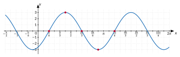{fig-alt="Figure du cours"}
:::
:::
:::

::: {#exercice-4-6 data-sorte="exercice" data-num="4.6" data-page="43" data-phys="46" data-id="5UAA5.ex.045" data-type="exercice" data-tags="" .exo}
::: {.exo-tete}
[✎ Exercice 4.6]{.exo-titre} [[A4]{.exo-comp} ★☆☆]{.exo-meta}
:::

::: {.exo-corps}
Trace, sur une période, le graphique de chaque fonction par la méthode des cinq points.

1. $f(x) = 2 \sin(x - \frac{\pi}{4})$
2. $g(x) = \sin(2 x + \frac{\pi}{2})$

::: {.grille style="--n:2"}
::: {.cellule}
::: {.typst-fig}
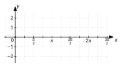{fig-alt="Figure du cours"}
:::
:::

::: {.cellule}
::: {.typst-fig}
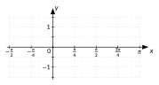{fig-alt="Figure du cours"}
:::
:::
:::
:::
:::

::: {.aides}
::: {.panel-tabset}
## Indice 1 {.unlisted}

Relis le paragraphe « Tracer par cinq points clés » et l’exemple qui suit.

## Indice 2 {.unlisted}

Pour quelles valeurs de $x$ l’argument vaut-il $0$, $\frac{\pi}{2}$, $\pi$, $\frac{3 \pi}{2}$, $2 \pi$ ?

## Indice 3 {.unlisted}

Résous « argument $= 0$ », puis ajoute chaque fois un quart de période.

## Solution {.unlisted}

::: {.solution-classe}
+ Argument $x - \frac{\pi}{4} = 0 ; \frac{\pi}{2} ; \pi ; \frac{3 \pi}{2} ; 2 \pi$ pour $x = \frac{\pi}{4} ; \frac{3 \pi}{4} ; \frac{5 \pi}{4} ; \frac{7 \pi}{4} ; \frac{9 \pi}{4}$ ; valeurs $0 ; 2 ; 0 ; -2 ; 0$.

1. Argument $2 x + \frac{\pi}{2} = 0 ; … ; 2 \pi$ pour $x = -\frac{\pi}{4} ; 0 ; \frac{\pi}{4} ; \frac{\pi}{2} ; \frac{3 \pi}{4}$ ; valeurs $0 ; 1 ; 0 ; -1 ; 0$. (On reconnaît $\cos(2 x)$.)
:::

## Pièges {.unlisted}

- Mettre les cinq points aux abscisses $0$, $\frac{\pi}{2}$, … sans tenir compte de l’argument.
- Relier les points par des segments.
:::
:::

::: {#exercice-4-7 data-sorte="exercice" data-num="4.7" data-page="44" data-phys="47" data-id="5UAA5.ex.046" data-type="exercice" data-tags="" .exo}
::: {.exo-tete}
[✎ Exercice 4.7]{.exo-titre} [[A4]{.exo-comp} ★★☆]{.exo-meta}
:::

::: {.exo-corps}
Trace, sur une période, le graphique de chaque fonction par la méthode des cinq points.

1. $f(x) = -2 \sin(x + \frac{\pi}{4})$
2. $g(x) = 3 \sin(\frac{x}{2})$

::: {.grille style="--n:2"}
::: {.cellule}
::: {.typst-fig}
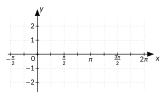{fig-alt="Figure du cours"}
:::
:::

::: {.cellule}
::: {.typst-fig}
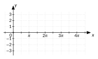{fig-alt="Figure du cours"}
:::
:::
:::
:::
:::

::: {.aides}
::: {.panel-tabset}
## Indice 1 {.unlisted}

Même méthode que l’exercice précédent : « Tracer par cinq points clés ».

## Indice 2 {.unlisted}

Si $a < 0$, la courbe monte-t-elle ou descend-elle après le premier point ?

## Indice 3 {.unlisted}

Calcule les cinq abscisses puis les ordonnées $0$, $a$, $0$, $-a$, $0$ (avec $a$ négatif pour $f$).

## Solution {.unlisted}

::: {.solution-classe}
+ Argument $x + \frac{\pi}{4} = 0 ; \frac{\pi}{2} ; \pi ; \frac{3 \pi}{2} ; 2 \pi$ pour $x = -\frac{\pi}{4} ; \frac{\pi}{4} ; \frac{3 \pi}{4} ; \frac{5 \pi}{4} ; \frac{7 \pi}{4}$ ; valeurs $0 ; -2 ; 0 ; 2 ; 0$ ($a = -2 < 0$ : la courbe descend d’abord).

1. Argument $\frac{x}{2} = 0 ; … ; 2 \pi$ pour $x = 0 ; \pi ; 2 \pi ; 3 \pi ; 4 \pi$ ; valeurs $0 ; 3 ; 0 ; -3 ; 0$. Période $4 \pi$.
:::

## Pièges {.unlisted}

- Oublier le signe de $a$.
- Pour $g$ : période $4 \pi$, pas $\pi$.
:::
:::

## Apparier

::: {#exercice-4-8 data-sorte="exercice" data-num="4.8" data-page="44" data-phys="47" data-id="5UAA5.ex.047" data-type="exercice" data-tags="" .exo}
::: {.exo-tete}
[✎ Exercice 4.8]{.exo-titre} [[A2]{.exo-comp} ★☆☆]{.exo-meta}
:::

::: {.exo-corps}
Associe chaque expression à son graphique (le graphique de $\sin$ est en pointillés).

::: {.grille style="--n:4"}
::: {.cellule}
(1) $1{,}5 \sin x$
:::

::: {.cellule}
(2) $\sin(3 x)$
:::

::: {.cellule}
(3) $\sin(x - \frac{\pi}{2})$
:::

::: {.cellule}
(4) $-\sin(2 x)$
:::
:::

::: {.grille style="--n:2"}
::: {.cellule}
::: {.typst-fig}
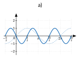{fig-alt="Figure du cours"}
:::
:::

::: {.cellule}
::: {.typst-fig}
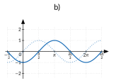{fig-alt="Figure du cours"}
:::
:::

::: {.cellule}
::: {.typst-fig}
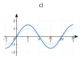{fig-alt="Figure du cours"}
:::
:::

::: {.cellule}
::: {.typst-fig}
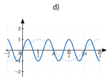{fig-alt="Figure du cours"}
:::
:::
:::
:::
:::

::: {.aides}
::: {.panel-tabset}
## Indice 1 {.unlisted}

Relis la [propriété « rôle de a et de b »](1-role-de-a-et-de.qmd#propriete-4-1) et la [propriété « rôle de c »](2-role-de-c-phase-et.qmd#propriete-4-2).

## Indice 2 {.unlisted}

Quel graphique a la même période que $\sin$ mais une autre amplitude ?

## Indice 3 {.unlisted}

Lis pour chaque graphique l’amplitude, la période et l’endroit où la courbe passe par $0$ en montant.

## Solution {.unlisted}

::: {.solution-classe}
(1) → c : période $2 \pi$, amplitude $1{,}5$. (2) → d : période $\frac{2 \pi}{3}$. (3) → b : l’argument s’annule en $x = \frac{\pi}{2}$, décalage de $\frac{\pi}{2}$ vers la droite. (4) → a : période $\pi$, courbe retournée (elle descend en partant de $0$).
:::

## Pièges {.unlisted}

- Confondre $\sin(3 x)$ et $3 \sin x$.
- Décaler $\sin(x - \frac{\pi}{2})$ vers la gauche.
:::
:::

::: {#exercice-4-9 data-sorte="exercice" data-num="4.9" data-page="45" data-phys="48" data-id="5UAA5.ex.048" data-type="exercice" data-tags="maison" .exo}
::: {.exo-tete}
[✎ Exercice 4.9]{.exo-titre} [⟵ à faire à la maison]{.exo-maison} [[A2]{.exo-comp} ★★☆]{.exo-meta}
:::

::: {.exo-corps}
Associe chaque expression à son graphique (le graphique de $\sin$ est en pointillés).

::: {.grille style="--n:3"}
::: {.cellule}
(1) $2 \sin x$
:::

::: {.cellule}
(2) $\sin(2 x)$
:::

::: {.cellule}
(3) $\sin(\frac{x}{2})$
:::

::: {.cellule}
(4) $\sin(x + \frac{\pi}{3})$
:::

::: {.cellule}
(5) $\sin(x - \frac{\pi}{3})$
:::

::: {.cellule}
(6) $-\sin x$
:::
:::

::: {.grille style="--n:3"}
::: {.cellule}
::: {.typst-fig}
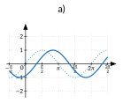{fig-alt="Figure du cours"}
:::
:::

::: {.cellule}
::: {.typst-fig}
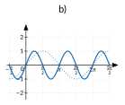{fig-alt="Figure du cours"}
:::
:::

::: {.cellule}
::: {.typst-fig}
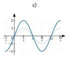{fig-alt="Figure du cours"}
:::
:::

::: {.cellule}
::: {.typst-fig}
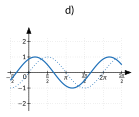{fig-alt="Figure du cours"}
:::
:::

::: {.cellule}
::: {.typst-fig}
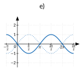{fig-alt="Figure du cours"}
:::
:::

::: {.cellule}
::: {.typst-fig}
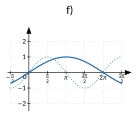{fig-alt="Figure du cours"}
:::
:::
:::
:::
:::

::: {.aides}
::: {.panel-tabset}
## Indice 1 {.unlisted}

Relis l’[activité « prédire, puis vérifier »](1-role-de-a-et-de.qmd#activite-4-1) et la [propriété « rôle de c »](2-role-de-c-phase-et.qmd#propriete-4-2).

## Indice 2 {.unlisted}

Pour $\sin(x + \frac{\pi}{3})$, où l’argument s’annule-t-il ?

## Indice 3 {.unlisted}

Classe d’abord les graphiques par période ($\pi$, $2 \pi$, $4 \pi$), puis par décalage.

## Solution {.unlisted}

(1) → c : même période que $\sin$, amplitude 2. (2) → b : période $\pi$. (3) → f : période $4 \pi$. (4) → d : l’argument s’annule en $x = -\frac{\pi}{3}$, décalage vers la gauche. (5) → a : décalage de $\frac{\pi}{3}$ vers la droite. (6) → e : courbe de $\sin$ retournée.

## Pièges {.unlisted}

- Confondre $b$ et la période : $\sin(2 x)$ a pour période $\pi$.
- Se tromper de sens pour le décalage.
:::
:::

## Retrouver l’expression

Pour retrouver une expression $a \sin(b x + c)$ à partir d’un graphique :

1. l’**amplitude** $|a|$ est la moitié de l’écart entre le maximum et le minimum ;
2. la **période** $T$ se lit entre deux maximums successifs ; on en déduit $b = \frac{2 \pi}{T}$ ;
3. on repère un point où la courbe passe par sa valeur moyenne **en montant** : l’argument doit y valoir $0$, ce qui donne $c$.

::: {#exemple-4-2 data-sorte="exemple" data-num="4.2" data-page="45" data-phys="48" data-id="5UAA5.exm.009" data-type="exemple" data-tags="" .theo .theo-exemple}
::: {.theo-head}
**Exemple 4.2**
:::

::: {.theo-body}
Le graphique ci-dessous varie entre $-2$ et $2$ : $a = 2$. Deux maximums successifs sont en $\frac{\pi}{2}$ et $\frac{3 \pi}{2}$ : $T = \pi$, donc $b = 2$. La courbe passe par $0$ en montant en $x = \frac{\pi}{4}$ : $2 \cdot \frac{\pi}{4} + c = 0$, donc $c = -\frac{\pi}{2}$. Expression : $f(x) = 2 \sin(2 x - \frac{\pi}{2})$.

::: {.typst-fig}
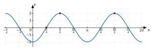{fig-alt="Figure du cours"}
:::
:::
:::

::: {#remarque-4-2 data-sorte="remarque" data-num="4.2" data-page="45" data-phys="48" data-id="5UAA5.rem.004" data-type="remarque" data-tags="" .theo .theo-remarque}
::: {.theo-head}
**Remarque 4.2**
:::

::: {.theo-body}
Plusieurs expressions conviennent pour un même graphique : on peut ajouter $2 \pi$ à $c$, ou choisir un autre point de départ. Toute expression qui redonne le graphique est correcte ; on la vérifie en calculant $f$ en deux ou trois points.
:::
:::

::: {#exercice-4-10 data-sorte="exercice" data-num="4.10" data-page="46" data-phys="49" data-id="5UAA5.ex.049" data-type="exercice" data-tags="" .exo}
::: {.exo-tete}
[✎ Exercice 4.10]{.exo-titre} [[A3]{.exo-comp} ★★☆]{.exo-meta}
:::

::: {.exo-corps}
Retrouve une expression de la forme $a \sin(b x + c)$ pour chaque graphique.

::: {.grille style="--n:3"}
::: {.cellule}
a)

::: {.typst-fig}
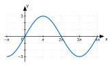{fig-alt="Figure du cours"}
:::
:::

::: {.cellule}
b)

::: {.typst-fig}
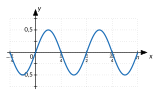{fig-alt="Figure du cours"}
:::
:::

::: {.cellule}
c)

::: {.typst-fig}
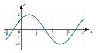{fig-alt="Figure du cours"}
:::
:::
:::
:::
:::

::: {.aides}
::: {.panel-tabset}
## Indice 1 {.unlisted}

Relis le paragraphe « Retrouver l’expression ».

## Indice 2 {.unlisted}

Entre quelles valeurs la courbe varie-t-elle ? Quelle distance sépare deux maximums ?

## Indice 3 {.unlisted}

Amplitude, puis $b = \frac{2 \pi}{T}$, puis $c$ par un point où la courbe passe par $0$ en montant.

## Solution {.unlisted}

::: {.solution-classe}
a) Amplitude 3 ; période $4 \pi$ (maximums en $\pi$ et $5 \pi$), donc $b = \frac{1}{2}$ ; passage par $0$ en montant en $x = 0$ : $c = 0$. $f(x) = 3 \sin(\frac{x}{2})$. \
 b) Amplitude $0{,}5$ ; période $\frac{\pi}{2}$, donc $b = 4$ ; $c = 0$. $f(x) = 0{,}5 \sin(4 x)$. \
 c) Amplitude 2 ; période $2 \pi$, $b = 1$ ; passage par $0$ en montant en $x = -\frac{\pi}{4}$ : $-\frac{\pi}{4} + c = 0$, $c = \frac{\pi}{4}$. $f(x) = 2 \sin(x + \frac{\pi}{4})$.
:::

## Pièges {.unlisted}

- Prendre l’écart total pour l’amplitude.
- Lire la période entre un maximum et un minimum (c’est une demi-période).
:::
:::

::: {#exercice-4-11 data-sorte="exercice" data-num="4.11" data-page="46" data-phys="49" data-id="5UAA5.ex.050" data-type="exercice" data-tags="maison" .exo}
::: {.exo-tete}
[✎ Exercice 4.11]{.exo-titre} [⟵ à faire à la maison]{.exo-maison} [[A3]{.exo-comp} ★★☆]{.exo-meta}
:::

::: {.exo-corps}
Retrouve une expression de la forme $a \sin(b x + c)$ pour chaque graphique, puis vérifie-la en un point.

::: {.grille style="--n:2"}
::: {.cellule}
a)

::: {.typst-fig}
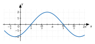{fig-alt="Figure du cours"}
:::
:::

::: {.cellule}
b)

::: {.typst-fig}
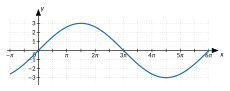{fig-alt="Figure du cours"}
:::
:::
:::
:::
:::

::: {.aides}
::: {.panel-tabset}
## Indice 1 {.unlisted}

Relis le paragraphe « Retrouver l’expression » et la remarque qui suit.

## Indice 2 {.unlisted}

Où la courbe passe-t-elle par $0$ en montant ?

## Indice 3 {.unlisted}

Amplitude, période, $b = \frac{2 \pi}{T}$, puis $c$ tel que l’argument s’annule en ce point. Vérifie en un maximum.

## Solution {.unlisted}

a) Amplitude 2 ; deux maximums successifs en $\frac{5 \pi}{6}$ et $\frac{17 \pi}{6}$ : période $2 \pi$, $b = 1$ ; passage par $0$ en montant en $x = \frac{\pi}{3}$ : $\frac{\pi}{3} + c = 0$, $c = -\frac{\pi}{3}$. $f(x) = 2 \sin(x - \frac{\pi}{3})$. Vérification : $f(\frac{5 \pi}{6}) = 2 \sin(\frac{\pi}{2}) = 2$. \
 b) Amplitude 3 ; maximums en $\frac{3 \pi}{2}$ et $\frac{15 \pi}{2}$ : période $6 \pi$, $b = \frac{2 \pi}{6 \pi} = \frac{1}{3}$ ; passage par $0$ en montant en $x = 0$ : $c = 0$. $f(x) = 3 \sin(\frac{x}{3})$. Vérification : $f(\frac{3 \pi}{2}) = 3 \sin(\frac{\pi}{2}) = 3$.

## Pièges {.unlisted}

- Choisir un point où la courbe passe par $0$ en descendant.
- Oublier la vérification.
:::
:::

## Si le temps le permet : caractéristiques à partir de l’expression

On peut trouver les caractéristiques d’une transformée sans la tracer, en raisonnant sur l’effet des paramètres sur la fonction $\sin$.

::: {#exemple-4-3 data-sorte="exemple" data-num="4.3" data-page="46" data-phys="49" data-id="5UAA5.exm.010" data-type="exemple" data-tags="" .theo .theo-exemple}
::: {.theo-head}
**Exemple 4.3**
:::

::: {.theo-body}
$f(x) = 3 \sin(2 x - \frac{\pi}{3})$.

- Domaine : $\mathbb{R}$, comme $\sin$.
- Période : $\frac{2 \pi}{2} = \pi$ : l’argument fait un tour quand $x$ parcourt un intervalle de longueur $\pi$.
- Ensemble image : $[-3 ; 3]$ : $\sin$ prend toutes les valeurs de $[-1 ; 1]$, multipliées par 3.
- Zéros : $\sin(2 x - \frac{\pi}{3}) = 0$ ssi $2 x - \frac{\pi}{3} = k \pi$, donc $x = \frac{\pi}{6} + \frac{k \pi}{2}$ ($k \in \mathbb{Z}$).
:::
:::

::: {#exercice-4-12 data-sorte="exercice" data-num="4.12" data-page="46" data-phys="49" data-id="5UAA5.ex.051" data-type="exercice" data-tags="" .exo}
::: {.exo-tete}
[✎ Exercice 4.12]{.exo-titre} [[A9]{.exo-comp} ★★☆]{.exo-meta}
:::

::: {.exo-corps}
Détermine le domaine, la période, l’ensemble image et les zéros de $f(x) = -3 \sin(\frac{x}{2} - \frac{\pi}{6})$.
:::
:::

::: {.aides}
::: {.panel-tabset}
## Indice 1 {.unlisted}

Relis l’exemple « $f(x) = 3 \sin(2 x - \frac{\pi}{3})$ » de « Si le temps le permet ».

## Indice 2 {.unlisted}

Pour quels arguments $u$ a-t-on $\sin u = 0$ ?

## Indice 3 {.unlisted}

Zéros : argument $= k \pi$, puis isole $x$ (multiplie aussi $k \pi$ par 2).

## Solution {.unlisted}

::: {.solution-classe}
Domaine $\mathbb{R}$. Période $\frac{2 \pi}{\frac{1}{2}} = 4 \pi$. Ensemble image $[-3 ; 3]$ ($\sin$ prend toutes les valeurs de $[-1 ; 1]$, multipliées par $-3$). Zéros : $\frac{x}{2} - \frac{\pi}{6} = k \pi$, donc $\frac{x}{2} = \frac{\pi}{6} + k \pi$ et $x = \frac{\pi}{3} + 2 k \pi$ ($k \in \mathbb{Z}$).
:::

## Pièges {.unlisted}

- Écrire l’ensemble image $[3 ; -3]$ ou $[-1 ; 1]$.
- Oublier de multiplier $k \pi$ par 2.
:::
:::

::: {#exercice-4-13 data-sorte="exercice" data-num="4.13" data-page="47" data-phys="50" data-id="5UAA5.ex.052" data-type="exercice" data-tags="maison" .exo}
::: {.exo-tete}
[✎ Exercice 4.13]{.exo-titre} [⟵ à faire à la maison]{.exo-maison} [[A9]{.exo-comp} ★★★]{.exo-meta}
:::

::: {.exo-corps}
Détermine le domaine, la période, l’ensemble image et les zéros de $g(x) = -2 \sin(\frac{x}{2} + \frac{\pi}{4})$.
:::
:::

::: {.aides}
::: {.panel-tabset}
## Indice 1 {.unlisted}

Même méthode que l’exercice précédent.

## Indice 2 {.unlisted}

Que donne $\frac{x}{2} + \frac{\pi}{4} = k \pi$ ?

## Indice 3 {.unlisted}

Isole $\frac{x}{2}$, puis multiplie tout par 2.

## Solution {.unlisted}

Domaine $\mathbb{R}$. Période $\frac{2 \pi}{\frac{1}{2}} = 4 \pi$. Ensemble image $[-2 ; 2]$ ($\sin$ prend toutes les valeurs de $[-1 ; 1]$, multipliées par $-2$). Zéros : $\frac{x}{2} + \frac{\pi}{4} = k \pi$, donc $x = -\frac{\pi}{2} + 2 k \pi$ ($k \in \mathbb{Z}$).

## Pièges {.unlisted}

- Oublier de multiplier $k \pi$ par 2.
- Le signe de $a$ ne change pas l’ensemble image.
:::
:::

::: {.ae-lien}
[✔ S'autoévaluer sur cette section : test de 6 questions →](../autoeval.qmd#sections=sec-tracer-apparier)
:::
