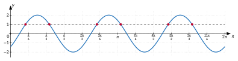

<!-- GÉNÉRÉ par typweb à partir des notes Typst : NE PAS ÉDITER (les modifications seraient écrasées). -->

::: {.callout-note title="Question Q9."}
Quand la cabine dépasse-t-elle une hauteur donnée ?
:::

Pour résoudre $a \sin(b x + c) = k$, on isole le sinus, on résout l’équation $\sin u = \frac{k}{a}$ par rapport à l’argument $u = b x + c$ (chapitre 2), puis on revient à $x$.

::: {#exemple-4-4 data-sorte="exemple" data-num="4.4" data-page="47" data-phys="50" data-id="5UAA5.exm.011" data-type="exemple" data-tags="" .theo .theo-exemple}
::: {.theo-head}
**Exemple 4.4**
:::

::: {.theo-body}
Résoudre $2 \sin(3 x - \frac{\pi}{4}) = 1$, puis donner les solutions dans $[0 ; 2 \pi]$.

- On isole le sinus : $\sin(3 x - \frac{\pi}{4}) = \frac{1}{2}$.
- On résout pour l’argument : $3 x - \frac{\pi}{4} = \frac{\pi}{6} + 2 k \pi$ ou $3 x - \frac{\pi}{4} = \frac{5 \pi}{6} + 2 k \pi$ ($k \in \mathbb{Z}$).
- On revient à $x$ : $3 x = \frac{5 \pi}{12} + 2 k \pi$ ou $3 x = \frac{13 \pi}{12} + 2 k \pi$, donc $x = \frac{5 \pi}{36} + \frac{2 k \pi}{3}$ ou $x = \frac{13 \pi}{36} + \frac{2 k \pi}{3}$.
- Dans $[0 ; 2 \pi] = [0 ; \frac{72 \pi}{36}]$, avec $\frac{2 \pi}{3} = \frac{24 \pi}{36}$ : $k = 0, 1, 2$ donnent $\frac{5 \pi}{36}$ ; $\frac{29 \pi}{36}$ ; $\frac{53 \pi}{36}$ et $\frac{13 \pi}{36}$ ; $\frac{37 \pi}{36}$ ; $\frac{61 \pi}{36}$. Six solutions.

::: {.typst-fig}
{fig-alt="Figure du cours"}
:::

Contrôle graphique : la droite $y = 1$ coupe la courbe six fois sur $[0 ; 2 \pi]$ (deux fois par période, et la période vaut $\frac{2 \pi}{3}$).
:::
:::

::: {.callout-warning title="Piège"}
Diviser par $b$ **seulement** le $2 k \pi$ oublié : $3 x = … + 2 k \pi$ donne $x = … + \frac{2 k \pi}{3}$, pas $… + 2 k \pi$. Les solutions sont plus serrées parce que la période est plus courte.
:::

::: {#exercice-4-14 data-sorte="exercice" data-num="4.14" data-page="47" data-phys="50" data-id="5UAA5.ex.053" data-type="exercice" data-tags="" .exo}
::: {.exo-tete}
[✎ Exercice 4.14]{.exo-titre} [[A6]{.exo-comp} ★☆☆]{.exo-meta}
:::

::: {.exo-corps}
Résous :

1. $\sin(2 x) = \frac{1}{2}$ dans $[0 ; 2 \pi]$ ;
2. $3 \sin(x - \frac{\pi}{4}) = 1{,}5$ dans $\mathbb{R}$ ;
3. $4 \sin(\frac{\pi}{6} x) = 2$ dans $\mathbb{R}$.
:::
:::

::: {.aides}
::: {.panel-tabset}
## Indice 1 {.unlisted}

Relis l’exemple de la section « Équations $a \sin(b x + c) = k$ ».

## Indice 2 {.unlisted}

Que vaut le sinus une fois isolé ? Pour quels arguments vaut-il $\frac{1}{2}$ ?

## Indice 3 {.unlisted}

Résous pour l’argument (deux familles), puis isole $x$ en divisant aussi $2 k \pi$.

## Solution {.unlisted}

::: {.solution-classe}
+ $2 x = \frac{\pi}{6} + 2 k \pi$ ou $2 x = \frac{5 \pi}{6} + 2 k \pi$, donc $x = \frac{\pi}{12} + k \pi$ ou $x = \frac{5 \pi}{12} + k \pi$. Dans $[0 ; 2 \pi]$ : $\frac{\pi}{12}$ ; $\frac{5 \pi}{12}$ ; $\frac{13 \pi}{12}$ ; $\frac{17 \pi}{12}$.

1. $\sin(x - \frac{\pi}{4}) = \frac{1}{2}$ : $x - \frac{\pi}{4} = \frac{\pi}{6} + 2 k \pi$ ou $x - \frac{\pi}{4} = \frac{5 \pi}{6} + 2 k \pi$, donc $x = \frac{5 \pi}{12} + 2 k \pi$ ou $x = \frac{13 \pi}{12} + 2 k \pi$ ($k \in \mathbb{Z}$).
2. $\sin(\frac{\pi}{6} x) = \frac{1}{2}$ : $\frac{\pi}{6} x = \frac{\pi}{6} + 2 k \pi$ ou $\frac{\pi}{6} x = \frac{5 \pi}{6} + 2 k \pi$, donc $x = 1 + 12 k$ ou $x = 5 + 12 k$ ($k \in \mathbb{Z}$).
:::

## Pièges {.unlisted}

- Oublier la seconde famille.
- Ne pas diviser $2 k \pi$ par $b$.
:::
:::

::: {#exercice-4-15 data-sorte="exercice" data-num="4.15" data-page="48" data-phys="51" data-id="5UAA5.ex.054" data-type="exercice" data-tags="" .exo}
::: {.exo-tete}
[✎ Exercice 4.15]{.exo-titre} [[A6]{.exo-comp} ★★☆]{.exo-meta}
:::

::: {.exo-corps}
Résous $2 \sin(3 x) = -1$ dans $[0 ; \pi]$. Contrôle le nombre de solutions sur un graphique.
:::
:::

::: {.aides}
::: {.panel-tabset}
## Indice 1 {.unlisted}

Même méthode que l’exercice précédent, puis on garde les solutions de l’intervalle.

## Indice 2 {.unlisted}

Quels arguments ont un sinus égal à $-\frac{1}{2}$ ?

## Indice 3 {.unlisted}

$3 x = -\frac{\pi}{6} + 2 k \pi$ ou $\frac{7 \pi}{6} + 2 k \pi$ ; divise par 3 ; essaie $k = 0, 1, 2$.

## Solution {.unlisted}

::: {.solution-classe}
$\sin(3 x) = -\frac{1}{2}$ : $3 x = -\frac{\pi}{6} + 2 k \pi$ ou $3 x = \frac{7 \pi}{6} + 2 k \pi$, donc $x = -\frac{\pi}{18} + \frac{2 k \pi}{3}$ ou $x = \frac{7 \pi}{18} + \frac{2 k \pi}{3}$. Dans $[0 ; \pi]$ : $\frac{7 \pi}{18}$ ($k = 0$) et $-\frac{\pi}{18} + \frac{2 \pi}{3} = \frac{11 \pi}{18}$ ($k = 1$). Deux solutions : sur $[0 ; \pi]$, la courbe (période $\frac{2 \pi}{3}$) ne descend sous $-1$ qu’une fois, entre $\frac{7 \pi}{18}$ et $\frac{11 \pi}{18}$.
:::

## Pièges {.unlisted}

- Garder $-\frac{\pi}{18}$, qui n’est pas dans $[0 ; \pi]$.
- Oublier $k = 1$.
:::
:::

::: {#exercice-4-16 data-sorte="exercice" data-num="4.16" data-page="48" data-phys="51" data-id="5UAA5.ex.055" data-type="exercice" data-tags="" .exo}
::: {.exo-tete}
[✎ Exercice 4.16]{.exo-titre} [[A6]{.exo-comp} ★★★]{.exo-meta}
:::

::: {.exo-corps}
Résous $5 \sin(2 x + 1) = 2$ dans $[0 ; \pi]$ (quatre décimales).
:::
:::

::: {.aides}
::: {.panel-tabset}
## Indice 1 {.unlisted}

Même méthode, avec la calculatrice : [exemple « avec la calculatrice, dans un intervalle »](../ch2-le-cercle-trigonomet/3-equations-sin-x-a-et.qmd#exemple-2-4).

## Indice 2 {.unlisted}

Si $x$ parcourt $[0 ; \pi]$, quel intervalle parcourt l’argument $u = 2 x + 1$ ?

## Indice 3 {.unlisted}

Cherche les $u$ de $[1 ; 2 \pi + 1]$ tels que $\sin u = 0{,}4$, puis $x = \frac{u - 1}{2}$.

## Solution {.unlisted}

::: {.solution-classe}
$\sin(2 x + 1) = 0{,}4$. Pour l’argument $u = 2 x + 1$ : $u \approx 0{,}4115 + 2 k \pi$ ou $u \approx 2{,}7301 + 2 k \pi$. Si $x \in [0 ; \pi]$, alors $u \in [1 ; 2 \pi + 1] \approx [1 ; 7{,}2832]$ : on garde $u \approx 2{,}7301$ et $u \approx 0{,}4115 + 2 \pi \approx 6{,}6947$. Alors $x = \frac{u - 1}{2}$ : $x \approx 0{,}8650$ et $x \approx 2{,}8474$.
:::

## Pièges {.unlisted}

- Garder $u \approx 0{,}4115$, qui donne un $x$ négatif.
- Oublier de soustraire 1 avant de diviser par 2.
:::
:::

::: {.ae-lien}
[✔ S'autoévaluer sur cette section : test de 3 questions →](../autoeval.qmd#sections=sec-equations-asin)
:::
