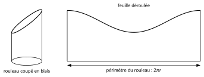
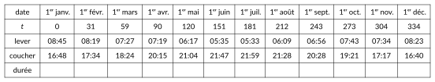
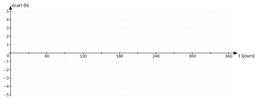

<!-- GÉNÉRÉ par typweb à partir des notes Typst : NE PAS ÉDITER (les modifications seraient écrasées). -->

::: {.callout-note title="Question Q10."}
Le même outil décrit-il d’autres phénomènes qui se répètent ? **Q11.** Le modèle colle-t-il aux données ?
:::

## Le cylindre tronqué

::: {#activite-5-1 data-sorte="activite" data-num="5.1" data-page="49" data-phys="52" data-id="5UAA5.enrouler-couper-derouler" data-type="activite" data-tags="" .theo .theo-activite}
::: {.theo-head}
**Activité 5.1** — enrouler, couper, dérouler
:::

::: {.theo-body}
Enroule une feuille autour d’un rouleau en carton (ou d’une bouteille), et fixe-la. Coupe le rouleau en biais, en un seul trait de scie (ou trace un trait sur la feuille en suivant une feuille plane posée en biais). Déroule la feuille.

::: {.typst-fig}
{fig-alt="Figure du cours"}
:::

1. Quelle courbe le bord de la feuille dessine-t-il ?

   ::: {.rep-bloc}
   Une sinusoïde : le bord monte et descend régulièrement, avec une période égale au périmètre du rouleau.
   :::
2. Explique pourquoi, à l’aide du cercle trigonométrique.

   ::: {.rep-bloc}
   Prenons un rouleau de rayon $r$ et repérons un point du bord de la feuille par la longueur $s$ de l’arc qui le sépare, sur le rouleau, d’un point de départ. Ce point a tourné de l’angle $\frac{s}{r}$ (en radians) autour de l’axe du rouleau. Le plan de coupe est incliné dans une direction : la hauteur de la coupe augmente proportionnellement à la position du point dans cette direction, c’est-à-dire, si on choisit bien le point de départ, proportionnellement à $\sin(\frac{s}{r})$. La hauteur du bord vaut donc $h(s) = h_{0} + k \sin(\frac{s}{r})$, où $h_{0}$ est la hauteur moyenne de la coupe et $k$ dépend de l’inclinaison. Sur la feuille déroulée, $s$ devient l’abscisse : le bord est une sinusoïde de période $2 \pi r$, le périmètre du rouleau. On retrouve le radian : l’angle est l’arc divisé par le rayon.
   :::
:::
:::

::: {#remarque-5-1 data-sorte="remarque" data-num="5.1" data-page="50" data-phys="53" data-id="5UAA5.rem.005" data-type="remarque" data-tags="" .theo .theo-remarque}
::: {.theo-head}
**Remarque 5.1**
:::

::: {.theo-body}
De la même façon, la projection d’un ressort (une hélice) sur un mur, éclairé par le côté, dessine une sinusoïde.
:::
:::

## La durée du jour à Uccle

L’Observatoire royal de Belgique publie chaque année les heures de lever et de coucher du Soleil à Uccle^[Observatoire royal de Belgique, « Lever et coucher de soleil en 2026 », robinfo.oma.be (heure légale belge).]. Voici celles du premier jour de chaque mois de 2026 ($t$ est le numéro du jour, le 1^er^ janvier étant le jour 0).

::: {.typst-fig}
{fig-alt="Figure du cours"}
:::

::: {#activite-5-2 data-sorte="activite" data-num="5.2" data-page="50" data-phys="53" data-id="5UAA5.modeliser-duree-jour" data-type="activite" data-tags="" .theo .theo-activite}
::: {.theo-head}
**Activité 5.2** — modéliser la durée du jour
:::

::: {.theo-body}
1. Calcule la durée du jour le 1^er^ de chaque mois et complète la dernière ligne du tableau.
2. Le jour le plus long de 2026 est le 21 juin (lever 05:29, coucher 22:00) ; le plus court, le 21 décembre (lever 08:42, coucher 16:39). Calcule ces deux durées, puis la durée moyenne $m$ (la moyenne de la plus longue et de la plus courte) et l’amplitude $a$ (leur demi-écart), en heures (deux décimales).

   ::: {.rep-bloc}
   Durées : 16 h 31 et 7 h 57, soit 991 et 477 minutes. Moyenne : $\frac{991 + 477}{2} = 734$ min $= 12$ h $14 \approx 12{,}23$ h. Amplitude : $\frac{991 - 477}{2} = 257$ min $\approx 4{,}28$ h.
   :::
3. On modélise l’**écart à la durée moyenne** (durée $-$ $12{,}23$ h) par une fonction $E(t) = a \sin(b t + c)$. Quelle est la période ? Déduis-en $b$.

   ::: {.rep-bloc}
   Le phénomène se répète chaque année : $T = 365$ jours, donc $b = \frac{2 \pi}{365} \approx 0{,}0172$ (radian par jour).
   :::
4. Le 21 mars (jour 79), la durée du jour vaut 12 h 14, la durée moyenne, et elle augmente. Déduis-en $c$.

   ::: {.rep-bloc}
   L’écart s’annule en augmentant en $t = 79$ : l’argument y vaut $0$. $\frac{2 \pi}{365} \cdot 79 + c = 0$ donne $c = -\frac{2 \pi \cdot 79}{365} \approx -1{,}3599$. Modèle : $E(t) = 4{,}28 \sin(\frac{2 \pi}{365} (t - 79))$.
   :::
5. Place les écarts mesurés dans le repère, trace le modèle et compare.

   ::: {.typst-fig}
   {fig-alt="Figure du cours"}
   :::

   ::: {.rep-bloc}
   Le modèle suit bien les données : l’écart entre le modèle et les données ne dépasse pas une vingtaine de minutes (la plus grande différence, parmi les dates du tableau, est le 1^er^ novembre : environ 21 min). Le modèle est une approximation : les données ne sont pas exactement sinusoïdales.
   :::
:::
:::

::: {.ae-lien}
[✔ S'autoévaluer sur cette section : test de 2 questions →](../autoeval.qmd#sections=sec-sinusoides-partout)
:::
