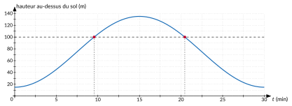

<!-- GÉNÉRÉ par typweb à partir des notes Typst : NE PAS ÉDITER (les modifications seraient écrasées). -->

::: {.callout-note title="Question Q0."}
Retour à la question du cours. **Q9.** Quand la cabine dépasse-t-elle une hauteur donnée ? **Q11.** Jusqu’où peut-on faire confiance à la réponse ?
:::

::: {#activite-5-3 data-sorte="activite" data-num="5.3" data-page="51" data-phys="54" data-id="5UAA5.plus-100-m-dessus-sol" data-type="activite" data-tags="" .theo .theo-activite}
::: {.theo-head}
**Activité 5.3** — plus de 100 m au-dessus du sol
:::

::: {.theo-body}
L’axe de la roue est à $135 - 60 = 75$ m du sol, et la hauteur de la cabine au-dessus de l’axe vaut $h(t) = 60 \sin(\frac{\pi}{15} t - \frac{\pi}{2})$ ($t$ en min, départ au point le plus bas).

1. À quelle hauteur au-dessus du sol la cabine est-elle après 5 minutes ? après 12 minutes ?

   ::: {.rep-bloc}
   $75 + h(5) = 75 + 60 \sin(\frac{\pi}{3} - \frac{\pi}{2}) = 75 + 60 \sin(-\frac{\pi}{6}) = 75 - 30 = 45$ m. \
   $75 + h(12) = 75 + 60 \sin(\frac{4 \pi}{5} - \frac{\pi}{2}) = 75 + 60 \sin(\frac{3 \pi}{10}) \approx 75 + 48{,}54 = 123{,}54$ m.
   :::
2. Pendant combien de temps, sur un tour, une cabine est-elle à plus de 100 m du sol ?

   ::: {.rep-bloc}
   La cabine est à plus de 100 m du sol quand $75 + h(t) > 100$, c’est-à-dire $h(t) > 25$. On résout d’abord l’équation $60 \sin(\frac{\pi}{15} t - \frac{\pi}{2}) = 25$, soit $\sin u = \frac{25}{60} = \frac{5}{12}$ avec $u = \frac{\pi}{15} t - \frac{\pi}{2}$.

   - La calculatrice donne $u \approx 0{,}430$ ; le cercle donne la seconde solution, $u \approx \pi - 0{,}430 \approx 2{,}712$.
   - On revient à $t$ : $t = (u + \frac{\pi}{2}) \cdot \frac{15}{\pi}$, d’où $t \approx 9{,}55$ min et $t \approx 20{,}45$ min (premier tour).
   - Entre ces deux instants, la cabine passe par le sommet ($t = 15$) : elle est au-dessus de 100 m. Durée : $20{,}45 - 9{,}55 \approx 10{,}9$ min.
   - Contrôle : les deux instants sont symétriques par rapport au sommet, $t = 15$ : $15 - 9{,}55 = 20{,}45 - 15 = 5{,}45$.

   Sur chaque tour de 30 minutes, une cabine passe environ 10,9 minutes à plus de 100 m du sol.

   ::: {.typst-fig}
   {fig-alt="Figure du cours"}
   :::
   :::
:::
:::

::: {#remarque-5-2 data-sorte="remarque" data-num="5.2" data-page="52" data-phys="55" data-id="5UAA5.limites-modele" data-type="remarque" data-tags="" .theo .theo-remarque}
::: {.theo-head}
**Remarque 5.2**
:::

::: {.theo-body}
- Les données sont approchées : « environ 30 minutes » par tour, et la vitesse annoncée par la même source n’est pas cohérente avec cette durée (exercice 1.10).
- La cabine est accrochée à l’extérieur de la jante : son centre n’est pas exactement sur le cercle de rayon 60 m.
- La roue s’arrête parfois, ou ralentit pour l’embarquement : le mouvement n’est alors plus régulier, et la formule ne s’applique plus.
- Pour la durée du jour, le modèle a été construit à Uccle : à une autre latitude, la durée moyenne reste proche de 12 h, mais l’amplitude change. Le modèle décrit des données ; il ne les remplace pas.
:::
:::

::: {#exercice-5-1 data-sorte="exercice" data-num="5.1" data-page="52" data-phys="55" data-id="5UAA5.ex.056" data-type="exercice" data-tags="" .exo}
::: {.exo-tete}
[✎ Exercice 5.1]{.exo-titre} [[T1]{.exo-comp} ★★☆]{.exo-meta}
:::

::: {.exo-corps}
On utilise le modèle de la durée du jour à Uccle : durée $= 12{,}23 + 4{,}28 \sin(\frac{2 \pi}{365} (t - 79))$ (en heures, $t$ = numéro du jour, 1^er^ janvier = 0).

1. Entre quels jours de l’année la durée du jour dépasse-t-elle 15 heures, d’après le modèle ? Donne les dates.
2. Compare avec les données de l’ORB : 1^er^ mai : 14 h 47 ; 15 mai : 15 h 31 ; 1^er^ août : 15 h 19 ; 15 août : 14 h 33.
:::
:::

::: {.aides}
::: {.panel-tabset}
## Indice 1 {.unlisted}

Relis l’[activité « modéliser la durée du jour »](1-des-sinusoides-partout.qmd#activite-5-2) et la section « Équations $a \sin(b x + c) = k$ ».

## Indice 2 {.unlisted}

Que doit valoir $\sin u$ pour que la durée vaille 15 h ?

## Indice 3 {.unlisted}

$\sin u = \frac{15 - 12{,}23}{4{,}28}$ ; deux valeurs de $u$ ; puis $t = 79 + u \cdot \frac{365}{2 \pi}$.

## Solution {.unlisted}

::: {.solution-classe}
+ $12{,}23 + 4{,}28 \sin u = 15$ avec $u = \frac{2 \pi}{365} (t - 79)$ : $\sin u = \frac{2{,}77}{4{,}28} \approx 0{,}6472$. La calculatrice donne $u \approx 0{,}7039$ ; le cercle donne $u \approx \pi - 0{,}7039 \approx 2{,}4377$. Alors $t = 79 + u \cdot \frac{365}{2 \pi}$ : $t \approx 119{,}9$ et $t \approx 220{,}6$, soit le jour 120 (1^er^ mai) et le jour 221 (10 août). D’après le modèle, le jour dure plus de 15 h du 1^er^ mai au 10 août environ.

1. D’après les données, la durée dépasse 15 h entre le 1^er^ mai (14 h 47) et le 15 mai (15 h 31), et repasse sous 15 h entre le 1^er^ août (15 h 19) et le 15 août (14 h 33). Le modèle avance donc le début de quelques jours : il donne la bonne période de l’année, mais pas la date exacte.
:::

## Pièges {.unlisted}

- Oublier de soustraire $12{,}23$ avant de diviser.
- Convertir un numéro de jour en date sans compter le 1^er^ janvier comme jour 0.
:::
:::

::: {#exercice-5-2 data-sorte="exercice" data-num="5.2" data-page="52" data-phys="55" data-id="5UAA5.ex.057" data-type="exercice" data-tags="" .exo}
::: {.exo-tete}
[✎ Exercice 5.2]{.exo-titre} [[T1]{.exo-comp} ★★☆]{.exo-meta}
:::

::: {.exo-corps}
Une roue de vélo de 70 cm de diamètre roule sans glisser. La valve est fixée sur la jante ; au départ, elle touche le sol.

1. Quand la roue a parcouru une distance $d$ (en cm), de quel angle a-t-elle tourné ? Justifie.
2. Montre que la hauteur de la valve au-dessus de l’axe de la roue vaut $e(d) = 35 \sin(\frac{d}{35} - \frac{\pi}{2})$.
3. Sur le premier tour, pour quelles distances la valve est-elle à plus de 50 cm du sol ?
:::
:::

::: {.aides}
::: {.panel-tabset}
## Indice 1 {.unlisted}

Relis la [définition du radian](../ch1-tourner-angles-arcs/3-le-radian-mesurer-un-arc.qmd#definition-1-1) et le modèle de la cabine.

## Indice 2 {.unlisted}

Quand la roue roule sans glisser, quelle longueur de jante a touché le sol ?

## Indice 3 {.unlisted}

Angle $= \frac{d}{35}$. La valve part du point le plus bas, comme la cabine : $c = -\frac{\pi}{2}$. Pour 50 cm du sol : $e(d) > 15$.

## Solution {.unlisted}

::: {.solution-classe}
+ La roue roule sans glisser : l’arc de jante qui a touché le sol a la même longueur que la distance parcourue. L’angle de rotation vaut donc $\frac{d}{35}$ radians (arc divisé par le rayon).

1. C’est le mouvement de la cabine, avec un rayon de 35 cm et l’angle $\frac{d}{35}$ au lieu de $\frac{\pi}{15} t$ : la valve part du point le plus bas, donc $e(d) = 35 \sin(\frac{d}{35} - \frac{\pi}{2})$. Contrôle : $e(0) = -35$ (au sol), $e(35 \pi) = 35 \sin(\frac{\pi}{2}) = 35$ (au sommet, après un demi-tour).
2. L’axe est à 35 cm du sol : il faut $e(d) > 15$. On résout $\sin(\frac{d}{35} - \frac{\pi}{2}) = \frac{15}{35} = \frac{3}{7}$ : la calculatrice donne $0{,}4429$, le cercle $\pi - 0{,}4429$. Donc $d = 35(\frac{\pi}{2} + 0{,}4429) \approx 70{,}48$ cm et $d = 35(\frac{3 \pi}{2} - 0{,}4429) \approx 149{,}43$ cm. La valve est à plus de 50 cm du sol pour $d$ entre environ 70,48 cm et 149,43 cm, soit sur environ 79 cm d’un tour de $70 \pi \approx 220$ cm.
:::

## Pièges {.unlisted}

- Prendre le diamètre comme rayon.
- Résoudre $e(d) > 50$ en oubliant que $e$ est mesurée depuis l’axe.
:::
:::

::: {#exercice-5-3 data-sorte="exercice" data-num="5.3" data-page="52" data-phys="55" data-id="5UAA5.ex.058" data-type="exercice" data-tags="maison" .exo}
::: {.exo-tete}
[✎ Exercice 5.3]{.exo-titre} [⟵ à faire à la maison]{.exo-maison} [[T1]{.exo-comp} ★★★]{.exo-meta}
:::

::: {.exo-corps}
*(Situation imaginée.)* Un objet suspendu à un ressort oscille verticalement : sa distance au point d’attache varie entre 12 cm et 28 cm, et il fait 5 oscillations complètes en 4 secondes. À l’instant $t = 0$, il est au plus près du point d’attache, à 12 cm.

1. Écris l’écart $y(t)$ entre l’objet et sa position moyenne (positif vers le bas, $t$ en s) sous la forme $A \sin(\omega t + \varphi)$.
2. À quels instants de la première oscillation l’objet est-il à 24 cm du point d’attache ?
:::
:::

::: {.aides}
::: {.panel-tabset}
## Indice 1 {.unlisted}

Relis la remarque « notation physique » et la [propriété « rôle de c »](../ch4-la-fonction-x-a-sin/2-role-de-c-phase-et.qmd#propriete-4-2).

## Indice 2 {.unlisted}

Quelle est la position moyenne ? Quelle est la période d’une oscillation ?

## Indice 3 {.unlisted}

$A = 8$ ; $T = \frac{4}{5}$ ; à $t = 0$ l’écart est minimal : comme la cabine au point bas, $\varphi = -\frac{\pi}{2}$.

## Solution {.unlisted}

+ Position moyenne : $\frac{12 + 28}{2} = 20$ cm ; amplitude $A = \frac{28 - 12}{2} = 8$ cm. Période : $T = \frac{4}{5} = 0{,}8$ s, donc $\omega = \frac{2 \pi}{0{,}8} = \frac{5 \pi}{2}$ rad/s. À $t = 0$, l’écart vaut $-8$ (minimum) : comme pour la cabine, $\varphi = -\frac{\pi}{2}$. Donc $y(t) = 8 \sin(\frac{5 \pi}{2} t - \frac{\pi}{2})$.

1. À 24 cm du point d’attache, l’écart vaut $+4$ : $\sin(\frac{5 \pi}{2} t - \frac{\pi}{2}) = \frac{1}{2}$, donc $\frac{5 \pi}{2} t - \frac{\pi}{2} = \frac{\pi}{6}$ ou $\frac{5 \pi}{6}$, d’où $t = \frac{2 \pi}{3} \cdot \frac{2}{5 \pi} \approx 0{,}2667$ s et $t = \frac{4 \pi}{3} \cdot \frac{2}{5 \pi} \approx 0{,}5333$ s.

## Pièges {.unlisted}

- Prendre 5 (oscillations) comme période.
- Oublier que l’écart est compté depuis la position moyenne (20 cm).
:::
:::

**Synthèse : questions et réponses**

Chaque question du cours, la section où elle est traitée et sa réponse. Les questions marquées *détour* ne viennent pas de la cabine mais du programme. Pour réviser, cache la colonne « réponse » et vérifie que tu sais répondre à chaque question.

::: {.tableau}
| **Code** | **Question** | **Section** | **Réponse** |
|:---:|:---:|:---:|:---:|
| Q0 | À quelle hauteur sera une cabine du London Eye au bout de $t$ minutes ? Quand dépassera-t-elle 100 m ? | 1.1 → 5.2 | $h(t) = 75 + 60 \sin(\frac{\pi}{15} t - \frac{\pi}{2})$ (m au-dessus du sol) ; au-dessus de 100 m pendant environ 10,9 min par tour. |
| Q1 | Quelle distance la cabine parcourt-elle en $t$ minutes ? | 1.2 | Longueur d’arc, proportionnelle à l’angle : $\ell = \frac{\alpha}{360} \cdot 2 \pi r$ ; ici $4 \pi t$ m. |
| Q1′ | *Détour.* Quelle aire balaie un rayon de la roue ? | 1.2 | Aire du disque $\pi r^{2}$ (anneaux, par défaut et par excès) ; aire d’un secteur $\frac{\alpha}{360} \cdot \pi r^{2}$. |
| Q2 | Comment mesurer l’angle de rotation pour qu’il se calcule simplement à partir de la distance parcourue ? | 1.3 | En radians : $\theta = \frac{\ell}{r}$ ; ici $\theta = \frac{\pi}{15} t$. |
| Q3 | La roue fait plusieurs tours : comment repérer la position après $t$ minutes ? | 1.4 | Angles orientés ; mesures $\alpha + 2 k \pi$ ; mesure principale dans $[0 ; 2 \pi[$. |
| Q4 | Connaissant l’angle, comment calculer la hauteur et l’écart horizontal, quel que soit l’angle ? | 2.1 | Cercle trigonométrique ; $\cos x$ et $\sin x$ d’un réel ; hauteur $= 60 \sin \theta$. |
| Q4′ | Valeurs exactes ? Positions symétriques ? | 2.2 | Valeurs remarquables (carré, triangle équilatéral) ; symétries du cercle ; $\cos^{2} x + \sin^{2} x = 1$. |
| Q5 | À quel(s) instant(s) la cabine est-elle à une hauteur donnée ? | 2.4, 2.5, 3.3 | $\sin x = a$ : $x = \alpha + 2 k \pi$ ou $\pi - \alpha + 2 k \pi$ ; $\cos x = a$ : $\pm \alpha + 2 k \pi$ ; $\tan x = a$ : $\alpha + k \pi$. |
| Q5′ | *Détour.* Quelle est l’inclinaison du bras qui porte la cabine ? | 2.3 | $\tan x$ = pente de $O P(x)$. |
| Q6 | Comment voir d’un seul coup toute l’évolution de la hauteur ? | 3.1, 3.2 | Graphiques de $\sin$, $\cos$, $\tan$ ; période, parité, extremums. |
| Q7 | À quelle vitesse la cabine monte-t-elle ? *(module dérivées)* | 6.1, 6.2 | $(\sin x)' = \cos x$ ; vitesse maximale $4 \pi \approx 12{,}6$ m/min au niveau de l’axe. |
| Q8 | Comment écrire la hauteur à partir du rayon, de la durée d’un tour et de la position de départ ? | 4.1, 4.2 | $a \sin(b t + c)$ : $\|a\|$ = amplitude, $b = \frac{2 \pi}{T}$, $-\frac{c}{b}$ = déphasage. |
| Q8′ | Comment reconnaître une telle fonction sur un graphique, et inversement ? | 4.3 | Lire amplitude, période, déphasage ; tracer par cinq points clés. |
| Q9 | Quand la cabine dépasse-t-elle une hauteur donnée ? | 4.4, 5.2 | Résoudre $a \sin(b x + c) = k$ : isoler le sinus, résoudre pour l’argument, revenir à $x$. |
| Q10 | Le même outil décrit-il d’autres phénomènes qui se répètent ? | 5.1 | Cylindre tronqué, durée du jour, oscillations : modèles $a \sin(b x + c)$. |
| Q11 | Jusqu’où peut-on faire confiance aux données et au modèle ? | 1.3, 5.1, 5.2 | Contrôler les sources par le calcul ; comparer modèle et données ; domaine de validité. |
:::

::: {.callout-tip title="En ligne"}
Autoévaluation par objectif, avec bilan et export de la progression. [→ ouvrir](../autoeval.html)
:::

::: {.ae-lien}
[✔ S'autoévaluer sur cette section : test de 1 question →](../autoeval.qmd#sections=sec-retour-london-eye)
:::
