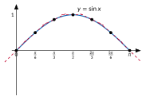
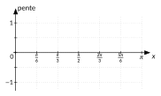
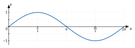

<!-- GÉNÉRÉ par typweb à partir des notes Typst : NE PAS ÉDITER (les modifications seraient écrasées). -->

::: {.callout-note title="Question Q7."}
À quelle vitesse la cabine monte-t-elle ?
:::

::: {#activite-6-1 data-sorte="activite" data-num="6.1" data-page="53" data-phys="56" data-id="5UAA5.pente-sinusoide" data-type="activite" data-tags="" .theo .theo-activite}
::: {.theo-head}
**Activité 6.1** — la pente de la sinusoïde
:::

::: {.theo-body}
::: {.typst-fig}
{fig-alt="Figure du cours"}
:::

1. À la calculatrice (en radians), estime la pente de la courbe $y = \sin x$ en $x = 0$, $\frac{\pi}{6}$, $\frac{\pi}{3}$, …, $\pi$ par le quotient $\frac{\sin(x + 0{,}01) - \sin x}{0{,}01}$ (trois décimales).

   ::: {.tableau}
   | $x$ | $0$ | $\frac{\pi}{6}$ | $\frac{\pi}{3}$ | $\frac{\pi}{2}$ | $\frac{2 \pi}{3}$ | $\frac{5 \pi}{6}$ | $\pi$ |
   |:---:|:---:|:---:|:---:|:---:|:---:|:---:|:---:|
   | pente | [$1{,}000$]{.rep} | [$0{,}864$]{.rep} | [$0{,}496$]{.rep} | [$-0{,}005$]{.rep} | [$-0{,}504$]{.rep} | [$-0{,}869$]{.rep} | [$-1{,}000$]{.rep} |
   :::
2. Place les points ($x$ ; pente) dans le repère. Quelle courbe connue reconnais-tu ?

   ::: {.typst-fig}
   {fig-alt="Figure du cours"}
   :::

   ::: {.rep-bloc}
   Les pentes reproduisent les valeurs de $\cos x$ : $1$ ; $0{,}866$ ; $0{,}5$ ; $0$ ; $-0{,}5$ ; $-0{,}866$ ; $-1$ (aux erreurs d’approximation près). La courbe des pentes est celle du cosinus.
   :::
:::
:::

Retour à la cabine : elle monte le plus vite au niveau de l’axe, là où la pente de la sinusoïde est la plus grande ; elle ne monte plus du tout au sommet, là où la pente est nulle. C’est ce que montraient les accroissements de l’activité 1.1.

**Pourquoi, sur le cercle.** Le point $P(x)$ parcourt le cercle à vitesse $1$ : quand $x$ augmente de $h$, il parcourt un arc de longueur $h$ (c’est la définition du radian). Sa vitesse est tangente au cercle, donc perpendiculaire au rayon $O P(x)$, qui est dirigé par $(\cos x ; \sin x)$ : c’est le vecteur $(-\sin x ; \cos x)$. Sa composante verticale, la vitesse à laquelle l’ordonnée $\sin x$ change, vaut $\cos x$ ; sa composante horizontale, la vitesse à laquelle l’abscisse $\cos x$ change, vaut $-\sin x$.

::: {#activite-6-2 data-sorte="activite" data-num="6.2" data-page="54" data-phys="57" data-id="5UAA5.pourquoi-radians" data-type="activite" data-tags="" .theo .theo-activite}
::: {.theo-head}
**Activité 6.2** — pourquoi les radians ?
:::

::: {.theo-body}
Calcule $\frac{\sin h}{h}$ pour $h = 0{,}1$ ; $0{,}01$ ; $0{,}001$ (calculatrice en radians), puis $\frac{\sin 1°}{1}$ (calculatrice en degrés). Compare.

::: {.rep-bloc}
En radians : $0{,}99833$ ; $0{,}9999833$ ; $0{,}99999983$ : pour un petit arc, la hauteur et l’arc sont presque égaux, et la pente de $\sin$ en $0$ vaut $1$. En degrés : $\frac{\sin 1°}{1} \approx 0{,}01745 \approx \frac{\pi}{180}$ : la formule serait $(\sin x)' = \frac{\pi}{180} \cos x$.
:::
:::
:::

Le radian est l’unité qui rend la formule simple : c’est la troisième raison annoncée dans l’encadré « Pourquoi les radians plutôt que les degrés ? ».

::: {#propriete-6-1 data-sorte="propriete" data-num="6.1" data-page="54" data-phys="57" data-id="5UAA5.derivees" data-type="propriete" data-tags="" .theo .theo-propriete}
::: {.theo-head}
**Propriété 6.1** — dérivées de $\sin$, $\cos$, $\tan$
:::

::: {.theo-body}
Pour tout réel $x$ (et $\cos x \neq 0$ pour la tangente) :

$$
(\sin x)' = \cos x, \quad \quad (\cos x)' = -\sin x, \quad \quad (\tan x)' = \frac{1}{\cos^{2} x} = 1 + \tan^{2} x.
$$
:::
:::

La formule de la tangente se **calcule** avec la règle du quotient :

$$
(\frac{\sin x}{\cos x})' = \frac{\cos x \cdot \cos x - \sin x \cdot (-\sin x)}{\cos^{2} x} = \frac{\cos^{2} x + \sin^{2} x}{\cos^{2} x} = \frac{1}{\cos^{2} x},
$$

grâce à $\cos^{2} x + \sin^{2} x = 1$ ; et $\frac{1}{\cos^{2} x} = \frac{\cos^{2} x + \sin^{2} x}{\cos^{2} x} = 1 + \tan^{2} x$.

::: {.callout-warning title="Piège"}
Le signe $-$ dans $(\cos x)' = -\sin x$. Il se retrouve sur le graphique : $\cos$ décroît sur $[0 ; \pi]$, là où $\sin$ est positif ; sa dérivée y est donc négative.
:::

::: {#exercice-6-1 data-sorte="exercice" data-num="6.1" data-page="55" data-phys="58" data-id="5UAA5.ex.059" data-type="exercice" data-tags="" .exo}
::: {.exo-tete}
[✎ Exercice 6.1]{.exo-titre} [[C9]{.exo-comp} ★☆☆]{.exo-meta}
:::

::: {.exo-corps}
Sur le graphique de $\sin$ sur $[0 ; 2 \pi]$, repère, sans calcul, les réels où la pente de la courbe est nulle, ceux où elle est la plus grande et ceux où elle est la plus petite. Vérifie avec $(\sin x)' = \cos x$.

::: {.typst-fig}
{fig-alt="Figure du cours"}
:::
:::
:::

::: {.aides}
::: {.panel-tabset}
## Indice 1 {.unlisted}

Relis l’[activité « la pente de la sinusoïde »](#activite-6-1).

## Indice 2 {.unlisted}

Où la tangente à la courbe est-elle horizontale ?

## Indice 3 {.unlisted}

Pente nulle aux sommets et aux creux ; la plus forte là où la courbe monte le plus raide.

## Solution {.unlisted}

::: {.solution-classe}
La pente est nulle au sommet et au creux de la courbe : en $\frac{\pi}{2}$ et en $\frac{3 \pi}{2}$ ; en effet $\cos(\frac{\pi}{2}) = \cos(\frac{3 \pi}{2}) = 0$. Elle est la plus grande là où la courbe monte le plus raide, en $0$ et en $2 \pi$ : $\cos 0 = \cos(2 \pi) = 1$. Elle est la plus petite là où la courbe descend le plus raide, en $\pi$ : $\cos \pi = -1$.
:::

## Pièges {.unlisted}

- Confondre la hauteur du point et la pente.
- Croire que la pente est maximale au sommet.
:::
:::

```{=html}
<div class="tg" id="anim-pente-sinus" data-tg="pente-sinus" data-cfg='{}'></div>
```

::: {.tg-legende}
Animation : une tangente glisse le long de $y = \sin x$ ; sa pente se trace en même temps.
:::

::: {#exercice-6-2 data-sorte="exercice" data-num="6.2" data-page="55" data-phys="58" data-id="5UAA5.ex.060" data-type="exercice" data-tags="" .exo}
::: {.exo-tete}
[✎ Exercice 6.2]{.exo-titre} [[A8]{.exo-comp} ★☆☆]{.exo-meta}
:::

::: {.exo-corps}
Calcule les dérivées : (a) $\sin x + \cos x$ ; (b) $\cos x - 2 \tan x$ ; (c) $x^{2} \cos x$ ; (d) $x \sin x$.
:::
:::

::: {.aides}
::: {.panel-tabset}
## Indice 1 {.unlisted}

Relis la [propriété « dérivées de sin, cos, tan »](#propriete-6-1) et la règle du produit.

## Indice 2 {.unlisted}

Pour $x^{2} \cos x$, quels sont les deux facteurs ?

## Indice 3 {.unlisted}

$(u v)' = u' v + u v'$ ; $(\cos x)' = -\sin x$ ; $(\tan x)' = \frac{1}{\cos^{2} x}$.

## Solution {.unlisted}

::: {.solution-classe}
(a) $\cos x - \sin x$. (b) $-\sin x - \frac{2}{\cos^{2} x}$. (c) Règle du produit : $2 x \cos x - x^{2} \sin x$. (d) $\sin x + x \cos x$.
:::

## Pièges {.unlisted}

- Oublier le signe $-$ de $(\cos x)'$.
- Dériver un produit comme le produit des dérivées.
:::
:::

::: {#exercice-6-3 data-sorte="exercice" data-num="6.3" data-page="55" data-phys="58" data-id="5UAA5.ex.061" data-type="exercice" data-tags="" .exo}
::: {.exo-tete}
[✎ Exercice 6.3]{.exo-titre} [[A8]{.exo-comp} ★★☆]{.exo-meta}
:::

::: {.exo-corps}
Calcule la dérivée de $f(x) = \frac{\sin x}{1 + \cos x}$ et simplifie-la.
:::
:::

::: {.aides}
::: {.panel-tabset}
## Indice 1 {.unlisted}

Règle du quotient : $(\frac{u}{v})' = \frac{u' v - u v'}{v^{2}}$.

## Indice 2 {.unlisted}

Que valent $u'$ et $v'$ pour $u = \sin x$ et $v = 1 + \cos x$ ?

## Indice 3 {.unlisted}

Développe le numérateur et utilise $\cos^{2} x + \sin^{2} x = 1$.

## Solution {.unlisted}

::: {.solution-classe}
Règle du quotient : $f'(x) = \frac{\cos x (1 + \cos x) - \sin x \cdot (-\sin x)}{(1 + \cos x)^{2}} = \frac{\cos x + \cos^{2} x + \sin^{2} x}{(1 + \cos x)^{2}} = \frac{\cos x + 1}{(1 + \cos x)^{2}} = \frac{1}{1 + \cos x}$, pour $\cos x \neq -1$.
:::

## Pièges {.unlisted}

- Oublier le signe de $v' = -\sin x$.
- Ne pas simplifier par $1 + \cos x$.
:::
:::

::: {#exercice-6-4 data-sorte="exercice" data-num="6.4" data-page="55" data-phys="58" data-id="5UAA5.ex.062" data-type="exercice" data-tags="maison" .exo}
::: {.exo-tete}
[✎ Exercice 6.4]{.exo-titre} [⟵ à faire à la maison]{.exo-maison} [[C9]{.exo-comp} ★★☆]{.exo-meta}
:::

::: {.exo-corps}
Complète la rubrique « fonction dérivée » des cartes d’identité de $\sin$, $\cos$ et $\tan$ (chapitre 3). Retrouve ensuite le tableau de variations de $\sin$ sur $[0 ; 2 \pi]$ à partir du signe de sa dérivée.
:::
:::

::: {.aides}
::: {.panel-tabset}
## Indice 1 {.unlisted}

Relis la [propriété « dérivées de sin, cos, tan »](#propriete-6-1).

## Indice 2 {.unlisted}

Sur quels intervalles $\cos x$ est-il positif ?

## Indice 3 {.unlisted}

Signe de $\cos x$ sur $[0 ; 2 \pi]$, puis croissance là où la dérivée est positive.

## Solution {.unlisted}

$(\sin x)' = \cos x$ est positive sur $[0 ; \frac{\pi}{2}[$, négative sur $]\frac{\pi}{2} ; \frac{3 \pi}{2}[$, positive sur $]\frac{3 \pi}{2} ; 2 \pi]$ : $\sin$ croît de $0$ à $1$ sur $[0 ; \frac{\pi}{2}]$, décroît de $1$ à $-1$ sur $[\frac{\pi}{2} ; \frac{3 \pi}{2}]$, croît de $-1$ à $0$ sur $[\frac{3 \pi}{2} ; 2 \pi]$. On retrouve le tableau de la carte d’identité.

## Pièges {.unlisted}

- Confondre le signe de $\sin$ et celui de sa dérivée.
- Oublier les bornes $\frac{\pi}{2}$ et $\frac{3 \pi}{2}$.
:::
:::

::: {.ae-lien}
[✔ S'autoévaluer sur cette section : test de 2 questions →](../autoeval.qmd#sections=sec-derivees)
:::
